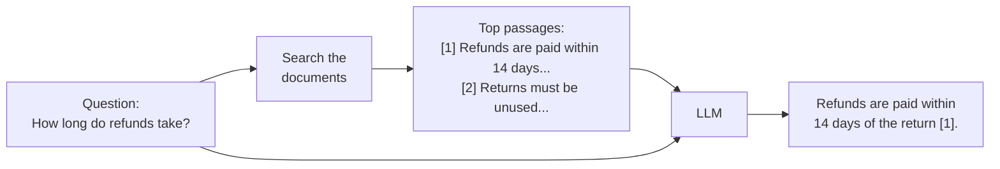
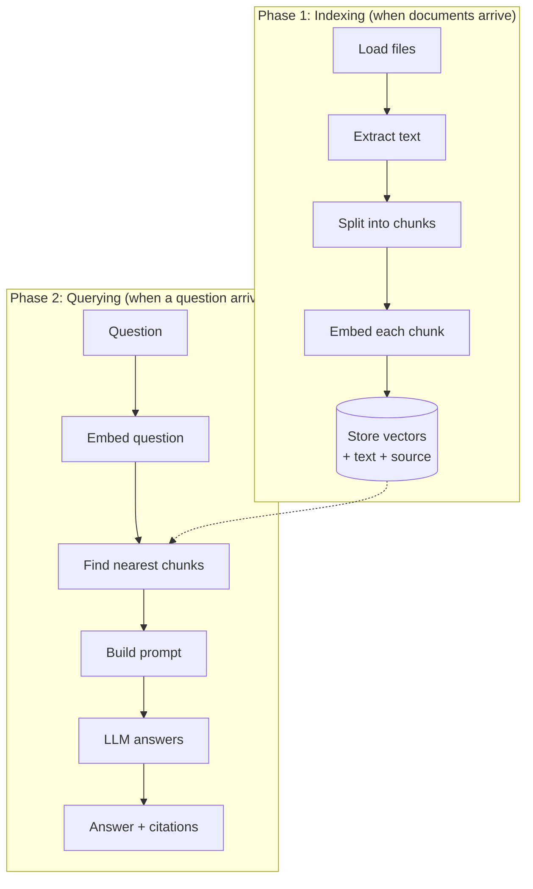
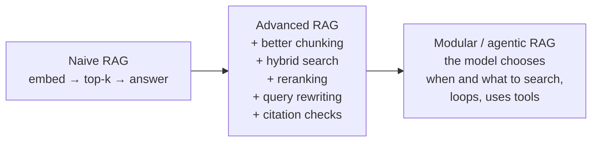

# 01 · What is RAG?

**[← Concepts](README.md)** · **Next: [02 LLM basics →](02-llm-basics.md)** · **In the course:** [Week 1](../lessons/week01-naive-rag.md)

**RAG (retrieval-augmented generation)** means: before a language model answers a question, *search* your documents for the relevant passages, put those passages in the prompt, and ask the model to answer *from them*.

It's an open-book exam. Without RAG, the model answers from memory. With RAG, it gets to look things up first, and it can show which page it used.

---

## 1. The problem RAG solves

A large language model (LLM) such as Claude, GPT or Llama learns from a huge snapshot of public text. That gives it four limits that matter for real applications:

| Limit | Example | Why it happens |
| --- | --- | --- |
| **It doesn't know your data** | "What's our refund policy?" | Your internal documents were never in its training data |
| **Its knowledge is frozen** | "What changed in last week's release?" | Training stopped at a cut-off date |
| **It makes things up** | Invents a plausible refund period: "30 days" | It is trained to produce likely text, not true text (see [02](02-llm-basics.md#5-why-models-hallucinate)) |
| **It can't show sources** | "Where does it say that?" | Knowledge in its weights has no page numbers |

RAG fixes all four with one move: **give the model the relevant text at question time.** Your documents can change daily; you just re-index them. And because the answer comes from passages you supplied, you can cite them, and check them.

## 2. The idea in one picture



Three steps: **retrieve**, **augment** (add the passages to the prompt), **generate**. That's the whole name.

## 3. The two phases

A RAG system does its work in two phases, at two different times.



**Indexing** is slow and done once per document: parse it ([03](03-document-parsing.md)), cut it into chunks ([04](04-chunking.md)), turn each chunk into a vector ([05](05-embeddings.md)) and store it ([06](06-vector-search.md)).

**Querying** must be fast, because a user is waiting: embed the question, find the closest chunks, put them in a prompt, generate ([11](11-grounded-generation.md)).

## 4. A complete example, by hand

Three tiny documents:

| Source | Text |
| --- | --- |
| `refunds.md` | "Refunds are paid within 14 days of us receiving the return." |
| `returns.md` | "Items can be returned within 30 days if unused." |
| `shipping.md` | "Standard shipping takes 3 to 5 working days." |

**Question:** "How fast do I get my money back?"

**Step 1: retrieve.** The question is embedded and compared with each chunk's embedding. Note that the question says "money back", not "refund". A keyword search would find nothing, but embeddings capture meaning, so the scores might look like this (cosine similarity, see [06](06-vector-search.md)):

| Chunk | Similarity to the question |
| --- | --- |
| refunds.md | **0.71** |
| returns.md | 0.52 |
| shipping.md | 0.38 |

Keep the top 2.

**Step 2: augment.** Build the prompt:

```text
System: Answer using only the numbered passages. Cite them like [1].
        If they don't contain the answer, say you couldn't find it.

Passages:
[1] (refunds.md) Refunds are paid within 14 days of us receiving the return.
[2] (returns.md) Items can be returned within 30 days if unused.

Question: How fast do I get my money back?
```

**Step 3: generate.**

> You'll get your money back within 14 days of the return arriving [1]. Note that you have 30 days to send the item back, and it must be unused [2].

Every claim carries a citation, and each citation can be checked against the passage.

## 5. RAG vs the alternatives

| Approach | How | Good for | Weak at |
| --- | --- | --- | --- |
| **Prompt only** | Ask the model directly | General knowledge, writing, reasoning | Your data, recent facts, sources |
| **Long context ("stuff everything")** | Paste all documents into the prompt | A few documents (up to a few hundred pages) | Cost and latency on every call; accuracy drops in very long prompts ([11](11-grounded-generation.md#3-lost-in-the-middle)); doesn't scale to thousands of files |
| **Fine-tuning** | Train the model further on your data | Style, format, tone, a specialised task | Teaching facts (unreliable, can't cite, expensive to update) |
| **RAG** | Search, then answer from the results | Large, changing document sets; answers with sources | Questions whose answer is spread across the whole corpus ([15](15-agentic-and-graph-rag.md)) |

The rule of thumb: **fine-tune for behaviour, retrieve for knowledge.** They combine well: a fine-tuned model can still be given retrieved passages.

## 6. Naive, advanced and modular RAG

The research survey by Gao et al. (2023) describes three generations:



raggy follows the same path: week 1 is naive RAG; weeks 3–12 add the advanced pieces one at a time, measuring each; the bonus week adds the agentic loop.

## 7. Where RAG goes wrong

Barnett et al. (2024) studied real RAG systems and named seven failure points. Each concept page in this folder addresses one or more of them:

| # | Failure | Example | Fix (page) |
| --- | --- | --- | --- |
| 1 | **Missing content**: the answer isn't in the documents | Asking about a policy nobody wrote down | Refuse honestly ([11](11-grounded-generation.md)) |
| 2 | **Missed the top-ranked documents**: it exists but isn't retrieved | Query says "money back", the document says "refund", and keyword search is used | Embeddings ([05](05-embeddings.md)), hybrid ([08](08-hybrid-search.md)), query rewriting ([10](10-query-transformation.md)) |
| 3 | **Not in context**: retrieved, but cut when the prompt was built | Ranked 7th with only 5 slots | Reranking ([09](09-reranking.md)), packing ([11](11-grounded-generation.md)) |
| 4 | **Not extracted**: in the prompt, but the model missed it | Buried among contradicting passages | Fewer, better passages; ordering |
| 5 | **Wrong format**: asked for a table, got prose | | Prompting |
| 6 | **Incorrect specificity**: too general or too detailed | | Prompting, query transformation |
| 7 | **Incomplete**: only part of the answer | The answer needs facts from two documents | Multi-hop retrieval ([15](15-agentic-and-graph-rag.md)) |

Failures 1–3 are **retrieval** problems; 4–7 are **generation** problems. That split is why RAG evaluation measures the two separately ([12](12-evaluation.md)).

## 8. Common mistakes

- **Tuning the prompt when retrieval is the problem.** If the right passage isn't in the prompt, no prompt wording will fix the answer. Check retrieval first.
- **Judging by eye on five questions.** Results vary a lot between questions. Build a test set early ([12](12-evaluation.md)).
- **Assuming a bigger context window removes the need for retrieval.** Every token you send costs money and time, and models use long contexts unevenly.
- **Forgetting the "I don't know" path.** A RAG system that never refuses will answer from unrelated passages.

## 9. In raggy

- [Week 1](../lessons/week01-naive-rag.md) builds the whole loop in about 770 lines: load, chunk, embed, search, answer with citations.
- `raggy/pipeline.py` is the two phases: `ingest` and `ask`.

## 10. Further reading

| Read | Why |
| --- | --- |
| [Retrieval-Augmented Generation for Knowledge-Intensive NLP Tasks](https://arxiv.org/abs/2005.11401), Lewis et al. (2020) | The paper that named RAG |
| [Retrieval-Augmented Generation for Large Language Models: A Survey](https://arxiv.org/abs/2312.10997), Gao et al. (2023) | The map of the field: naive, advanced and modular RAG |
| [Seven Failure Points When Engineering a RAG System](https://arxiv.org/abs/2401.05856), Barnett et al. (2024) | Short, practical, the failure list above |
| [What is RAG?](https://aws.amazon.com/what-is/retrieval-augmented-generation/) (AWS) | A gentle non-technical overview |
| [Introducing Contextual Retrieval](https://www.anthropic.com/news/contextual-retrieval) (Anthropic) | A clear walk through a modern RAG pipeline, with measured gains per step |
