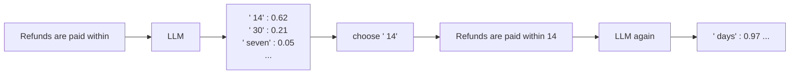

# 02 · LLM basics for RAG

**[← 01 What is RAG?](01-what-is-rag.md)** · **[Concepts](README.md)** · **Next: [03 Document parsing →](03-document-parsing.md)** · **In the course:** [Week 1](../lessons/week01-naive-rag.md)

You don't need to know how to train a language model to build RAG. You do need six ideas: tokens, the context window, how text is generated, temperature, why models hallucinate, and what you pay for.

---

## 1. Tokens

An LLM doesn't read letters or words. It reads **tokens**: pieces of text from a fixed vocabulary of roughly 50,000–200,000 entries, learned so that common strings get one token and rare strings get split.

```text
"Refunds are paid within 14 days."
 → ["Ref", "unds", " are", " paid", " within", " ", "14", " days", "."]     (illustrative)
```

The exact split depends on the model's tokenizer, but the rules of thumb hold for English:

| Rule of thumb | Value |
| --- | --- |
| 1 token | about 4 characters |
| 1 token | about ¾ of a word |
| 1,000 tokens | about 750 words, 1.5 pages |
| A 300-page book | about 100,000–150,000 tokens |

Why it matters for RAG:

- **Chunk sizes** are best measured in tokens, because both the embedding model and the LLM have token limits ([04](04-chunking.md)).
- **Cost** is per token ([section 6](#6-what-you-pay-for)).
- Codes, numbers and non-English text often take *more* tokens per character, so a "500-token chunk" holds less of them.

## 2. The context window

The **context window** is the most tokens a model can handle in one call: the input (system prompt, passages, question) *plus* the output it writes.

```text
┌──────────────────────── context window (e.g. 200,000 tokens) ────────────────────────┐
│ system prompt │ retrieved passages ............................ │ question │ answer → │
│     300       │                   4,000                         │    20    │   300    │
└───────────────────────────────────────────────────────────────────────────────────────┘
```

Modern windows are large (128k–1M tokens), so a RAG prompt of a few thousand tokens fits easily. The constraint is rarely "does it fit?" but:

- **Cost and latency**: both grow with input length.
- **Attention quality**: models use the start and end of long prompts better than the middle ([11](11-grounded-generation.md#3-lost-in-the-middle)).
- **Noise**: every irrelevant passage is a chance to be distracted.

So retrieval's job is not to fill the window, but to put **the few right passages** in it.

## 3. How generation works

An LLM is a next-token predictor. Given the tokens so far, it outputs a probability for every token in its vocabulary, picks one, appends it, and repeats.



Two consequences:

1. **Output is produced one token at a time.** That's why answers can be *streamed* to the user as they're written, and why a long answer takes longer than a short one ([14](14-production.md)).
2. **The passages in the prompt shift the probabilities.** If passage [1] says "14 days", the token " 14" becomes far more likely. That's the whole mechanism of grounding: no special wiring, just text in the prompt.

## 4. Temperature

At each step, the model has a probability distribution. **Temperature** controls how it picks:

| Temperature | Behaviour | Use |
| --- | --- | --- |
| 0 | (Nearly) always the most likely token: repeatable | RAG answers, extraction, judging |
| 0.7–1.0 | Samples: varied, creative | Brainstorming, writing |

For RAG, use a low temperature: you want the answer the passages support, not a creative one. Even at temperature 0, outputs can vary slightly between runs (batching and hardware effects), which is one reason evaluations must be repeated ([12](12-evaluation.md#6-noise-is-the-default)).

## 5. Why models hallucinate

A model is trained to produce **plausible** continuations. When it doesn't know a fact, the most plausible continuation is still a confident-sounding sentence. "Refunds are paid within ___ days" has to end with *some* number.

```text
Question: What is Acme's refund period?
No passages given.
Model: "Acme offers a 30-day refund period."   ← plausible, common in training data, unsupported
```

Hallucination gets worse when:

- the fact is rare, recent, or private (it was never learned);
- the prompt *presupposes* something false ("Why did Acme double its refund period?");
- the retrieved passages are close but wrong (a different product's policy).

RAG reduces hallucination by supplying the fact, but doesn't eliminate it: the model can still ignore, misread or embellish passages. That's why grounded generation adds instructions to refuse, citations, and checks ([11](11-grounded-generation.md)).

## 6. What you pay for

API models charge per million tokens, with **output tokens costing several times more than input tokens**. A RAG call is mostly input (the passages), with a short output.

A worked example, with illustrative prices of $3 per million input tokens and $15 per million output tokens:

| Part | Tokens | Cost |
| --- | --- | --- |
| System prompt + 5 passages + question | 3,000 input | 3,000 × $3 / 1,000,000 = $0.0090 |
| Answer | 300 output | 300 × $15 / 1,000,000 = $0.0045 |
| **Per question** | | **$0.0135** |
| 10,000 questions a month | | **$135** |

Halving the passages from 5 to 2 or 3 roughly halves the input cost, which is one reason reranking ([09](09-reranking.md)) and careful packing ([11](11-grounded-generation.md)) pay for themselves. Local models (via Ollama, for example) cost no money per token, but are slower on a laptop and usually less accurate.

## 7. System prompt, user prompt

Chat models take messages with roles:

| Role | Holds | In RAG |
| --- | --- | --- |
| **System** | Standing instructions | "Answer only from the passages. Cite them. Refuse if they don't contain the answer." |
| **User** | The request | The passages and the question |
| **Assistant** | The model's reply | The answer |

Instructions in the system prompt are followed more consistently than instructions buried in the user message.

## 8. Embedding models are different models

RAG uses *two* kinds of model:

| | Embedding model | Generative LLM |
| --- | --- | --- |
| Input | A text | A prompt |
| Output | A fixed-length vector of numbers | Text, token by token |
| Size | Small (20M–600M parameters); runs on a laptop CPU | Large (billions of parameters) |
| Used for | Search ([05](05-embeddings.md)) | Answering |

## 9. In raggy

- `raggy/generate/llm.py` has one adapter per provider (Claude, OpenAI, Ollama), all behind one `complete(system, user)` method.
- `raggy/costs.py` turns token counts into money ([week 12](../lessons/week12-production.md)).

## 10. Further reading

| Read | Why |
| --- | --- |
| [Intro to Large Language Models](https://www.youtube.com/watch?v=zjkBMFhNj_g), Andrej Karpathy (video, 1 h) | The best non-technical introduction to what an LLM is |
| [Let's build the GPT Tokenizer](https://www.youtube.com/watch?v=zduSFxRajkE), Andrej Karpathy (video) | How tokenizers are built, and why they cause odd behaviour with numbers and spelling |
| [The Illustrated Transformer](https://jalammar.github.io/illustrated-transformer/), Jay Alammar | The architecture inside both LLMs and embedding models, with pictures |
| [OpenAI tokenizer playground](https://platform.openai.com/tokenizer) | Paste text and see its tokens |
| [Why Language Models Hallucinate](https://arxiv.org/abs/2509.04664), Kalai et al. (2025) | Why training and grading reward confident guessing |
