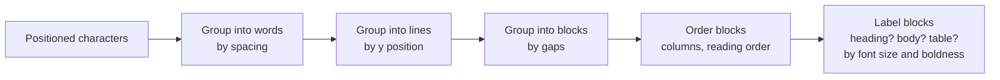

# 03 · Document parsing: getting clean text out of files

**[← 02 LLM basics](02-llm-basics.md)** · **[Concepts](README.md)** · **Next: [04 Chunking →](04-chunking.md)** · **In the course:** [Week 3](../lessons/week03-ingestion.md), [Week 9](../lessons/week09-rich-documents.md)

Everything downstream (chunks, embeddings, answers) is built from the text you extract. **Garbage in, garbage retrieved.** Parsing is the least glamorous part of RAG and often the one with the biggest effect on accuracy.

---

## 1. The problem

Files are made for people to *look at*, not for programs to *read*. Each format hides its text differently:

| Format | What's actually stored | Typical trap |
| --- | --- | --- |
| Plain text, Markdown | The text | Almost none; headings are explicit |
| HTML | Text mixed with menus, footers, cookie banners, scripts | Boilerplate drowns the content |
| PDF | Instructions to draw characters at coordinates | No paragraphs, no reading order, tables become scrambled words |
| Scanned PDF, photo | Pixels | No text at all until OCR |
| DOCX, PPTX, XLSX | Zipped XML | Slide order, speaker notes, formulas vs values |
| Audio, video | Sound and frames | Need speech-to-text ([13](13-multimodal-rag.md)) |

## 2. What a PDF really is

A PDF page is closer to a drawing than a document. Simplified, its content looks like this:

```text
BT /F1 12 Tf  72 700 Td (Refund) Tj ET
BT /F1 12 Tf 118 700 Td (policy) Tj ET
BT /F2 10 Tf  72 680 Td (Refunds are paid within 14) Tj ET
BT /F2 10 Tf  72 668 Td (days of receipt.) Tj ET
```

"Put the string `Refund` at x=72, y=700 in font F1, size 12." There's no "heading", no "paragraph", no "table". A parser has to *reconstruct* them:



Every step can go wrong:

- **Two columns** read straight across: "The battery is | The frame is covered | covered for two | for ten years" becomes nonsense.
- **Hyphenation**: "war-\nranty" must be rejoined as "warranty".
- **Headers and footers** ("Page 3 of 40 · Confidential") repeat on every page and pollute chunks.
- **Ligatures**: "fi" stored as a single character makes "refund" and "refind" different strings.
- **Tables** come out as a stream of cells with the row/column structure lost.

### Tables

```text
What the reader sees:          What naive extraction gives:
┌────────┬──────────┐          Model Warranty Ebb 2 years
│ Model  │ Warranty │          Kestrel 5 years
├────────┼──────────┤
│ Ebb    │ 2 years  │          …which works for this table, but for wide tables
│ Kestrel│ 5 years  │          with wrapped cells, values end up next to the
└────────┴──────────┘          wrong headers.
```

A common fix is to rebuild the table and write it as Markdown, or to turn each row into a sentence ("Model: Ebb; Warranty: 2 years"), so a chunk carries its column names with it.

## 3. HTML: separating content from boilerplate

A typical web page might be 10% article and 90% navigation, ads, related links and footers. If you embed all of it, every page from the same site looks alike (they share the boilerplate), and search quality collapses.

**Main-content extraction** tools score each block of the page by text density, link density and position, and keep the article. Libraries: [trafilatura](https://trafilatura.readthedocs.io/), Mozilla's Readability.

```text
<nav> Home | Products | Support | Login </nav>           ← link-dense: drop
<div class="article"> Refunds are paid within 14... </div> ← text-dense: keep
<footer> © 2026 · Privacy · Cookies </footer>              ← drop
```

## 4. OCR: when there's no text at all

**Optical character recognition** turns pixels into characters. It's needed for scanned PDFs, photos and screenshots.

| Option | How | Strengths | Weaknesses |
| --- | --- | --- | --- |
| Classic OCR (Tesseract) | Find text lines, recognise characters | Free, local, fast on clean scans | Struggles with layout, handwriting, low quality |
| Layout-aware models (docling, marker, Unstructured) | Detect regions (title, table, figure), then OCR | Keeps structure, tables | Heavier, slower |
| Vision LLMs | "Transcribe this page as Markdown" | Handles messy layouts, describes figures | Cost per page; can "correct" or invent text |

How to detect that a PDF page needs OCR: the extracted text is empty or very short, but the page contains an image.

## 5. Normalisation

Small inconsistencies make identical text look different to search:

| Problem | Example | Fix |
| --- | --- | --- |
| Unicode variants | "fi" vs "fi"; full-width "１４" vs "14" | Unicode NFKC normalisation |
| Whitespace | Tabs, non-breaking spaces, runs of newlines | Collapse whitespace |
| Smart quotes | ’ vs ' | Normalise (or leave, if the embedder handles it) |
| Broken hyphenation | "war- ranty" | Rejoin across line breaks |

## 6. Metadata: keep where each piece came from

For every piece of text, keep: the source file or URL, the page/slide/sheet, the section heading, and the modification date. This metadata becomes:

- the **citation** shown to the user ("refunds.pdf, page 3");
- a **filter** ("only search documents from 2026");
- the **incremental re-index key** (re-parse only files whose content hash changed).

## 7. De-duplication

Real document sets are full of copies: the same policy in three folders, a page saved twice, version 1 and version 1-final. Duplicates waste index space and, worse, fill the top-k results with the same passage five times.

- **Exact duplicates**: hash the normalised text (SHA-256). Same hash, same text.
- **Near duplicates** (one changed date): **MinHash**. Split each text into overlapping word shingles, estimate the Jaccard similarity of the two shingle sets from a small signature, and treat pairs above a threshold (say 0.9) as copies. Locality-sensitive hashing (LSH) finds such pairs without comparing every pair.

```text
A: "refunds are paid within 14 days"     shingles(3 words): {refunds are paid, are paid within, paid within 14, within 14 days}
B: "refunds are paid within 10 days"     shingles:          {refunds are paid, are paid within, paid within 10, within 10 days}
Jaccard = |A ∩ B| / |A ∪ B| = 2 / 6 = 0.33   → different enough to keep both
```

## 8. Common mistakes

- **Never looking at the extracted text.** Print a few chunks from each file type. Most parsing bugs are obvious to the eye.
- **Treating all PDFs alike.** Born-digital and scanned PDFs need different paths.
- **Losing page numbers**, then being unable to cite pages.
- **Embedding boilerplate**: every chunk starts with the same 200-character header.

## 9. In raggy

- [Week 3](../lessons/week03-ingestion.md) and the [ingestion guide](../docs/ingestion.md): HTML main-content extraction, Unicode normalisation, MinHash de-duplication, incremental re-ingest.
- [Week 9](../lessons/week09-rich-documents.md) and the [rich documents guide](../docs/rich-documents.md): PDF headings and tables, OCR, page/slide/sheet locations.

## 10. Further reading

| Read | Why |
| --- | --- |
| [How PDFs store text](https://pdfa.org/resource/pdf-specification-archive/) (PDF Association) | The specification archive, for the curious; the "Text" chapter explains positioned glyphs |
| [docling](https://github.com/docling-project/docling) | An open-source document converter with layout and table models; read its docs for what "layout analysis" means in practice |
| [Unstructured](https://docs.unstructured.io/open-source/introduction/overview) | Partitioning documents into typed elements (title, narrative text, table) |
| [trafilatura](https://trafilatura.readthedocs.io/) | Web page main-content extraction, with an evaluation of competing tools |
| [Tesseract OCR](https://github.com/tesseract-ocr/tesseract) | The classic open-source OCR engine |
| [Mining of Massive Datasets, chapter 3](http://www.mmds.org/) | The clearest explanation of shingling, MinHash and LSH |
