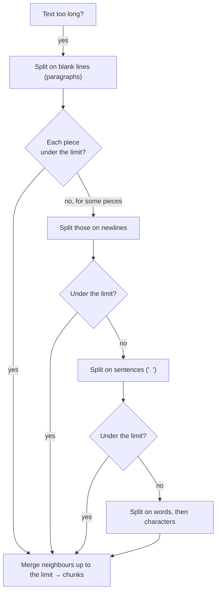

# 04 · Chunking: splitting documents into searchable pieces

**[← 03 Document parsing](03-document-parsing.md)** · **[Concepts](README.md)** · **Next: [05 Embeddings →](05-embeddings.md)** · **In the course:** [Week 4](../lessons/week04-chunking.md)

A **chunk** is the unit you embed, search, and put in the prompt. Chunking decides what a "search result" *is*. Get it wrong and the right fact is either diluted in a huge chunk or cut in half between two small ones.

---

## 1. Why split at all?

Why not embed each whole document?

| Reason | Explanation |
| --- | --- |
| **Embeddings blur long text** | An embedding is one vector for the whole input. A 20-page manual about batteries, frames, brakes and warranties becomes an "average" of all of them, and matches no specific question well |
| **Models have input limits** | Many embedding models read at most 512 tokens; the rest is silently cut |
| **Prompt budget** | You can afford a few passages per question, not a few documents |
| **Precise citations** | "See paragraph 3 on page 12" beats "see the manual" |

But a chunk that is too small loses context:

```text
Too big:   [ ...battery... frame... brakes... warranty: 2 years... shipping... ]  → vague match
Too small: [ It lasts 2 years. ]                                                   → "it" = what?
Right:     [ Battery warranty. The Ebb's battery is covered for 2 years from purchase. ]
```

**The chunking trade-off:** small chunks match precisely but lose context; large chunks keep context but match vaguely. Typical sizes are 200–800 tokens.

## 2. Fixed-size chunking

Cut every N tokens, with an overlap of M tokens so a sentence cut at a boundary appears whole in at least one chunk.

```text
Document tokens:  0 ──────────────────────────────────────────── 1000
size=400, overlap=100:
chunk 1: [0 ─────────── 400)
chunk 2:           [300 ─────────── 700)
chunk 3:                     [600 ─────────── 1000)
```

Worked numbers: with size *S* and overlap *O*, each new chunk advances by *S − O* tokens. A 1,000-token document with S=400, O=100 advances by 300: chunks start at 0, 300, 600, so **3 chunks**, and 200 of the 1,000 tokens are stored twice (20% extra).

- **Pros:** simple, predictable sizes.
- **Cons:** ignores meaning; cuts mid-sentence, mid-table, mid-list.

## 3. Recursive splitting

Try to split at the *biggest natural boundary* that keeps pieces under the size limit, falling back to smaller boundaries only when needed:



The separator list is usually `["\n\n", "\n", ". ", " ", ""]`. This is LangChain's `RecursiveCharacterTextSplitter`, and a sensible default for prose.

## 4. Structure-aware chunking

Documents with explicit structure (Markdown headings, HTML sections, PDF headings rebuilt by the parser) can be split *by section*:

```text
# Warranty                    ─┐
## Battery                     │ chunk: "Warranty > Battery: The battery is covered for two years..."
The battery is covered...     ─┘
## Frame                      ─┐
The frame is covered...       ─┘ chunk: "Warranty > Frame: The frame is covered for ten years..."
```

Each chunk is a coherent unit, and the heading path ("Warranty > Battery") can be prepended to the chunk text. That **contextual header** helps a lot: the sentence "It is covered for two years" becomes searchable as a *battery warranty* sentence.

## 5. Semantic chunking

Embed each sentence; walk through the document; start a new chunk where consecutive sentences are dissimilar (the topic changed).

```text
sentence:        s1    s2    s3    s4    s5    s6
similarity(i,i+1):  0.82  0.79  0.31  0.85  0.80
                              ↑ topic shift → cut here
chunks: [s1 s2 s3] [s4 s5 s6]
```

- **Pros:** chunks follow topics even without headings.
- **Cons:** an embedding call per sentence at index time; threshold tuning; studies show it often doesn't beat simple recursive splitting by much (see Further reading).

## 6. Parent/child (small-to-big) retrieval

Use **small chunks for searching** (precise matches) but **return their larger parent to the LLM** (enough context).


Variants: **sentence window** retrieval (search sentences, return ±2 sentences around the hit), and **auto-merging** (if several children of one parent are retrieved, return the parent once).

Two traps: several children of the same parent can return the same parent twice (de-duplicate), and parents can be large enough to blow the prompt budget.

## 7. Contextual retrieval

A chunk cut out of a document loses what the document was about. "Revenue grew 3% over the previous quarter" — which company? which quarter?

**Contextual retrieval** (Anthropic, 2024) asks an LLM, once per chunk at index time, to write a one- or two-sentence context from the whole document, and prepends it before embedding (and before keyword indexing):

```text
Original chunk:   "Revenue grew 3% over the previous quarter."
Context added:    "From ACME's Q2 2023 SEC filing, section on financial results; Q1 revenue was $314M."
Indexed text:     "From ACME's Q2 2023 SEC filing... Revenue grew 3% over the previous quarter."
```

Anthropic reported that this cut failed retrievals by 35% with contextual embeddings, 49% when combined with contextual BM25, and 67% with reranking added. The cost is one LLM call per chunk at ingest (made cheaper with prompt caching, since the same document is sent for each of its chunks).

**Late chunking** reaches a similar goal without an LLM: run a long-context embedding model over the *whole document*, then pool the token vectors per chunk, so each chunk's vector was computed "seeing" the rest of the document.

## 8. Choosing a chunker

| Your documents | Start with |
| --- | --- |
| Markdown, HTML, well-structured docs | Structure-aware, with heading paths as contextual headers |
| PDFs, plain prose | Recursive, 300–500 tokens, 10–15% overlap |
| FAQs, glossaries, tickets | One item per chunk |
| Code | Split by function/class (tree-sitter based splitters) |
| Short answers needed from long, cross-referencing docs | Parent/child, or contextual retrieval |

Then **measure**: chunkers are easy to compare unfairly. Bigger chunks put more text in the prompt and look better on answer quality for that reason alone. Compare at equal *context size* (same total tokens given to the LLM).

## 9. Common mistakes

- **Measuring size in characters** when the model's limit is in tokens.
- **No overlap** with fixed-size chunking, so facts at boundaries are cut in half.
- **Splitting tables** across chunks, separating values from their column headers.
- **Losing the heading**: the chunk says "It is covered for two years" and nothing says what "it" is.

## 10. In raggy

- [Week 4](../lessons/week04-chunking.md) and the [chunking guide](../docs/chunking.md): fixed, recursive and structure-aware chunkers, contextual headers, parent/child retrieval, contextual retrieval, and comparing at equal context.
- `raggy/chunking/` holds the chunkers.

## 11. Further reading

| Read | Why |
| --- | --- |
| [Chunking Strategies for LLM Applications](https://www.pinecone.io/learn/chunking-strategies/) (Pinecone) | A practical tour of the options |
| [The 5 Levels of Text Splitting](https://github.com/FullStackRetrieval-com/RetrievalTutorials/blob/main/tutorials/LevelsOfTextSplitting/5_Levels_Of_Text_Splitting.ipynb), Greg Kamradt | A notebook walking from fixed-size to semantic and agentic chunking |
| [Introducing Contextual Retrieval](https://www.anthropic.com/news/contextual-retrieval) (Anthropic) | The contextual retrieval method and its measured gains |
| [Late Chunking](https://arxiv.org/abs/2409.04701), Günther et al. (2024) | Chunk after embedding the whole document |
| [Evaluating Chunking Strategies for Retrieval](https://research.trychroma.com/evaluating-chunking) (Chroma) | A careful measurement: simple recursive splitting holds up well |
| [Is Semantic Chunking Worth the Computational Cost?](https://arxiv.org/abs/2410.13070), Qu et al. (2024) | Finds the gains from semantic chunking inconsistent |
