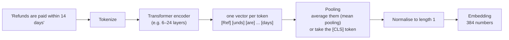

# 05 · Embeddings: turning meaning into numbers

**[← 04 Chunking](04-chunking.md)** · **[Concepts](README.md)** · **Next: [06 Vector search →](06-vector-search.md)** · **In the course:** [Week 1](../lessons/week01-naive-rag.md)

An **embedding** is a list of numbers (a vector) that represents what a piece of text *means*. Texts with similar meanings get vectors that point in similar directions, even when they share no words. That's what lets "How fast do I get my money back?" find "Refunds are paid within 14 days."

---

## 1. The problem: words don't match

Keyword search matches strings. People and documents use different words for the same thing:

| User writes | Document says |
| --- | --- |
| money back | refund |
| bike won't turn on | the motor fails to engage |
| cancel my plan | terminate the subscription |

This is the **vocabulary mismatch** problem. Embeddings attack it by comparing *meanings* instead of words.

## 2. The idea: a map of meaning

Imagine placing every sentence on a map so that sentences about similar things land close together. Real embeddings use hundreds of dimensions instead of two, but the picture is the same:

```text
          ▲ (dimension 2)
          │        • "Standard shipping takes 3–5 days"
          │      • "When will my parcel arrive?"
          │
          │
          │                         • "Refunds are paid within 14 days"
          │                       • "How fast do I get my money back?"
          │                          • "Can I get a refund?"
          └──────────────────────────────────────────────▶ (dimension 1)
```

An embedding model is a function: `text → vector`. For example, `BAAI/bge-small-en-v1.5` maps any text to 384 numbers:

```text
embed("Refunds are paid within 14 days")  →  [0.021, -0.043, 0.118, ..., 0.007]   (384 numbers)
```

The individual numbers don't have readable meanings ("dimension 17 = money") — the meaning is in the *direction* of the whole vector, compared with other vectors ([06](06-vector-search.md)).

## 3. A short history

| Step | Idea | Limitation |
| --- | --- | --- |
| **One-hot / bag of words** | A vector with one slot per vocabulary word | "refund" and "money back" share no slots: no similarity |
| **Word2vec (2013)** | Learn a dense vector per *word* from which words appear near each other; the famous `king − man + woman ≈ queen` | One vector per word, regardless of context ("bank" of a river vs a bank account) |
| **Transformers (BERT, 2018)** | A vector per word *in context* | BERT's raw vectors are poor for comparing whole sentences |
| **Sentence embeddings (Sentence-BERT, 2019 →)** | Fine-tune a transformer so that *whole texts* with similar meaning get close vectors | The basis of modern RAG retrieval |

## 4. How a sentence embedding is computed



- **Pooling** squeezes a variable number of token vectors into one. Mean pooling averages them; CLS pooling uses a special first token trained to summarise the input. Each model is trained with one of them; use the one it was trained with.
- **Normalisation** scales the vector to length 1, so the dot product equals cosine similarity ([06](06-vector-search.md#2-three-ways-to-compare-vectors)).
- **Input limit**: most models read up to 512 tokens (some up to 8,192 or more). Text past the limit is silently cut, one more reason to chunk ([04](04-chunking.md)).

## 5. How embedding models are trained: contrastive learning

The model learns from pairs that *should* be close: a question and the passage that answers it, a title and its article, two paraphrases.

Training on a batch of pairs:

```text
Batch of 4 (query, passage) pairs. The model embeds all 8 texts, then scores every query against every passage:

                  p1: refunds   p2: shipping   p3: battery   p4: frame
q1: money back?      0.82 ✓         0.31          0.12          0.08
q2: parcel late?     0.25           0.77 ✓        0.10          0.05
q3: battery life?    0.15           0.09          0.80 ✓        0.33
q4: frame cracked?   0.05           0.11          0.29          0.74 ✓

Loss: push the diagonal (✓) up and everything else down.
```

The other passages in the batch serve as free **negatives** ("in-batch negatives"). Models improve further with **hard negatives**: passages that look relevant but aren't ("battery *charging* time" for a battery *warranty* question). The loss function is usually *InfoNCE* (a softmax over each row, trying to make the true passage win).

The result: a model that places texts by *what answers what*, not just by shared words.

## 6. Queries and passages are different

A question ("How long is the battery warranty?") is short and phrased as a question; the passage ("The battery is covered for two years from purchase") is a statement. Many models are trained **asymmetrically** and expect a prefix telling them which is which:

| Model family | Query input | Passage input |
| --- | --- | --- |
| E5 | `query: How long is the battery warranty?` | `passage: The battery is covered...` |
| BGE (v1.5, English) | `Represent this sentence for searching relevant passages: How long...` | the passage as is |
| Nomic embed | `search_query: ...` | `search_document: ...` |

Forgetting the prefix silently costs several points of recall. Libraries such as fastembed expose this as separate `query_embed` / `passage_embed` methods.

## 7. Choosing an embedding model

| Consider | Notes |
| --- | --- |
| **Quality on retrieval** | Check the *Retrieval* tab of the MTEB leaderboard, not the overall average, and prefer tasks like yours |
| **Dimension** | 384 (small, fast) to 3,072 (large). Storage = vectors × dimensions × 4 bytes. 1M chunks × 1,024 dims × 4 B ≈ 4 GB |
| **Speed / where it runs** | Small models (≈ 30M parameters) run fast on a CPU; large ones want a GPU or an API |
| **Max input length** | 512 tokens is common; long-context models allow bigger chunks |
| **Languages** | English-only vs multilingual (e.g. `bge-m3`, `multilingual-e5`) |
| **Matryoshka support** | Some models (OpenAI `text-embedding-3-*`, Nomic) let you truncate vectors to fewer dimensions with a small quality loss |

Examples: `all-MiniLM-L6-v2` (384 d, very fast), `BAAI/bge-small-en-v1.5` (384 d), `BAAI/bge-m3` (1,024 d, multilingual), OpenAI `text-embedding-3-small` (1,536 d), and hosted models from Cohere and Voyage.

**Changing the embedding model means re-embedding everything.** Vectors from different models live in different spaces and can't be compared.

## 8. What embeddings are bad at

| Weakness | Example | Mitigation |
| --- | --- | --- |
| **Exact identifiers** | Part number `BW-BT-5000` vs `BW-BT-5001` look nearly identical | Keyword search ([07](07-keyword-search-bm25.md)), hybrid ([08](08-hybrid-search.md)) |
| **Negation** | "is covered" vs "is *not* covered" land close together | Reranking ([09](09-reranking.md)); the LLM reads the actual text |
| **Numbers and dates** | "2 years" vs "5 years" | Same |
| **Rare jargon, new names** | Internal product names the model never saw | Hybrid search; domain fine-tuning |
| **Long, multi-topic text** | One vector averages many topics | Smaller chunks ([04](04-chunking.md)) |

Embeddings find the *neighbourhood* of the answer very well. Precise ordering inside that neighbourhood is the reranker's job ([09](09-reranking.md)).

## 9. In raggy

- [Week 1](../lessons/week01-naive-rag.md) and the [embeddings guide](../docs/embeddings-and-vector-search.md): fastembed with `bge-small-en-v1.5`, query vs passage embedding, normalisation.
- `raggy/embed/` holds the embedders, including a deterministic fake one for tests.

## 10. Further reading

| Read | Why |
| --- | --- |
| [The Illustrated Word2vec](https://jalammar.github.io/illustrated-word2vec/), Jay Alammar | The intuition for "meaning as direction", with pictures |
| [Sentence-BERT](https://arxiv.org/abs/1908.10084), Reimers & Gurevych (2019) | The paper behind sentence embeddings for search |
| [Dense Passage Retrieval](https://arxiv.org/abs/2004.04906), Karpukhin et al. (2020) | Question/passage training with in-batch negatives |
| [Text Embeddings by Weakly-Supervised Contrastive Pre-training (E5)](https://arxiv.org/abs/2212.03533), Wang et al. (2022) | How a modern embedding model is trained, including the query/passage prefixes |
| [Matryoshka Representation Learning](https://arxiv.org/abs/2205.13147), Kusupati et al. (2022) | Vectors you can truncate |
| [MTEB leaderboard](https://huggingface.co/spaces/mteb/leaderboard) | Compare models; use the Retrieval columns |
| [Sentence Transformers documentation](https://sbert.net/) | The standard library for using and training embedding models |
