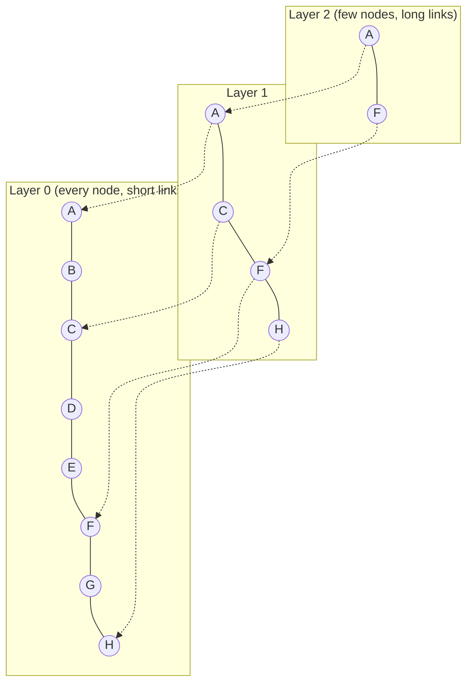

# 06 · Vector similarity and vector search

**[← 05 Embeddings](05-embeddings.md)** · **[Concepts](README.md)** · **Next: [07 Keyword search and BM25 →](07-keyword-search-bm25.md)** · **In the course:** [Week 1](../lessons/week01-naive-rag.md), [Week 5](../lessons/week05-scale.md)

Once every chunk is a vector, search becomes geometry: **find the stored vectors closest to the question's vector.** This page covers how "closest" is measured, how to search exactly, and how indexes such as HNSW search millions of vectors in milliseconds by being *almost* exact.

---

## 1. The task

```text
Given:  a query vector q, and N stored vectors v1 ... vN
Find:   the k vectors most similar to q          ("k nearest neighbours", kNN)
```

## 2. Three ways to compare vectors

| Measure | Formula | Range | Meaning |
| --- | --- | --- | --- |
| **Dot product** | a·b = Σ aᵢbᵢ | any | Direction *and* length |
| **Cosine similarity** | a·b / (‖a‖ ‖b‖) | −1 to 1 | Direction only: the cosine of the angle |
| **Euclidean distance** | ‖a − b‖ = √Σ(aᵢ − bᵢ)² | 0 to ∞ | Straight-line distance (smaller is closer) |

**When vectors are normalised to length 1, all three give the same ranking**, because ‖a − b‖² = 2 − 2·cos(a, b). That's why most systems normalise once at index time and then use the cheapest one, the dot product.

### Worked example (3 dimensions, so you can check it)

```text
q        = "How fast do I get my money back?"   = [0.8, 0.5, 0.1]
refund   = "Refunds are paid within 14 days"    = [0.9, 0.4, 0.1]
shipping = "Shipping takes 3 to 5 days"         = [0.1, 0.3, 0.9]
```

**Cosine(q, refund):**

```text
dot      = 0.8×0.9 + 0.5×0.4 + 0.1×0.1 = 0.72 + 0.20 + 0.01 = 0.93
‖q‖      = √(0.64 + 0.25 + 0.01) = √0.90 = 0.949
‖refund‖ = √(0.81 + 0.16 + 0.01) = √0.98 = 0.990
cosine   = 0.93 / (0.949 × 0.990) = 0.93 / 0.939 = 0.990
```

**Cosine(q, shipping):**

```text
dot        = 0.08 + 0.15 + 0.09 = 0.32
‖shipping‖ = √(0.01 + 0.09 + 0.81) = √0.91 = 0.954
cosine     = 0.32 / (0.949 × 0.954) = 0.32 / 0.905 = 0.354
```

Refund (0.990) ranks far above shipping (0.354). Real embeddings work the same way with 384+ numbers. In practice real cosine scores bunch up (often 0.3–0.9 for a given model), so **compare scores only within one model**, and don't treat a fixed number like 0.7 as universally "relevant".

```text
            ▲
            │   refund
            │  ↗ q        small angle  → cosine ≈ 1
            │ ↗
            │↗________________▶ shipping   large angle → cosine ≈ 0.35
```

## 3. Exact search: compare with everything

The simplest search computes the similarity between q and every stored vector, then keeps the top k. With all vectors in a matrix **V** (N rows × d columns), that's one matrix–vector multiply: `scores = V · q`.

Cost: N × d multiply-adds. For 100,000 chunks × 384 dimensions = 38.4 million operations, a few milliseconds with NumPy. **Exact search is fine up to a few hundred thousand vectors** and has perfect recall. Beyond that, or at many queries per second, approximate search pays.

## 4. Approximate nearest neighbour (ANN) search

ANN indexes trade a little recall for a lot of speed: they find *most* of the true top k, checking only a small fraction of the vectors. Quality is measured as **recall against exact search**: if exact search's top 10 and ANN's top 10 share 9 items, ANN recall@10 is 0.9.

### 4.1 IVF: search only the nearby clusters

**Inverted file index.** At build time, cluster the vectors (k-means) into, say, 1,000 cells, each with a centroid. At query time, find the few nearest centroids and search only their cells.

```text
   ·  · ·         ×  ·         × = centroid of a cell
  · × ·  ·      ·   · ·        q = query
   ·  ·  |  ·  ·  × ·
 ─────────┼──────────────      nprobe = 2: search only the 2 cells whose
  · · × · | ·  q   ·             centroids are closest to q
   ·  ·   |  · × ·  ·
```

The knob is **nprobe**: how many cells to search. More cells, higher recall, slower. The risk: the true nearest neighbour sits just across a cell border.

### 4.2 HNSW: a navigable graph

**Hierarchical navigable small world** graphs are the most widely used ANN index. Each vector is a node linked to its nearby vectors. Upper layers hold few nodes with long links (like motorways); lower layers hold all nodes with short links (like local streets).



**Search:** start at an entry node in the top layer; greedily move to whichever neighbour is closer to the query; when no neighbour is closer, drop down a layer and continue; at layer 0, keep a candidate list of size `ef` and return the best k.

| Knob | Meaning | Trade-off |
| --- | --- | --- |
| `M` | Links per node | More links: better recall, more memory |
| `efConstruction` | Candidate list size while building | Larger: better graph, slower build |
| `efSearch` | Candidate list size while searching | Larger: better recall, slower queries |

HNSW gives excellent recall (often 0.95–0.99) at sub-millisecond to millisecond latency, but keeps all vectors and links in memory, and deletions are awkward.

### 4.3 Quantisation: smaller vectors

Store compressed vectors to save memory (and speed up comparison):

| Method | How | Size of a 384-d vector |
| --- | --- | --- |
| float32 (none) | 4 bytes per number | 1,536 bytes |
| **Scalar (int8)** | Map each number to one byte | 384 bytes (4× smaller) |
| **Product quantisation (PQ)** | Split into 48 sub-vectors of 8 numbers; replace each with the id of its nearest of 256 learned "codewords" (1 byte) | 48 bytes (32× smaller) |
| **Binary** | Keep only the sign of each number (1 bit) | 48 bytes (32× smaller) |

Compression loses precision, so a common pattern is **search compressed, then re-score the top few hundred with the full vectors** ("refine" or "rescore").

## 5. Filtering

Real queries often come with conditions: "only documents from team X", "only 2026". Two approaches:

- **Post-filtering:** search, then drop results that fail the filter. Simple, but if 95% of results fail, you're left with too few.
- **Pre-filtering / filtered search:** apply the filter during the search. Vector databases implement this inside the index.

Filters are also how **permissions** are enforced: a user must never retrieve a chunk they can't read ([14](14-production.md#7-security-and-permissions)).

## 6. Vector databases and libraries

| Tool | Type | Notes |
| --- | --- | --- |
| NumPy | Array maths | Exact search; perfect for learning and small corpora |
| [FAISS](https://github.com/facebookresearch/faiss) | Library (Meta) | IVF, HNSW, PQ, GPU support; the reference implementation |
| hnswlib | Library | A small, fast HNSW |
| [pgvector](https://github.com/pgvector/pgvector) | PostgreSQL extension | Vectors beside your relational data, with SQL filters |
| Chroma, LanceDB | Embedded databases | Easy local start |
| Qdrant, Weaviate, Milvus | Vector database servers | Filtering, hybrid search, replication |
| Elasticsearch, OpenSearch | Search engines | BM25 and vectors in one system |
| Pinecone and other hosted services | Managed | No servers to run |

A "vector database" is an ANN index plus storage, metadata filters, updates and replication. For a few hundred thousand chunks, a NumPy array or SQLite with a vector extension is often enough.

## 7. Common mistakes

- **Mixing normalised and unnormalised vectors** with dot-product search: long vectors win regardless of direction.
- **Using ANN without measuring its recall** against exact search on your data.
- **Treating similarity scores as probabilities** or fixed thresholds across models.
- **Changing the embedding model without re-indexing.**

## 8. In raggy

- [Week 1](../lessons/week01-naive-rag.md): exact search with NumPy (`raggy/store/numpy_store.py`).
- [Week 5](../lessons/week05-scale.md) and the [vector search at scale guide](../docs/vector-search-at-scale.md): LanceDB (`raggy/store/lance_store.py`) with filters inside the search, and its `IvfHnswSq` index (IVF partitions, an HNSW graph in each, 8-bit vectors) with nprobes and refine; ANN recall measured against exact search.

## 9. Further reading

| Read | Why |
| --- | --- |
| [Faiss: The Missing Manual](https://www.pinecone.io/learn/series/faiss/) (Pinecone) | Illustrated chapters on IVF, PQ and HNSW |
| [Hierarchical Navigable Small World graphs](https://www.pinecone.io/learn/series/faiss/hnsw/) (Pinecone) | HNSW step by step |
| [Efficient and robust ANN search using HNSW](https://arxiv.org/abs/1603.09320), Malkov & Yashunin (2016) | The HNSW paper |
| [The Faiss library](https://arxiv.org/abs/2401.08281), Douze et al. (2024) | A clear overview of indexing, quantisation and their trade-offs |
| [ANN-Benchmarks](https://ann-benchmarks.com/) | Speed vs recall curves for many libraries |
| [Cosine similarity](https://en.wikipedia.org/wiki/Cosine_similarity) (Wikipedia) | The maths, with the relation to Euclidean distance |
