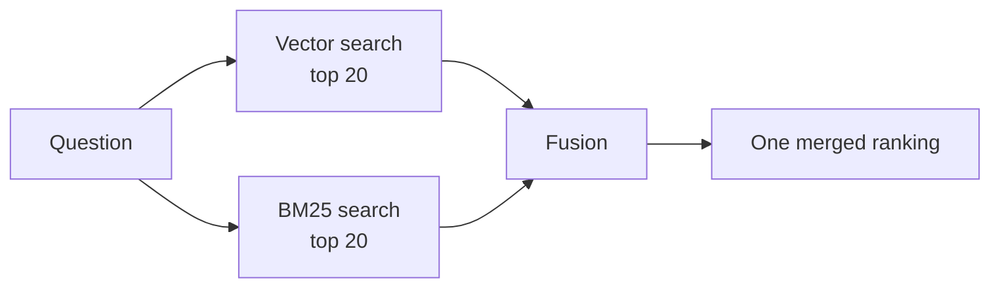

# 08 · Hybrid search and rank fusion

**[← 07 Keyword search and BM25](07-keyword-search-bm25.md)** · **[Concepts](README.md)** · **Next: [09 Reranking →](09-reranking.md)** · **In the course:** [Week 6](../lessons/week06-hybrid-search.md)

**Hybrid search** runs a vector search and a keyword search for the same question and merges the two result lists. Each catches what the other misses: embeddings handle paraphrases, keywords handle exact names and codes.

---

## 1. Why combine them

```text
Question: "Does the BW-BT-5000 battery come with a warranty?"

Vector search top 3:                     Keyword (BM25) top 3:
1. "The battery is covered for 2 years"  1. "BW-BT-5000: 500 Wh replacement battery..."
2. "Warranty claims need a receipt"       2. "Fitting the BW-BT-5000 requires..."
3. "The BW-BT-5001 battery..."  ← near-miss 3. "The battery is covered for 2 years"
```

The best answer needs both "covered for 2 years" (found by both) and the BW-BT-5000 product page (found only by keywords). Merged, both rise to the top.



## 2. The problem with adding scores

The obvious idea — add the two scores — fails, because the scores live on different scales:

| Passage | Cosine (vector) | BM25 |
| --- | --- | --- |
| A | 0.82 | 3.1 |
| B | 0.79 | 14.6 |
| C | 0.55 | 0.0 |

Adding them, BM25 dominates (its scores can be 0–30+, cosine's are around 0.3–0.9). And BM25's range changes with the query: a query with rare words produces bigger numbers.

Two fixes: **normalise the scores**, or **ignore scores and use ranks**.

## 3. Score normalisation (weighted fusion)

Rescale each list to 0–1 with min–max normalisation, then take a weighted sum:

```text
norm(s) = (s − min) / (max − min)
hybrid  = α × norm(vector) + (1 − α) × norm(bm25)          α = 0.5 is a common start
```

With the table above (vector min 0.55, max 0.82; BM25 min 0, max 14.6):

| | norm vector | norm BM25 | hybrid (α = 0.5) |
| --- | --- | --- | --- |
| A | (0.82 − 0.55)/0.27 = 1.00 | 3.1/14.6 = 0.21 | 0.61 |
| B | (0.79 − 0.55)/0.27 = 0.89 | 1.00 | **0.94** |
| C | 0.00 | 0.00 | 0.00 |

This works, but min–max is sensitive to outliers, and α needs tuning per dataset.

## 4. Reciprocal rank fusion (RRF)

RRF throws away the scores and uses only each passage's **rank** in each list:

```text
RRF(d) = Σ   1 / (k + rank_list(d))         k = 60 by convention
        lists
```

A passage missing from a list contributes nothing for that list. The constant k damps the difference between rank 1 and rank 2, so that agreement between lists matters more than one list's top spot.

### Worked example

| Rank | Vector list | BM25 list |
| --- | --- | --- |
| 1 | A | C |
| 2 | B | A |
| 3 | C | E |
| 4 | D | B |

```text
A: 1/(60+1) + 1/(60+2) = 0.016393 + 0.016129 = 0.032522
C: 1/(60+3) + 1/(60+1) = 0.015873 + 0.016393 = 0.032266
B: 1/(60+2) + 1/(60+4) = 0.016129 + 0.015625 = 0.031754
E:            1/(60+3) =                      0.015873
D: 1/(60+4)            =                      0.015625
```

| Fused rank | Passage | Why |
| --- | --- | --- |
| 1 | A | High in both |
| 2 | C | 3rd in vector, 1st in BM25: agreement lifts it above B |
| 3 | B | In both lists, but lower in both |
| 4 | E | Only in BM25, at rank 3 |
| 5 | D | Only in vector, at rank 4 |

**Being found by both retrievers is the strongest signal.** RRF needs no score normalisation and no training, which is why it's the default hybrid method in many search engines and vector databases.

The same formula fuses *any* number of rankings: several query rewrites ([10](10-query-transformation.md)), or several retrievers.

## 5. Weighted RRF and other knobs

| Knob | Effect |
| --- | --- |
| Candidates per list (e.g. 20–100) | More candidates, more chance to recover a passage only one retriever found |
| Weights per list | `w / (k + rank)` lets you trust one retriever more |
| k | Smaller k favours top ranks more strongly; 60 is a robust default |

## 6. When hybrid doesn't help

Hybrid search isn't automatically better. If your questions are paraphrases with no codes or names, BM25 adds mostly noise, and fusion can push a good vector result down. It helps most when:

- documents contain product codes, IDs, error numbers, legal citations, names;
- the embedding model is weak on your domain's jargon;
- users type keyword-style queries ("battery warranty BW-BT-5000").

Measure it on your own test set ([12](12-evaluation.md)). In raggy's fictional test suites, hybrid search did *not* beat vectors alone, so it stays off by default: a good example of measuring rather than assuming.

## 7. Common mistakes

- **Adding raw scores** from different retrievers.
- **Fusing only the top 5** of each list, so passages found by one retriever at rank 8 can't be rescued.
- **Applying a metadata filter to one retriever but not the other.**

## 8. In raggy

- [Week 6](../lessons/week06-hybrid-search.md) and the [hybrid search guide](../docs/hybrid-search.md): LanceDB full-text (BM25) search, RRF fusion (`raggy/retrieve/fusion.py`), filters and parent chunks in hybrid mode.

## 9. Further reading

| Read | Why |
| --- | --- |
| [Reciprocal Rank Fusion outperforms Condorcet and individual rank learning methods](https://plg.uwaterloo.ca/~gvcormac/cormacksigir09-rrf.pdf), Cormack et al. (2009) | The original two-page RRF paper |
| [Getting Started with Hybrid Search](https://www.pinecone.io/learn/hybrid-search-intro/) (Pinecone) | Dense + sparse with worked examples |
| [Hybrid search explained](https://weaviate.io/blog/hybrid-search-explained) (Weaviate) | Ranked vs relative-score fusion |
| [Reciprocal rank fusion](https://www.elastic.co/guide/en/elasticsearch/reference/current/rrf.html) (Elasticsearch docs) | How a production engine exposes RRF |
| [An Analysis of Fusion Functions for Hybrid Retrieval](https://arxiv.org/abs/2210.11934), Bruch et al. (2022) | When normalised score fusion beats RRF, and why |
