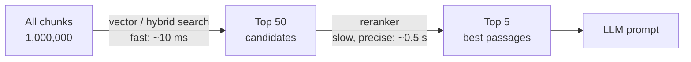
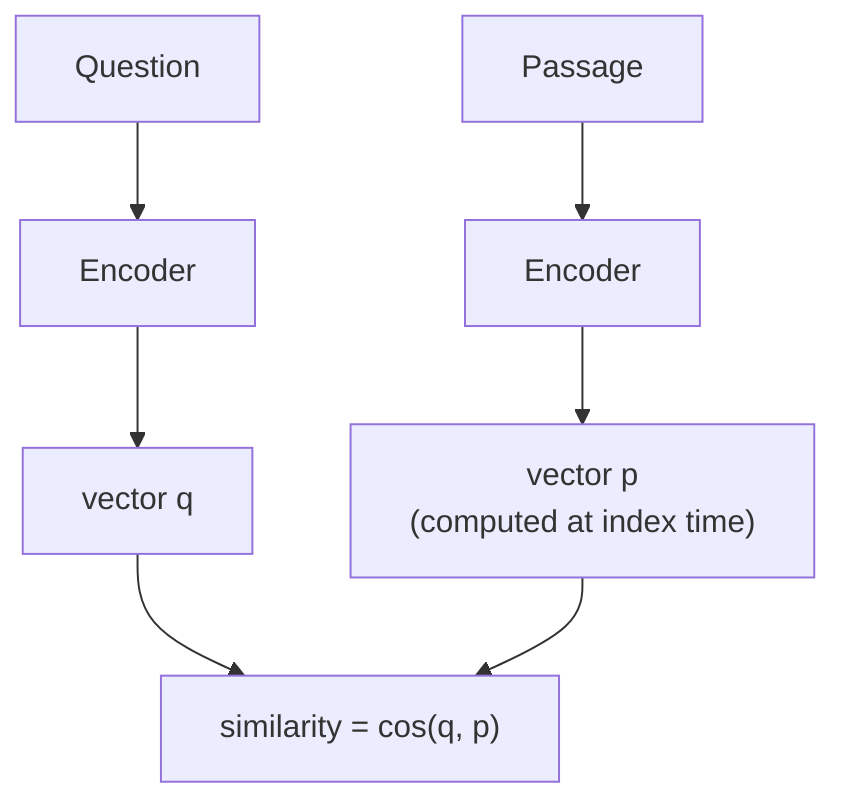
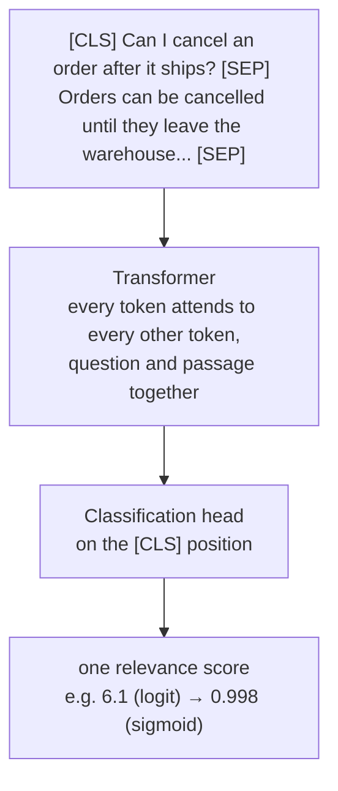

# 09 · Reranking and cross-encoders

**[← 08 Hybrid search](08-hybrid-search.md)** · **[Concepts](README.md)** · **Next: [10 Query transformation →](10-query-transformation.md)** · **In the course:** [Week 7](../lessons/week07-rerank-and-query-transforms.md)

**Reranking** is a second ranking pass over the first search's top results, using a slower but much more precise model. The first search is built for **speed and recall** (find the right passage *somewhere* in the top 50). The reranker is built for **precision** (put it *first*).

---

## 1. The problem: "similar" isn't "answers the question"

Vector search ranks passages by how similar their embeddings are to the question's embedding. That's a good way to find the right *neighbourhood*, but it's a blunt way to order it. A worked example (illustrative scores):

**Question:** "Can I cancel an order after it ships?"

| Passage | Vector rank (cosine) | Does it answer? |
| --- | --- | --- |
| P1 "You can cancel your subscription at any time from Settings." | **1** (0.81) | ❌ wrong kind of cancelling |
| P4 "To cancel an order, open Order history and press Cancel." | 2 (0.80) | ⚠️ how, but not *after shipping* |
| P2 "Orders can be cancelled until they leave the warehouse. After dispatch, return the item instead." | 3 (0.78) | ✅ the answer |
| P3 "Shipping takes 3–5 working days after dispatch." | 4 (0.74) | ❌ |
| P5 "Shipped items can be returned within 30 days for a refund." | 5 (0.70) | ✅ useful follow-up |

P1 shares the words and the "cancel" topic, so its vector is close. The embedding can't easily represent the *relationship* between "after it ships" and "until they leave the warehouse", because each passage's vector was computed **before the question existed**.

If only the top 2 go into the prompt, the LLM never sees the answer.

## 2. The idea: a retrieve-then-rerank funnel



Each stage is cheaper per item than the next and handles more items. The first stage only has to get the answer into the top 50. The reranker only has to score 50 passages, so it can afford to be thorough.

## 3. Bi-encoders vs cross-encoders

The key difference is *when the question and the passage meet*.

### Bi-encoder (the embedding model used for search)



Question and passage are encoded **separately**. Passage vectors are computed once, at index time. A search costs one encoding (the question) plus cheap vector comparisons. Everything the model knows about a passage must fit in one vector, written without knowing what will be asked.

### Cross-encoder (the reranker)



Question and passage are fed **together** as one input. Inside the transformer, every question token can attend to every passage token: "ships" can match "leave the warehouse" and "dispatch"; "order" can notice that P1 is about a "subscription". The output is a single number: how relevant this passage is to this question.

Nothing can be precomputed, because the score depends on the pair. That's what makes it precise, and slow.

### Side by side

| | Bi-encoder | Cross-encoder |
| --- | --- | --- |
| Input | Question *or* passage | Question *and* passage |
| Output | A vector | A score |
| Precomputable | ✅ passage vectors at index time | ❌ every pair at query time |
| Cost per query over N passages | 1 model run + N dot products | **N model runs** |
| Interaction between question and passage | Only through one dot product at the end | Full attention, at every layer |
| Accuracy at ordering | Good | Much better |
| Role | First-stage retrieval | Reranking a short list |

### The same example, reranked

Cross-encoder scores (illustrative logits, with sigmoid probabilities):

| Passage | Vector rank | Cross-encoder score | **New rank** |
| --- | --- | --- | --- |
| P2 "cancelled until they leave the warehouse..." | 3 | 6.1 (0.998) | **1** |
| P5 "Shipped items can be returned within 30 days..." | 5 | 3.0 (0.953) | **2** |
| P4 "To cancel an order, open Order history..." | 2 | 2.3 (0.909) | **3** |
| P3 "Shipping takes 3–5 working days..." | 4 | −2.0 (0.119) | **4** |
| P1 "cancel your subscription..." | 1 | −4.2 (0.015) | **5** |

With the top 2 after reranking, the LLM sees the answer *and* the useful follow-up.

## 4. The cost, worked through

A small cross-encoder (`ms-marco-MiniLM-L-6-v2`, 22M parameters) takes roughly 10–20 ms per question–passage pair on a laptop CPU.

| Rerank | Pairs | Time (≈ 20 ms/pair) |
| --- | --- | --- |
| Top 20 | 20 | **0.4 s** |
| Top 100 | 100 | 2 s |
| Whole index (1M chunks) | 1,000,000 | 20,000 s ≈ **5.6 hours** |

That's why cross-encoders can't replace first-stage search, and why the candidate count is a key knob: more candidates give the reranker more to rescue, and cost proportionally more time. A GPU, batching, and smaller models bring the per-pair cost down a lot.

## 5. How cross-encoders are trained

- **Data:** question–passage pairs labelled relevant or not. The standard dataset is **MS MARCO**: hundreds of thousands of real Bing queries with passages that answered them.
- **Objective:** classify each pair as relevant (1) or not (0), with binary cross-entropy; or score the relevant passage above several irrelevant ones for the same question.
- **Hard negatives:** the irrelevant examples are taken from the *top results of a first-stage retriever* (BM25 or a bi-encoder). That teaches the reranker exactly the distinctions the first stage gets wrong: subscription vs order, charging time vs warranty.
- **Distillation:** large, slow teacher models (or LLMs) score pairs, and a small student learns to copy their scores.

Because they learn from search data, rerankers generalise well across domains, but a model trained on English web queries may be weaker on, say, legal German. Multilingual rerankers exist (`bge-reranker-v2-m3`).

## 6. Using one

With the `sentence-transformers` library:

```python
from sentence_transformers import CrossEncoder

model = CrossEncoder("cross-encoder/ms-marco-MiniLM-L-6-v2")

question = "Can I cancel an order after it ships?"
passages = [
    "You can cancel your subscription at any time from Settings.",
    "Orders can be cancelled until they leave the warehouse. After dispatch, return the item instead.",
    "Shipped items can be returned within 30 days for a refund.",
]

scores = model.predict([(question, p) for p in passages])   # one score per pair
ranked = sorted(zip(scores, passages), reverse=True)
for score, passage in ranked:
    print(f"{score:6.2f}  {passage}")
```

Hosted rerankers (Cohere Rerank, Voyage, Jina) take a query and a list of documents and return them reordered with scores, in one API call.

Popular models:

| Model | Size | Notes |
| --- | --- | --- |
| `cross-encoder/ms-marco-MiniLM-L-6-v2` | 22M | Fast CPU baseline |
| `BAAI/bge-reranker-base` / `-large` | 278M / 560M | Stronger, still local |
| `BAAI/bge-reranker-v2-m3` | 568M | Multilingual |
| `mixedbread-ai/mxbai-rerank-*` | various | Strong open models |
| Cohere Rerank, Voyage rerank, Jina reranker | API | No model to host |

## 7. ColBERT: the middle ground (late interaction)

**ColBERT** keeps one vector **per token** instead of one per passage. Passage token vectors are precomputed (like a bi-encoder), but the comparison happens token by token at query time (a little like a cross-encoder):

```text
score(q, d) = Σ  max  ( qᵢ · dⱼ )         "MaxSim": each query token finds its best match
             i∈q  j∈d
```

Worked example, query tokens "cancel" and "shipped", passage tokens "orders", "cancelled", "dispatch":

```text
                orders  cancelled  dispatch
cancel           0.2      0.9        0.1      → max 0.9
shipped          0.3      0.2        0.8      → max 0.8
                                           score = 0.9 + 0.8 = 1.7
```

| | Bi-encoder | ColBERT | Cross-encoder |
| --- | --- | --- | --- |
| Precompute passages | One vector | One vector per token | Nothing |
| Storage | Small | Large (e.g. 200 tokens × 128 dims per chunk) | None |
| Query cost | Lowest | Low–medium | Highest |
| Precision | Good | Better | Best |

ColBERT can be used as the first-stage retriever or as a fast reranker.

## 8. LLMs as rerankers

A general LLM can judge relevance too, in three styles:

| Style | How | Cost |
| --- | --- | --- |
| **Pointwise** | "Is this passage relevant to the question? yes/no" per passage (often reading the probability of "yes") | N calls (or N items in a batch) |
| **Pairwise** | "Which of these two passages is more relevant?" | Many comparisons |
| **Listwise** | Show all candidates, numbered; ask for an ordering like `[3, 1, 7, ...]` | One call per window |

Listwise ranking (e.g. RankGPT) lets the model *compare* passages with each other. For lists longer than the context allows, it uses a **sliding window**: rank the last 20, move the window up by 10, repeat, so the best passages bubble to the top.

LLM rerankers are often the most accurate, and the slowest and most expensive: seconds and a paid call per question. Their output must be validated (ids that don't exist, ids repeated, candidates left out).

## 9. What reranking can and can't fix

```text
Retrieval found the answer at rank 35, reranker looks at the top 20  →  ❌ lost; reranking can't add passages
Retrieval found it at rank 12, the prompt takes the top 4            →  ✅ reranking moves it to rank 1
```

- It improves **precision at the top**: recall@1, MRR, nDCG ([12](12-evaluation.md)).
- It barely changes **recall@k** when k is close to the number of candidates, since those passages were already found.
- It lets you put **fewer passages** in the prompt (cheaper, less distraction) without losing the answer.
- A reranker score can drop clearly irrelevant passages (a minimum score), which also helps the "I couldn't find it" path. But scores are only roughly calibrated, so pick the threshold on your own data.

## 10. Common mistakes

- **Reranking too few candidates** (top 5 → top 3): little to reorder.
- **Truncation:** most cross-encoders read at most 512 tokens for question *and* passage together. A long passage is cut, and the answer may be in the cut part.
- **Not measuring latency per stage.** A reranker can double response time; measure p95, not just accuracy ([14](14-production.md)).
- **Reranking chunks but returning parents** without checking that the parent still contains the answer.

## 11. In raggy

- [Week 7](../lessons/week07-rerank-and-query-transforms.md) and the [reranking guide](../docs/reranking.md): `raggy/retrieve/rerank.py` has a local cross-encoder (fastembed's `ms-marco-MiniLM-L-6-v2`) and a listwise LLM reranker, with repair of bad LLM output and fallback to retrieval order on failure.
- On raggy's fictional test suites, mean recall@1 rose from 0.80 to 0.95 with MiniLM and to 1.00 with an LLM reranker; the LLM took 7–10 s per question.

## 12. Further reading

| Read | Why |
| --- | --- |
| [Rerankers and Two-Stage Retrieval](https://www.pinecone.io/learn/series/rag/rerankers/) (Pinecone) | Clear illustrated introduction |
| [Cross-Encoders](https://sbert.net/examples/cross_encoder/applications/README.html) (Sentence Transformers docs) | Bi- vs cross-encoder, with code |
| [Passage Re-ranking with BERT](https://arxiv.org/abs/1901.04085), Nogueira & Cho (2019) | The paper that made cross-encoder reranking standard |
| [Pretrained Transformers for Text Ranking: BERT and Beyond](https://arxiv.org/abs/2010.06467), Lin, Nogueira & Yates (2020) | The book-length survey; chapter 3 covers cross-encoders in depth |
| [ColBERT](https://arxiv.org/abs/2004.12832), Khattab & Zaharia (2020) | Late interaction |
| [Is ChatGPT Good at Search? (RankGPT)](https://arxiv.org/abs/2304.09542), Sun et al. (2023) | Listwise LLM reranking with sliding windows |
| [MS MARCO](https://microsoft.github.io/msmarco/) | The dataset most rerankers are trained on |
| [Cohere Rerank documentation](https://docs.cohere.com/docs/rerank-overview) | How a hosted reranker is called |
