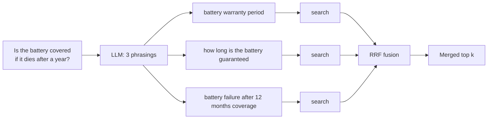

# 10 · Query transformation

**[← 09 Reranking](09-reranking.md)** · **[Concepts](README.md)** · **Next: [11 Grounded generation →](11-grounded-generation.md)** · **In the course:** [Week 7](../lessons/week07-rerank-and-query-transforms.md)

Reranking improves the *results*. Query transformation improves the *search itself*, by changing what you search for. An LLM rewrites the user's question into one or more queries that are more likely to match the documents.

---

## 1. The problem: users don't write like documents

```text
User:      "hey so my bike's battery died after like a year, is that covered??"
Document:  "Battery warranty. The battery is covered for two years from the date of purchase."
```

The question has filler, a story, and different words. Its embedding lands near "battery problems" rather than "warranty terms". The answer is retrievable, but the question is a poor search query.


The techniques below differ in *what* the LLM produces.

## 2. Rewriting

Turn the question into a clean, keyword-rich search query.

```text
In:   "hey so my bike's battery died after like a year, is that covered??"
Out:  "battery warranty coverage period"
```

Cheap (one short LLM call), and helps most with chatty, misspelled or vague questions. Risk: the rewrite drops a detail that mattered ("after a year").

## 3. Conversational condensing

In a chat, follow-up questions depend on earlier turns:

```text
Turn 1:  "What's the warranty on the Ebb's battery?"     → answered
Turn 2:  "And the frame?"
```

"And the frame?" is unsearchable on its own. **Condense** the history and the follow-up into a standalone question:

```text
"What is the warranty on the Ebb's frame?"
```

Any chat-style RAG system needs this step; without it, follow-ups retrieve nonsense.

## 4. Multi-query (and RAG-Fusion)

Generate several phrasings, search each, and fuse the rankings with RRF ([08](08-hybrid-search.md#4-reciprocal-rank-fusion-rrf)):



A passage that ranks well for several phrasings rises; a passage matched by one unlucky wording sinks. It hedges against any single phrasing. Cost: one LLM call plus several searches (cheap if run in parallel).

## 5. HyDE: search with a fake answer

**Hypothetical Document Embeddings.** Ask the LLM to *write an answer* (without retrieval), and embed that instead of the question.

```text
Question:  "Is the battery covered if it dies after a year?"
LLM writes: "The battery is covered by the manufacturer's warranty for a period of
             two years from purchase, including failures from normal use."
Embed the fake answer → search
```

Why it works: questions and answers look different, but a fake answer *looks like* a real answer — same style, same vocabulary — so its vector lands near real answers.

```text
                    question ●
                              \  far
                               \
  fake answer ●  ── close ──  ● real answer passage
```

The facts in the fake answer can be wrong ("two years" may be invented). That's fine for *finding* passages, because only the vector is used, never the text. The risk is a fake answer that is confidently specific in the wrong direction and lands near the wrong section.

## 6. Step-back prompting

Ask a more general question first, to retrieve background the specific question needs:

```text
Specific:   "Can I fit a 750 Wh battery to my 2024 Kestrel?"
Step back:  "What batteries are compatible with the Kestrel, and what limits apply?"
```

Search both; the general passage supplies the rule, the specific one the detail.

## 7. Decomposition (sub-questions)

Split a compound question into parts, retrieve for each, then answer from everything:

```text
"Which is lighter, the Ebb or the Kestrel, and which has the longer warranty?"
  → "How much does the Ebb weigh?"
  → "How much does the Kestrel weigh?"
  → "What is the Ebb's warranty?"
  → "What is the Kestrel's warranty?"
```

Decomposition works when the parts are known in advance. When a later part depends on an earlier *answer* ("the warranty of the bike that seats two children"), you need a loop: that's multi-hop, agentic retrieval ([15](15-agentic-and-graph-rag.md)).

## 8. Routing and self-query

- **Routing:** choose *where* to search: the product catalogue, the HR policies, or a SQL database. An LLM (or a small classifier) reads the question and picks a source.
- **Self-query / filter extraction:** turn parts of the question into metadata filters.

```text
"Warranty changes announced in 2026 for the Kestrel"
  → query:   "warranty changes"
  → filters: year = 2026, product = "Kestrel"
```

## 9. Choosing

| Technique | LLM calls | Helps with | Risk |
| --- | --- | --- | --- |
| Rewrite | 1 | Chatty, vague, misspelled questions | Drops a detail |
| Condense | 1 | Chat follow-ups | Wrong reference resolution |
| Multi-query | 1 (+ N searches) | Sensitivity to wording | More results to fuse; latency |
| HyDE | 1 | Question/answer vocabulary gap | Confidently wrong fake answers |
| Step-back | 1 | Questions needing general rules | Extra, sometimes irrelevant, context |
| Decomposition | 1+ | Compound questions | Too many sub-questions |
| Routing / self-query | 1 | Several sources, metadata-heavy data | Wrong route = nothing found |

All of them add an LLM call **before** retrieval, so they add latency to every question (often 0.5–2 s). Caching transforms by the question text makes repeated questions free.

## 10. Common mistakes

- **Transforming every question** when most are already good queries. Measure first: in raggy's week 7, the transforms moved recall@1 up and down by a question or two, inside the noise, and HyDE lost a question.
- **Searching only the rewrite.** Searching the original question *and* the rewrite, then fusing, is safer.
- **Using a slow, large model** for a step that a small, fast model does well.

## 11. In raggy

- [Week 7](../lessons/week07-rerank-and-query-transforms.md) and the [reranking and query transforms guide](../docs/reranking.md): rewrite, multi-query with RRF, and HyDE in `raggy/retrieve/transforms.py`, cached by model, prompt version and question.

## 12. Further reading

| Read | Why |
| --- | --- |
| [Precise Zero-Shot Dense Retrieval without Relevance Labels (HyDE)](https://arxiv.org/abs/2212.10496), Gao et al. (2022) | The HyDE paper |
| [Query Rewriting for Retrieval-Augmented LLMs](https://arxiv.org/abs/2305.14283), Ma et al. (2023) | Rewrite-retrieve-read |
| [Take a Step Back](https://arxiv.org/abs/2310.06117), Zheng et al. (2023) | Step-back prompting |
| [RAG-Fusion](https://arxiv.org/abs/2402.03367), Rackauckas (2024) | Multi-query with reciprocal rank fusion, evaluated |
| [Query2doc](https://arxiv.org/abs/2303.07678), Wang et al. (2023) | Expanding the query with a generated pseudo-document, for both BM25 and dense search |
| [Query Transformations](https://blog.langchain.dev/query-transformations/) (LangChain blog) | A practical overview with code |
