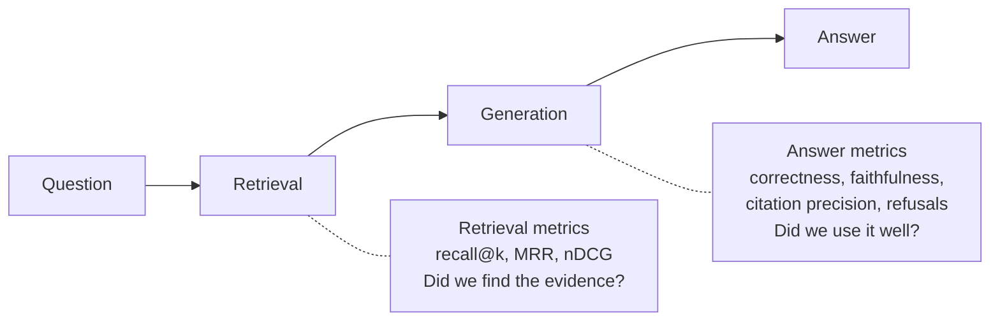

# 12 · Evaluating RAG

**[← 11 Grounded generation](11-grounded-generation.md)** · **[Concepts](README.md)** · **Next: [13 Multimodal RAG →](13-multimodal-rag.md)** · **In the course:** [Week 2](../lessons/week02-evals.md), and every week after

Every page in this folder describes a technique that *might* help. Evaluation is how you find out whether it *does*, on *your* documents and questions. Without it, RAG work is guesswork driven by the last five questions you tried.

For every metric worked by hand, see **[RAG metrics, explained with examples](../docs/metrics-explained.md)**. This page is about the method.

---

## 1. The problem: "it looks better" isn't evidence

You change the chunk size, ask three questions, and the answers look better. But:

- three questions can't show a change that helps 10% of questions;
- the same question can get different answers on two runs;
- a change can fix one kind of question and break another.

An evaluation is a fixed set of questions, with known correct answers, scored automatically, so any change can be compared with the last one.

## 2. Evaluate the stages separately

RAG has two stages that fail in different ways ([01](01-what-is-rag.md#7-where-rag-goes-wrong)). Measure each one on its own:



If the answer is wrong, the retrieval metrics tell you whether to fix search or fix the prompt.

## 3. Building a test set

Each test item has a question, the evidence (which passage or quote answers it), and a reference answer. Include **unanswerable** questions too.

```yaml
- id: q07
  question: "How long is the Ebb's battery covered?"
  gold:
    - source: warranty.md
      quote: "The battery is covered for two years"
  answer: "Two years from purchase."
- id: u02
  question: "What is the CEO's shoe size?"
  answerable: false
```

Where questions come from:

| Source | Pros | Cons |
| --- | --- | --- |
| **Real user questions** (logs, support tickets) | Realistic wording and topics | Need someone to label the evidence |
| **Hand-written** by people who know the documents | High quality | Slow; authors copy the documents' wording, which makes retrieval look too easy |
| **LLM-generated** from passages ("write a question this passage answers") | Fast, cheap, scalable | Too easy and too literal; check and edit a sample |
| **Public benchmarks** (BEIR, HotpotQA, SciFact) | Comparable with published results | Not your documents |

**Gold as a quote, not a chunk id.** If the evidence is recorded as "chunk 17", changing the chunker breaks the test set. Recorded as a quote ("The battery is covered for two years"), any chunk containing the quote counts as a hit, under any chunker.

How many questions? Enough that one question changes the score by a small amount. With 30 questions, one question is 3.3 points; with 200, it's 0.5. Start with 30–50, grow over time.

## 4. Retrieval metrics (summary)

| Metric | Question it answers | Example |
| --- | --- | --- |
| **recall@k** | Is the evidence in the top k? | Evidence at rank 3: recall@1 = 0, recall@5 = 1 |
| **MRR** | How high is the first relevant result? | Rank 3: 1/3 = 0.33 |
| **nDCG@k** | Are all the relevant results near the top, weighted by position? | Rewards rank 1 over rank 4 smoothly |
| **precision@k** | What share of the top k is relevant? | 2 relevant in top 5: 0.4 |

Worked by hand, with traps: [metrics explained](../docs/metrics-explained.md).

## 5. Answer metrics and LLM-as-judge

| Metric | Question | How it's usually scored |
| --- | --- | --- |
| **Correctness** | Does the answer match the reference? | LLM judge with a rubric |
| **Faithfulness** | Is every claim supported by the passages? | Split into claims, check each (NLI or LLM) |
| **Answer relevance** | Does it address the question? | LLM judge |
| **Citation precision** | Do the cited passages support the sentences? | Lexical check or LLM |
| **Refusal accuracy** | Refuses unanswerable questions, answers answerable ones? | Exact match on the refusal sentence |

**LLM-as-judge**: a second LLM grades the answer with a rubric:

```text
System: You grade answers. Compare the ANSWER to the REFERENCE.
        Reply JSON: {"verdict": "correct" | "partially_correct" | "incorrect", "reason": "..."}
User:   QUESTION: How long is the Ebb's battery covered?
        REFERENCE: Two years from purchase.
        ANSWER: The battery has a two-year warranty [1].
→ {"verdict": "correct", "reason": "Same period."}
```

Known judge biases, and the fixes:

| Bias | Fix |
| --- | --- |
| **Position bias** (prefers the first of two answers) | Grade one answer at a time, or swap order and average |
| **Verbosity bias** (prefers longer answers) | Rubric says length doesn't matter; compare to a reference |
| **Self-preference** (prefers its own model's style) | Use a different model family as judge |
| **Drift** (prompt or model changes alter scores) | Version the judge prompt; never compare scores across judge versions |

Check the judge itself: hand-label 30 answers and measure how often the judge agrees.

## 6. Noise is the default

Run the *same* configuration twice and the scores differ: the LLM's answers vary, and so does the judge. Before believing a change:

1. Run the baseline **twice**; the gap between the two runs is your noise level.
2. A change is real only if it beats the baseline by **more than the noise**, on more than one run.
3. Look at which questions flipped, not just the average.

```text
baseline run 1: correctness 0.879
baseline run 2: correctness 0.939       ← same config: noise ≈ 0.06
new chunker:    correctness 0.909       ← inside the noise: no evidence it helps
```

**Write the decision rule before the run** ("adopt if recall@4 rises by ≥ 0.05 and correctness doesn't drop by more than the noise"), so the numbers can't talk you into a change after the fact.

## 7. Frameworks

| Tool | What it gives |
| --- | --- |
| [RAGAS](https://docs.ragas.io/) | Faithfulness, answer relevancy, context precision/recall, test-set generation |
| [DeepEval](https://github.com/confident-ai/deepeval), [TruLens](https://www.trulens.org/) | Metric libraries and tracing |
| [ARES](https://arxiv.org/abs/2311.09476) | Trains small judges, with confidence intervals |
| Your own script | Often enough, and you'll understand every number |

## 8. Offline and online

- **Offline** (this page): a fixed test set, run before shipping a change.
- **Online**: real users. Thumbs up/down, "was this helpful?", how often people rephrase, A/B tests between configurations. Online signals catch questions your test set never imagined; feed them back into the test set.

## 9. Common mistakes

- **One run per configuration**: noise mistaken for improvement.
- **Measuring only the final answer**, so you can't tell whether retrieval or generation failed.
- **Test questions written while reading the passage**, using its exact words, so retrieval looks perfect.
- **Comparing at unequal context**: a configuration that sends more text to the LLM scores higher for that reason alone.
- **No unanswerable questions**, so a system that never refuses looks perfect.

## 10. In raggy

- [Week 2](../lessons/week02-evals.md) and the [evaluating RAG guide](../docs/evaluating-rag.md): span-level gold, retrieval and answer metrics, versioned judge prompts, baselines.
- Every later week writes its decision rule before running, and keeps a technique off by default unless the measurement supports it.

## 11. Further reading

| Read | Why |
| --- | --- |
| [RAG metrics, explained with examples](../docs/metrics-explained.md) | This course's long worked guide |
| [Your AI Product Needs Evals](https://hamel.dev/blog/posts/evals/), Hamel Husain | Why and how to build evals, from practice |
| [RAGAS: Automated Evaluation of Retrieval Augmented Generation](https://arxiv.org/abs/2309.15217), Es et al. (2023) | Reference-free RAG metrics |
| [Judging LLM-as-a-Judge](https://arxiv.org/abs/2306.05685), Zheng et al. (2023) | Judge biases measured |
| [BEIR](https://arxiv.org/abs/2104.08663), Thakur et al. (2021) | A standard retrieval benchmark across 18 datasets |
| [Introduction to Information Retrieval, chapter 8](https://nlp.stanford.edu/IR-book/html/htmledition/evaluation-in-information-retrieval-1.html) | Classic retrieval evaluation |
| [Adding Error Bars to Evals](https://arxiv.org/abs/2411.00640), Miller (2024) | Statistics for deciding whether a difference is real |
