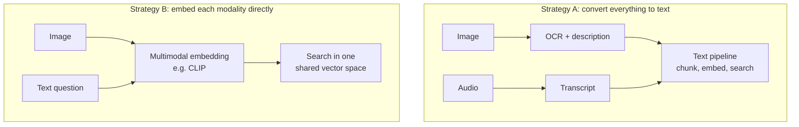
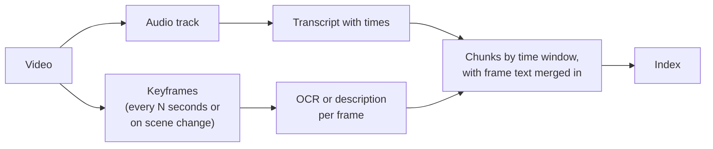

# 13 · Multimodal RAG: images, tables, audio and video

**[← 12 Evaluating RAG](12-evaluation.md)** · **[Concepts](README.md)** · **Next: [14 RAG in production →](14-production.md)** · **In the course:** [Week 9](../lessons/week09-rich-documents.md), [Week 10](../lessons/week10-images.md), [Week 11](../lessons/week11-audio-video.md)

Much knowledge isn't in plain text: a wiring diagram, a pricing table in a slide, a screenshot of an error, a recorded meeting. **Multimodal RAG** makes that content searchable and answerable.

---

## 1. Two strategies



| | Convert to text | Embed directly |
| --- | --- | --- |
| Reuses the text pipeline (chunking, BM25, reranking, citations) | ✅ | ❌ needs its own |
| Loses visual information (layout, colour, shapes) | ⚠️ partly | ✅ keeps more |
| Cost at index time | OCR/vision model per image | Embedding per image |
| Answering | Any text LLM | A vision LLM to read the retrieved image |

Most systems start with conversion to text, and add direct image search where pictures *themselves* are what users search for.

## 2. Images

### 2.1 OCR

Reads the *text in* an image: screenshots, scanned forms, labels. Fast and local, but it says nothing about a diagram with no text, and it scrambles complex layouts ([03](03-document-parsing.md#4-ocr-when-theres-no-text-at-all)).

### 2.2 Vision-language model descriptions

A vision LLM (Claude, GPT-4o, or a local model such as LLaVA or Qwen-VL) is asked to describe the image:

```text
Image: a wiring diagram
Prompt: "Describe this image for a search index. Transcribe all visible text exactly.
         Describe what it shows: components, labels, relationships."
Output: "Wiring diagram for the Ebb E-Cargo motor controller. The battery (BW-BT-5000)
         connects to the controller via a 30 A fuse; the controller connects to the
         hub motor and the display. Labels: 'FUSE 30A', 'CTRL', 'HUB'..."
```

The description is chunked and embedded like any text. Keep the OCR text *beside* the description: the model may paraphrase or "correct" codes, while OCR keeps them exact for keyword search.

### 2.3 CLIP: one space for images and text

**CLIP** (Contrastive Language–Image Pre-training) trains an image encoder and a text encoder together, on hundreds of millions of image–caption pairs, so that an image and its caption get close vectors ([05](05-embeddings.md#5-how-embedding-models-are-trained-contrastive-learning) explains the training trick, here across two modalities).

```text
   "a red cargo bike with a child seat" ●──close──● [photo of a red cargo bike]
   "a wiring diagram"                   ●──close──● [diagram image]
```

A text question can then search images directly. CLIP is good at "what is pictured" (objects, scenes, styles), weak at reading text inside images and at fine detail.

### 2.4 Page images: ColPali

**ColPali** skips parsing entirely: it embeds a *screenshot of each page* with a vision-language model, producing many patch vectors per page, and compares them with the question's token vectors using ColBERT-style late interaction ([09](09-reranking.md#7-colbert-the-middle-ground-late-interaction)). It handles tables, charts and layouts that text extraction mangles. The retrieved page images are then given to a vision LLM to answer.

## 3. Tables

Tables are hard for chunking and embedding: a row means nothing without its column headers.

| Approach | Example |
| --- | --- |
| Markdown table in one chunk | `\| Model \| Warranty \|` ... (small tables) |
| **Row as sentence** with headers repeated | "Model: Ebb. Battery warranty: 2 years. Weight: 38 kg." |
| Table summary + table | An LLM writes "Warranty periods by model" above the table |
| Text-to-SQL | Load spreadsheets into a database and let an LLM write queries, for numeric questions ("average price of models over 30 kg") |

Retrieval metrics can't see whether a table was *understood*: the right chunk can be found and still be misread. Check answers on table questions specifically.

## 4. Audio: speech to text

**Automatic speech recognition (ASR)** turns speech into a transcript with timestamps. OpenAI's **Whisper** (open source, runs locally; `faster-whisper` is a fast implementation) is the common choice.

```text
[00:00:12.4 → 00:00:17.9]  "The Ebb's battery is covered for two years."
[00:00:18.0 → 00:00:23.2]  "For the frame, it's ten years."
```

How to chunk a transcript: by **time windows** (say 60 seconds), by **speaker turns**, or by topic. Keep the start time with each chunk, so the citation is a timestamp: *podcast.mp3 at 00:12*.

Whisper's known failure modes:

| Failure | Mitigation |
| --- | --- |
| Misheard names and codes ("BW-BT-5000" → "BWBT 5,000") | A vocabulary prompt; hybrid search tolerant of variants |
| **Hallucinated text in silence or music** (repeated phrases, "Thanks for watching") | Voice-activity detection to skip silence |
| No speaker labels | **Diarization** (e.g. pyannote) labels who spoke when |

If human-made subtitles (`.srt`, `.vtt`) exist, use them first: they're more accurate and free.

## 5. Video

Video = audio + frames.



- **Keyframes**: sample a frame every few seconds, or when the picture changes a lot (scene detection), and skip near-identical frames.
- **Slide videos and screen recordings**: OCR on keyframes captures what's on screen but not spoken.
- Citations become **timestamps**, so the user can jump to the moment.

## 6. Common mistakes

- **Describing images without keeping OCR text**, so exact codes are lost.
- **Sending every image to a vision model**, including logos and icons. Filter by size, and cache by image bytes so repeated images are described once.
- **Long transcript chunks without timestamps**, so citations can't point to a moment.
- **Trusting ASR on names**: check transcripts of important names and numbers.

## 7. In raggy

- [Week 9](../lessons/week09-rich-documents.md): PDFs with headings and tables, OCR, slides and spreadsheets.
- [Week 10](../lessons/week10-images.md) and the [images guide](../docs/images.md): OCR plus vision descriptions, CLIP search, caching by image bytes.
- [Week 11](../lessons/week11-audio-video.md) and the [audio and video guide](../docs/audio-video.md): faster-whisper transcripts, time windows, subtitles first, keyframes.

## 8. Further reading

| Read | Why |
| --- | --- |
| [CLIP: Learning Transferable Visual Models From Natural Language Supervision](https://arxiv.org/abs/2103.00020), Radford et al. (2021) | Images and text in one vector space |
| [ColPali: Efficient Document Retrieval with Vision Language Models](https://arxiv.org/abs/2407.01449), Faysse et al. (2024) | Retrieval over page images |
| [Robust Speech Recognition via Large-Scale Weak Supervision (Whisper)](https://arxiv.org/abs/2212.04356), Radford et al. (2022) | The Whisper paper |
| [faster-whisper](https://github.com/SYSTRAN/faster-whisper) | Fast local Whisper |
| [pyannote.audio](https://github.com/pyannote/pyannote-audio) | Speaker diarization |
| [Multimodal RAG overview](https://developer.nvidia.com/blog/an-easy-introduction-to-multimodal-retrieval-augmented-generation/) (NVIDIA) | The strategies compared, with diagrams |
| [Vision](https://docs.anthropic.com/en/docs/build-with-claude/vision) (Anthropic docs) | Sending images to Claude |
