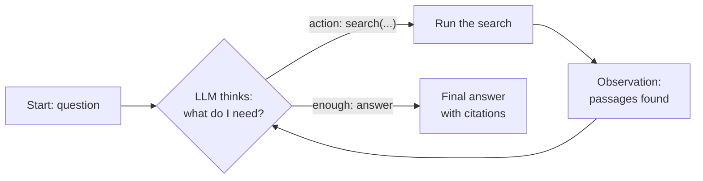
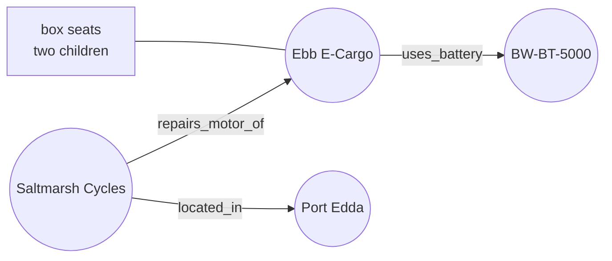
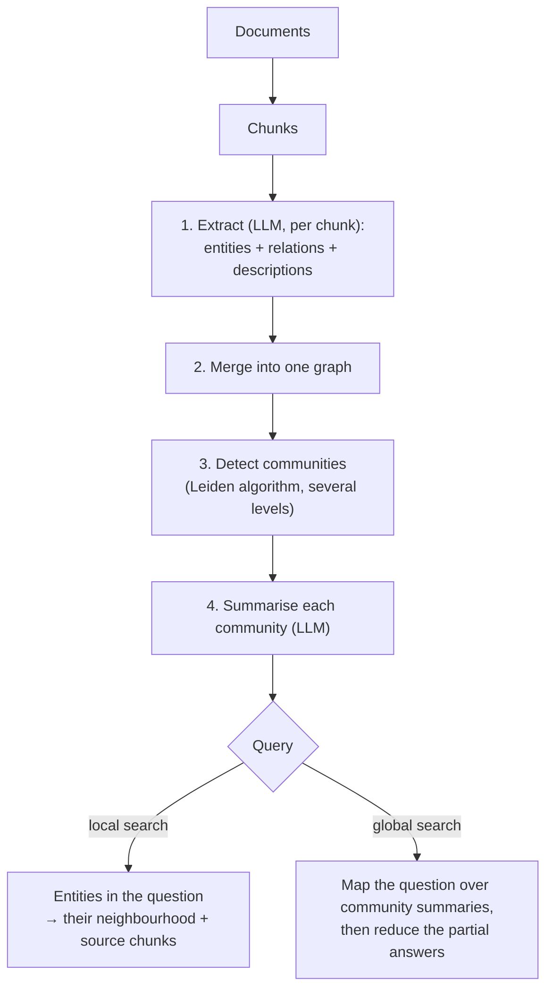

# 15 · Agentic and graph RAG

**[← 14 RAG in production](14-production.md)** · **[Concepts](README.md)** · **Next: [16 Where RAG fails →](16-failure-modes.md)** · **In the course:** [Bonus week](../lessons/bonus-agentic-and-graph-rag.md)

Everything so far is a **pipeline**: search once, answer once. Some questions can't be answered that way. **Agentic RAG** lets the model decide when and what to search, in a loop. **Graph RAG** connects facts ahead of time, in a knowledge graph. Both target questions that need more than one piece of evidence.

---

## 1. The problem: multi-hop questions

> "Which service centre can repair the motor of the bike whose box seats two children?"

Answering needs two facts, from two documents:

```text
hop 1: "the bike whose box seats two children"  →  bike-models.md:     "The Ebb E-Cargo... a box that seats two children"
hop 2: "who repairs the Ebb E-Cargo's motor"    →  service-centres.md: "Saltmarsh Cycles is the only centre that works on the Ebb E-Cargo's motor"
```

The link, "Ebb E-Cargo", is a **bridge entity**: it's in neither the question nor anything that resembles the question. A single search scores passages by similarity to the question; the service-centre passage isn't similar to it. No embedding, hybrid search or reranker can fix that, because they all rank by similarity to the same query. The second search can only be written **after reading the first result**.

Other shapes that need more than one search:

| Shape | Example |
| --- | --- |
| Bridge | "Who repairs the motor of the bike that weighs 38 kg?" |
| Comparison | "Which has the longer warranty, the Ebb or the Kestrel?" |
| Aggregation | "How many models have a battery over 500 Wh?" |
| Global / summary | "What are the most common complaints across all support tickets?" |

## 2. Agents in one paragraph

An **agent** is an LLM in a loop: it decides an action, a program carries it out, the result goes back to the model, and it decides again, until it chooses to stop.



This is **ReAct** (reason + act): the model alternates thoughts and actions, and each action's result informs the next thought.

## 3. Agentic retrieval, step by step

A trace of the loop on the multi-hop question:

```text
Question: Which service centre can repair the motor of the bike whose box seats two children?

Step 1  search: "Which service centre can repair the motor of the bike whose box seats two children?"
        found:  [1] bike-models.md: "The Ebb E-Cargo has a box that seats two children..."
                [2] service-centres.md: "Kestrel owners can use any partner centre..."

Step 2  model: The bike is the Ebb E-Cargo. I don't yet know who repairs its motor.
        → {"action": "search", "query": "service centre Ebb E-Cargo motor"}
        found:  [3] service-centres.md: "Saltmarsh Cycles is the only centre that works on the Ebb E-Cargo's motor."

Step 3  model: [1] identifies the bike, [3] the centre. Enough.
        → {"action": "answer"}

Answer: Saltmarsh Cycles [3]. The bike with a box for two children is the Ebb E-Cargo [1].
```

The second query uses a name ("Ebb E-Cargo") that the model **learned from the first result**. That's the whole idea.

### Design choices

| Choice | Options | Trade-off |
| --- | --- | --- |
| Actions | One `search` tool; several tools (search, SQL, web, "neighbours of entity") | More tools, more power, more ways to go wrong |
| Decision format | Native tool calling; JSON in text | Native is validated; JSON works with any model |
| First step | Search the question immediately; let the model plan first | Searching first is free for single-hop questions |
| Stopping | Model says "answer"; step limit; repeated query; nothing new found | Always have a hard limit |
| What the model sees | All passages; truncated passages; summaries | Longer prompts at every step |

### Costs and risks

- **Latency and cost:** one LLM decision per step, on top of the final answer. Two hops ≈ two extra calls.
- **Searching past the answer:** the model keeps looking for confirmation. Cap the steps.
- **Answering too early:** it guesses hop 2. Citation checks catch unsupported claims ([11](11-grounded-generation.md)).
- **Drift on unanswerable questions:** it searches until something looks vaguely related, then answers from that. Test with unanswerable multi-hop questions.
- **Unfair comparison:** the agent ends up with more passages in its prompt than single-pass retrieval. Compare at equal context, or you'll credit the agent for what is really more context.

## 4. Self-correcting variants

| Method | Idea |
| --- | --- |
| **Self-RAG** | The model is trained to emit special tokens deciding *whether* to retrieve, and to critique whether each passage is relevant and each claim is supported |
| **Corrective RAG (CRAG)** | A small evaluator grades the retrieved passages; if they're poor, rewrite the query or fall back to web search; strip irrelevant sentences before answering |
| **Adaptive RAG** | A classifier routes each question by complexity: no retrieval, single search, or a multi-step loop, so easy questions stay cheap |
| **IRCoT** | Interleave retrieval with chain-of-thought: every reasoning sentence triggers a new search |

## 5. Knowledge graphs in one page

A **knowledge graph** stores facts as **triples**: (subject, relation, object).

```text
(Ebb E-Cargo,     has_feature,      box that seats two children)
(Ebb E-Cargo,     uses_battery,     BW-BT-5000)
(Saltmarsh Cycles, repairs_motor_of, Ebb E-Cargo)
(Saltmarsh Cycles, located_in,      Port Edda)
```



The multi-hop question becomes a **walk**: from "box seats two children" to Ebb E-Cargo, then along `repairs_motor_of` backwards to Saltmarsh Cycles. No second search needed: the bridge was recorded at index time.

## 6. GraphRAG

Microsoft's **GraphRAG** (Edge et al., 2024) builds such a graph from plain documents with an LLM:



- **Local search** answers entity-centred questions ("who repairs the Ebb?") from an entity's neighbours and their source chunks.
- **Global search** answers questions about the **whole corpus** ("what themes run through these 500 reports?") from community summaries. This is something no top-k retrieval can do, because no handful of passages contains the answer.

Costs: an LLM call per chunk to extract entities, plus summaries, at index time; extraction errors become graph errors; updating documents means updating the graph. Lighter variants (LightRAG, nano-graphrag) reduce the build cost; **HippoRAG** uses the graph with Personalized PageRank to find related passages.

## 7. Choosing

| Your questions | Best fit |
| --- | --- |
| Mostly single-hop | Plain RAG (pages 01–14) |
| Some 2–3 hop, corpus changes often | Agentic retrieval: nothing extra to build |
| Many hops over stable, entity-rich data (catalogues, contracts, org charts) | A knowledge graph: pay once at index time |
| Summaries of the whole corpus | GraphRAG global search |
| A mix | An agent with both a text-search tool and a graph tool |

## 8. Common mistakes

- **Using an agent for every question**, paying several LLM calls for questions one search answers.
- **No step limit** or stop reason; a loop that can't explain why it stopped can't be debugged.
- **Building a graph before measuring** that multi-hop questions are a real share of your traffic.

## 9. In raggy

- The [bonus lesson](../lessons/bonus-agentic-and-graph-rag.md) and the [agentic and graph RAG guide](../docs/agentic-and-graph-rag.md): `raggy/agent.py` runs a search loop with JSON decisions (search / answer / not_found), stop reasons, and a `multihop` test suite with bridge-entity and unanswerable questions.

## 10. Further reading

| Read | Why |
| --- | --- |
| [ReAct: Synergizing Reasoning and Acting in Language Models](https://arxiv.org/abs/2210.03629), Yao et al. (2022) | The reason–act–observe loop |
| [Building effective agents](https://www.anthropic.com/engineering/building-effective-agents) (Anthropic) | When to use workflows vs agents, in practice |
| [IRCoT](https://arxiv.org/abs/2212.10509), Trivedi et al. (2022) | Retrieval interleaved with reasoning |
| [Self-RAG](https://arxiv.org/abs/2310.11511), Asai et al. (2023) | Learning when to retrieve and self-critique |
| [Corrective RAG](https://arxiv.org/abs/2401.15884), Yan et al. (2024) | Grading retrieval and correcting it |
| [Adaptive-RAG](https://arxiv.org/abs/2403.14403), Jeong et al. (2024) | Routing by question complexity |
| [From Local to Global: A Graph RAG Approach](https://arxiv.org/abs/2404.16130), Edge et al. (2024) | GraphRAG |
| [GraphRAG documentation](https://microsoft.github.io/graphrag/) (Microsoft) | The pipeline, with diagrams |
| [LightRAG](https://arxiv.org/abs/2410.05779), Guo et al. (2024) | A cheaper graph-based RAG |
| [HippoRAG](https://arxiv.org/abs/2405.14831), Gutiérrez et al. (2024) | Knowledge graph + Personalized PageRank for multi-hop retrieval |
| [HotpotQA](https://arxiv.org/abs/1809.09600), Yang et al. (2018) | The standard multi-hop question benchmark |
