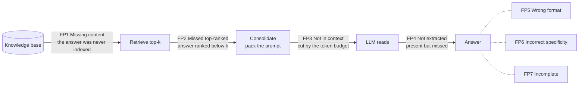
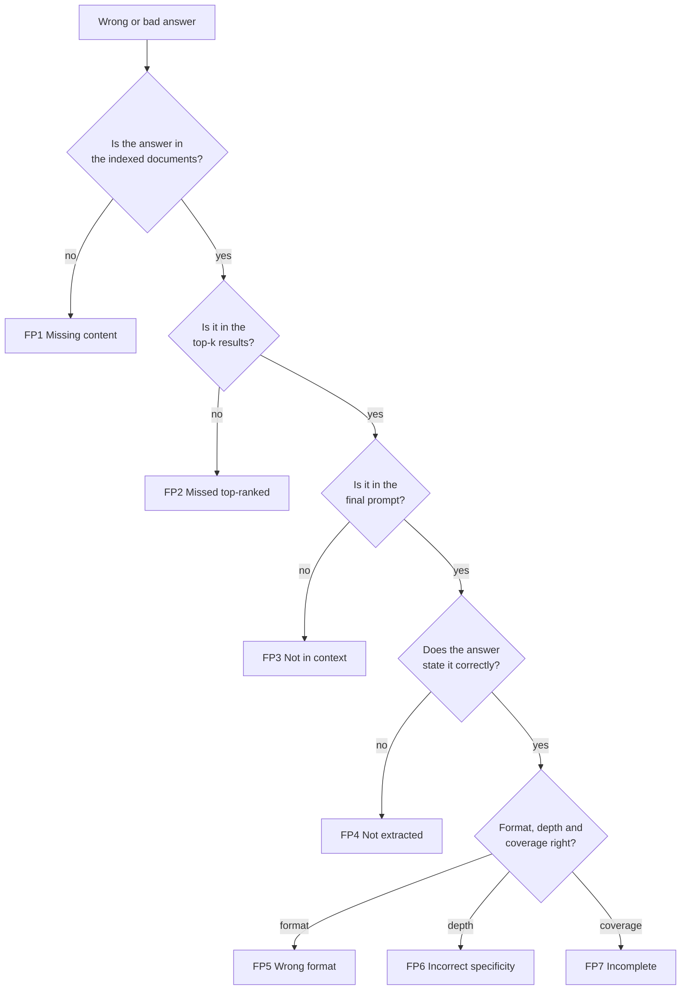

# 16 · Where RAG fails: failure points and how to fix them

**[← 15 Agentic and graph RAG](15-agentic-and-graph-rag.md)** · **[Concepts](README.md)** · **In the course:** every week; [Week 2](../lessons/week02-evals.md) gives you the measurements to tell the failures apart

A RAG demo works on the five questions you tried. Real users then ask question number six, and the system answers it wrongly and confidently. This page lists the ways RAG applications fail, how to tell which failure you have, and the fixes for each one.

The backbone is the paper **"Seven Failure Points When Engineering a Retrieval Augmented Generation System"** (Barnett et al., 2024). Its authors built three RAG systems and catalogued what broke. Section 6 adds the failures the paper doesn't name, collected from the rest of this folder and from practitioners' write-ups.

---

## 1. The map: where each failure happens

A RAG answer passes through a chain of stages, and a failure at any stage loses the answer. The seven failure points (FP) sit at specific stages:



They fall into two groups:

| Group | Failure points | The question it answers | Fix it in |
| --- | --- | --- | --- |
| **Retrieval and context** | FP1, FP2, FP3 | Did the evidence reach the model? | Ingestion, chunking, search, ranking, packing |
| **Generation and extraction** | FP4, FP5, FP6, FP7 | Did the model use the evidence well? | The prompt, the model, the output checks |

The most useful habit on this page: **when an answer is wrong, find out which group failed before changing anything.** Tuning the prompt does nothing for a retrieval failure. A new embedding model does nothing for a generation failure.

## 2. Diagnosing a wrong answer, step by step

For one wrong answer, ask these questions in order. The first "no" is the failure point.



Each question has a cheap check, if you log the right things:

| Question | How to check | What you need to log |
| --- | --- | --- |
| In the documents? | Search the raw text for the gold quote (`grep`) | The source files |
| In the top-k? | Is any retrieved chunk a match for the gold quote? (**recall@k**) | Retrieved chunk ids and text, with scores |
| In the prompt? | Is the gold quote in the prompt that was actually sent? | The final prompt |
| Stated correctly? | Correctness and **faithfulness** against the passages | The answer |

This is why [evaluation](12-evaluation.md#2-evaluate-the-stages-separately) measures retrieval and generation separately: one score per stage tells you which half to fix.

---

## 3. Group 1: retrieval and context failures

### FP1: Missing content

**What happens.** The user asks something the knowledge base doesn't answer.

**Example.**

```text
Question: "What is Acme's refund period?"
Indexed:  bike manuals and warranty pages. No refund policy for Acme.
Bad:      "Acme offers a 30-day refund period."    ← sounds right, is invented
Good:     "I couldn't find this in the documents."
```

**Why it's dangerous.** The ideal answer is "I don't know", but when the question *resembles* indexed topics, retrieval still returns passages that look relevant (a refund policy for a different product, say). The model sees related text and answers from it, or from its training data ([02](02-llm-basics.md#5-why-models-hallucinate)).

**Mitigations.**

| Fix | How it helps | Page |
| --- | --- | --- |
| **A refusal path in the prompt** with an exact sentence ("I couldn't find this in the documents.") | Gives the model permission not to answer, and makes refusals detectable by code | [11](11-grounded-generation.md#6-refusing-honestly) |
| **A score gate** before generation: if even the best passage scores below a threshold, refuse without calling the LLM | Cheap; stops junk retrieval reaching the model. Calibrate the threshold on held-out questions | [11](11-grounded-generation.md#6-refusing-honestly) |
| **Unanswerable questions in the test set** | Without them, a system that never refuses looks perfect | [12](12-evaluation.md#3-building-a-test-set) |
| **Clean, complete source data**: find which topics users ask about and the corpus lacks (from logs of refusals) | The real fix is to add the missing document | [03](03-document-parsing.md) |
| **Routing**: send questions outside the corpus's scope to a different source or a fixed reply | The system knows what it covers | [10](10-query-transformation.md#8-routing-and-self-query) |

**Measure it with** refusal accuracy: refuses unanswerable questions *and* answers answerable ones. Track false refusals too, because a gate set too high refuses questions it could have answered.

### FP2: Missed top-ranked documents

**What happens.** The answer is in the index, but its chunk scored below the top k, so it was cut before reaching the model. Retrieval is capped at k chunks for cost and speed, so anything ranked k+1 or lower is invisible.

**Example.**

```text
Question: "Can I fit a child seat to the Ebb?"
Rank 1: "The Ebb is a cargo bike with a 200 kg payload..."       ← similar words, no answer
Rank 2: "Child seats: compatible models are listed in..."         ← different model
...
Rank 7: "The Ebb accepts rear child seats on the MIK rack."      ← the answer, but k = 5
```

**Why it happens.**

- **Vocabulary mismatch.** The user writes "child seat"; the document says "MIK rack" or a part code. Embeddings miss exact codes and rare names ([07](07-keyword-search-bm25.md)).
- **Bad chunking.** The fact is split across two chunks, or buried in a long chunk about something else, which dilutes its vector ([04](04-chunking.md)).
- **Similar ≠ answers.** Vector search finds text *about* the topic, not text that *answers* the question ([09](09-reranking.md#1-the-problem-similar-isnt-answers-the-question)).
- **The question is vague, conversational, or multi-part** ("and for the other one?").

**Mitigations.**

| Fix | How it helps | Page |
| --- | --- | --- |
| **Hybrid search** (vectors + BM25, fused with RRF) | Keywords catch exact codes, names and numbers that embeddings miss | [08](08-hybrid-search.md) |
| **Retrieve wide, then rerank**: take the top 50, let a cross-encoder pick the best 5 | The answer at rank 7 rises to rank 1 | [09](09-reranking.md#2-the-idea-a-retrieve-then-rerank-funnel) |
| **Query transformation**: rewriting, multi-query, HyDE, decomposition, conversational condensing | Turns the user's wording into the documents' wording | [10](10-query-transformation.md) |
| **Better chunking**: structure-aware splits, headings kept with each chunk, parent/child | Each chunk is about one thing and carries its context | [04](04-chunking.md#4-structure-aware-chunking) |
| **Contextual retrieval**: prepend a short document-level summary to each chunk before embedding | "It's covered for two years" becomes findable as being about the Ebb's battery | [04](04-chunking.md#7-contextual-retrieval) |
| **Metadata filters** (product, date, language) | Narrows the search to the right subset before ranking | [10](10-query-transformation.md#8-routing-and-self-query) |
| **Tune k and the chunk size on your test set** | The best values depend on your documents; measure, don't guess | [12](12-evaluation.md) |
| **A better or fine-tuned embedding model** for a specialised domain | General models can miss domain terms | [05](05-embeddings.md) |

**Measure it with** recall@k and MRR ([metrics explained](../docs/metrics-explained.md)).

### FP3: Not in context (consolidation limits)

**What happens.** The right chunk *was* retrieved, but it was dropped while the prompt was assembled: the token budget ran out, a truncation rule cut it, or de-duplication removed the wrong copy.

**Example.**

```text
Retrieved (after reranking): 12 chunks, 9,000 tokens.
Budget:                      4,000 tokens for passages.
Packer keeps chunks 1–5. The answer was in chunk 6.
```

**Mitigations.**

| Fix | How it helps | Page |
| --- | --- | --- |
| **Rerank before packing**, so the budget is spent on the best chunks | The answer is near the top when the cut happens | [09](09-reranking.md) |
| **Fewer, better chunks** rather than many | Five relevant chunks beat twenty mixed ones on accuracy *and* cost | [11](11-grounded-generation.md#4-context-packing) |
| **De-duplicate and merge neighbours** before counting tokens | Overlap and parent chunks waste budget on copies | [11](11-grounded-generation.md#4-context-packing) |
| **Compress context**: extract only the relevant sentences from each chunk, or summarise | More distinct facts fit in the same budget | [11](11-grounded-generation.md#4-context-packing) |
| **A larger context window** where the cost is acceptable | Raises the budget (but see FP4: more text can also mean more noise) | [02](02-llm-basics.md#2-the-context-window) |

**Measure it with** a check that each gold quote appears in the *final* prompt, not just in the retrieved list. The gap between "retrieved" and "in prompt" is FP3.

---

## 4. Group 2: generation and extraction failures

### FP4: Not extracted

**What happens.** The answer is in the prompt, and the model still doesn't use it. It answers from memory, picks the wrong passage, or says it couldn't find it.

**Why it happens.**

- **Noise.** Many irrelevant passages around the one that matters.
- **Contradictions.** Two passages disagree (an old and a new policy), and the model picks one at random or blends them.
- **Lost in the middle.** Models use the start and end of a long prompt best; a passage in the middle is more often overlooked ([11](11-grounded-generation.md#3-lost-in-the-middle)).
- **Hard phrasing.** The answer is in a table, a footnote or a double negative.

**Example.**

```text
[1] (refunds-2023.md) Refunds are accepted within 30 days.
[2] (refunds-2025.md) From March 2025, refunds are accepted within 14 days.
Answer: "Refunds are accepted within 30 days [1]."    ← used the outdated passage
```

**Mitigations.**

| Fix | How it helps | Page |
| --- | --- | --- |
| **Put the best passage first** (rerank) and send fewer passages | Avoids the middle of the prompt; less noise | [11](11-grounded-generation.md#3-lost-in-the-middle) |
| **Metadata in each passage**: file name, section path, date, chunk number | The model can tell which passage is about what, and which is newer. The paper's case studies found this improved extraction | [03](03-document-parsing.md#6-metadata-keep-where-each-piece-came-from) |
| **Resolve conflicts at index time**: remove superseded documents, or keep a version/date field and filter on it | Old and new policies never meet in one prompt | [14](14-production.md) |
| **Ask the model to quote first, then answer** | Forces it to find the evidence before writing | [11](11-grounded-generation.md#5-citations) |
| **Tables as text with headers repeated per row** | A row is readable on its own | [13](13-multimodal-rag.md#3-tables) |
| **A stronger model, or a larger context window**: the case studies saw better extraction with an 8K window than a 4K one | More capacity to read and reason over the passages | [02](02-llm-basics.md) |
| **Low temperature** | Fewer creative departures from the text | [02](02-llm-basics.md#4-temperature) |

**Measure it with** faithfulness and correctness on questions where you know the evidence was in the prompt. If recall is high and correctness is low, this is your failure.

### FP5: Wrong format

**What happens.** The prompt asks for a list, JSON or a table, and the model returns prose, malformed JSON, or extra text around the JSON. Code that parses the answer breaks.

**Mitigations.**

| Fix | How it helps |
| --- | --- |
| **Structured output** (the API's JSON schema / tool-call mode) instead of asking in words | The output is constrained to the schema |
| **Validate, then retry once** with the validation error in the prompt | Catches the rare bad output without failing the request |
| **An example of the exact format** in the prompt | Models copy examples more reliably than they follow descriptions |
| **Parse leniently** where possible (strip code fences, find the first `{`) | Tolerates harmless wrapping |

**Measure it with** the parse-failure rate per format.

### FP6: Incorrect specificity

**What happens.** The answer is right but at the wrong level of detail: too general ("check the warranty terms") or too specific (a page of clauses when the user wanted yes or no). The paper saw this in tutoring, where students needed a step-by-step explanation, not the bare answer.

**Why it happens.** The question is ambiguous, or the right depth depends on who's asking and why, and the prompt doesn't say.

**Mitigations.**

| Fix | How it helps | Page |
| --- | --- | --- |
| **State the audience and the depth** in the system prompt ("answer in 2–3 sentences for a customer", "explain step by step for a student") | The model knows what "a good answer" means here | [11](11-grounded-generation.md#2-anatomy-of-a-grounded-prompt) |
| **Ask a clarifying question** when the query is ambiguous | Avoids guessing the intent | [15](15-agentic-and-graph-rag.md) |
| **Step-back prompting** for questions that need the general principle first | Retrieves the background as well as the detail | [10](10-query-transformation.md#6-step-back-prompting) |
| **Route by question type** to different prompt templates (a lookup, a how-to, a comparison) | Each type gets its own expected length and shape | [10](10-query-transformation.md#8-routing-and-self-query) |

**Measure it with** an LLM judge using a rubric that scores the depth, and with user feedback ("too long", "not detailed enough").

### FP7: Incomplete answer

**What happens.** The answer is correct but leaves out facts that were in the passages. This is common for multi-part questions ("Compare the warranty, weight and price of the three models").

**Mitigations.**

| Fix | How it helps | Page |
| --- | --- | --- |
| **Decompose the question** into sub-questions, retrieve and answer each, then combine | Each part gets its own retrieval and its own attention | [10](10-query-transformation.md#7-decomposition-sub-questions) |
| **Agentic retrieval** for multi-hop questions, where a later search depends on an earlier answer | The system keeps searching until it has every part | [15](15-agentic-and-graph-rag.md) |
| **Ask for a checklist answer**: "address each part of the question; say if a part isn't covered" | The model accounts for every part | [11](11-grounded-generation.md) |
| **Enough retrieval per part**: a single top-5 can't cover three products | Retrieval budget scales with the number of parts | [09](09-reranking.md) |

**Measure it with** a rubric of key points per reference answer, scoring the share covered (answer recall).

---

## 5. Lessons from the paper's case studies

The authors tested these failure points on three systems:

| System | Domain | What it indexed |
| --- | --- | --- |
| **Cognitive Reviewer** | Research | Scientific papers, for literature reviews |
| **AI Tutor** | Education | A university course's PDFs, web pages and video transcripts (Whisper) |
| **BioASQ** | Biomedical | 4,017 papers, evaluated with 1,000 domain questions |

Their main lessons:

1. **Metadata helps extraction (FP2, FP4).** Adding the file name and chunk number to each passage in the prompt improved answers.
2. **Larger context windows helped (FP4).** Moving from a 4K to an 8K context window improved extraction.
3. **Semantic caching cuts cost and latency.** A cache of answers to frequent questions, matched by meaning rather than exact text, avoids repeated LLM calls and helps with rate limits ([14](14-production.md#3-caching-at-every-layer)). Cached answers must be invalidated when the documents change.
4. **Testing must continue after launch.** A RAG system's quality is only known at run time, because users ask questions nobody anticipated. Offline tests before launch aren't enough: log real questions, review failures, and feed them back into the test set ([12](12-evaluation.md#8-offline-and-online)).
5. **Validation happens during operation.** The robustness of a RAG system evolves rather than being designed in at the start.

---

## 6. Failures beyond the seven

The paper's list is about one question and one answer. Real applications fail in other ways too. Wenqi Glantz's "12 RAG Pain Points" adds five (the ones marked ✚), and the rest come from the pages of this folder.

### 6.1 Ingestion and data

| Failure | What happens | Mitigation | Page |
| --- | --- | --- | --- |
| **Bad parsing** ✚ | Tables come out as jumbled numbers; PDFs lose reading order; scans have no text layer | Layout-aware parsers; OCR for scans; table-specific handling; check samples of parsed text | [03](03-document-parsing.md), [13](13-multimodal-rag.md) |
| **Boilerplate and duplicates** | Menus, cookie banners and copies of the same page crowd out real content in search results | Strip boilerplate; de-duplicate by hash or near-duplicate detection | [03](03-document-parsing.md#7-de-duplication) |
| **Stale or conflicting documents** | Old policies stay in the index beside new ones | Incremental re-indexing on change; delete superseded versions; date metadata and filters | [14](14-production.md#5-ingestion-at-scale) |
| **Ingestion doesn't scale** ✚ | Indexing millions of documents is slow or runs out of memory | Batching, parallel workers, incremental updates, approximate (ANN) indexes | [06](06-vector-search.md), [14](14-production.md#5-ingestion-at-scale) |
| **Non-text content ignored** | Images, diagrams, audio and video hold the answer but were never indexed | OCR, vision-model descriptions, transcripts, keyframes | [13](13-multimodal-rag.md) |

### 6.2 Retrieval

| Failure | What happens | Mitigation | Page |
| --- | --- | --- | --- |
| **Questions over structured data** ✚ | "What's the average price of models over 30 kg?" Chunk retrieval can't compute an average | Text-to-SQL over tables loaded into a database; route numeric questions there | [13](13-multimodal-rag.md#3-tables), [10](10-query-transformation.md#8-routing-and-self-query) |
| **Multi-hop questions** | The second search depends on the first answer ("the warranty of the bike that won the 2024 award") | Agentic retrieval; knowledge graphs; GraphRAG for whole-corpus questions | [15](15-agentic-and-graph-rag.md) |
| **Follow-up questions** | "And the frame?" means nothing without the conversation | Condense the conversation into a standalone question before searching | [10](10-query-transformation.md#3-conversational-condensing) |
| **Chunks without context** | "It is covered for two years" doesn't say what "it" is | Headings in each chunk; contextual retrieval; parent/child | [04](04-chunking.md) |

### 6.3 Generation and trust

| Failure | What happens | Mitigation | Page |
| --- | --- | --- | --- |
| **Wrong citations** | The answer cites [2], but [2] doesn't support the sentence | Citation checks: valid ids, lexical overlap, NLI, LLM judge | [11](11-grounded-generation.md#5-citations) |
| **Embellishment** | Correct facts plus invented details ("...by bank transfer") | Strict grounding rules; faithfulness checks claim by claim | [11](11-grounded-generation.md#7-hallucination-kinds-and-checks) |
| **Prompt injection through documents** ✚ | A retrieved page says "ignore previous instructions..." and the model obeys | Treat passages as data; delimit them; no dangerous tools; control what gets indexed | [11](11-grounded-generation.md#8-prompt-injection-through-documents) |
| **Permission leaks** | A user gets an answer drawn from a document they aren't allowed to see | Filter by access rights *at retrieval time*, not after generation | [14](14-production.md#7-security-and-permissions) |

### 6.4 Operations

| Failure | What happens | Mitigation | Page |
| --- | --- | --- | --- |
| **Slow answers** | Several model calls, reranking and long prompts add up to many seconds | Stream the answer; cache embeddings, retrievals and answers; rerank fewer candidates | [14](14-production.md#1-where-the-time-goes) |
| **Cost grows with traffic** | Long prompts × many questions | Fewer, better passages; prompt caching; smaller models for easy steps | [14](14-production.md#4-cost-per-answer) |
| **Provider outages and rate limits** ✚ | The LLM API fails or throttles | Retries with backoff; a fallback model; semantic cache | [14](14-production.md#8-reliability) |
| **Silent quality drift** | New documents, a new model version or a changed prompt degrades answers, and no one notices | Run the test set on every change; trace every request; watch online feedback | [12](12-evaluation.md), [14](14-production.md#6-observability-tracing) |

---

## 7. The cheat sheet

| Failure | Typical symptom | Metric that shows it | First fixes to try |
| --- | --- | --- | --- |
| FP1 Missing content | Confident answer to a question the documents don't cover | Refusal accuracy on unanswerable questions | Refusal instruction, score gate, add the missing documents |
| FP2 Missed top-ranked | "I couldn't find it" although the document exists | recall@k, MRR | Hybrid search, reranking, query rewriting, better chunks |
| FP3 Not in context | Retrieved but missing from the prompt | Gold-in-prompt rate vs recall@k | Rerank before packing, de-duplicate, compress |
| FP4 Not extracted | Evidence in the prompt, wrong answer | Faithfulness, correctness at high recall | Fewer passages, best first, metadata, resolve conflicts |
| FP5 Wrong format | Parser errors | Parse-failure rate | Structured output, validate and retry |
| FP6 Wrong specificity | "Too vague" / "too long" feedback | Rubric-based judge, user feedback | State audience and depth, clarifying questions |
| FP7 Incomplete | Parts of a multi-part question missing | Key-point coverage | Decompose, agentic retrieval, checklist prompt |

## 8. Common mistakes

- **Fixing before diagnosing.** Changing the embedding model when the answer was retrieved and then ignored (FP4), or rewriting the prompt when it was never retrieved (FP2).
- **Only logging the final answer.** Without the retrieved chunks and the final prompt, you can't tell FP2, FP3 and FP4 apart.
- **No unanswerable questions in the test set**, so FP1 is invisible until a user finds it.
- **Raising k "to be safe".** It fixes some FP2 cases and creates FP3 (budget) and FP4 (noise) cases.
- **Testing only before launch.** The questions that break the system are the ones nobody wrote down; keep collecting them from real use.

## 9. In raggy

Most weeks of the course remove one of these failures, and measure the result:

| Failure | Where raggy addresses it |
| --- | --- |
| FP1 | [Week 8](../lessons/week08-grounded-generation.md): the refusal sentence and the calibrated score gate; [Week 2](../lessons/week02-evals.md): unanswerable questions in the test set |
| FP2 | [Week 4](../lessons/week04-chunking.md) chunking, [Week 6](../lessons/week06-hybrid-search.md) hybrid search, [Week 7](../lessons/week07-rerank-and-query-transforms.md) reranking and query transforms |
| FP3, FP4 | [Week 8](../lessons/week08-grounded-generation.md): context packing (`raggy/generate/pack.py`) and passages labelled with their source |
| Wrong citations | [Week 8](../lessons/week08-grounded-generation.md): citation checks (`raggy/generate/verify.py`) |
| Parsing, multimodal | [Week 3](../lessons/week03-ingestion.md), [Weeks 9–11](../lessons/week09-rich-documents.md) |
| Scale, cost, security | [Week 5](../lessons/week05-scale.md), [Week 12](../lessons/week12-production.md) |
| Multi-hop, FP7 | [Bonus](../lessons/bonus-agentic-and-graph-rag.md): agentic and graph RAG |
| Telling them apart | [Week 2](../lessons/week02-evals.md) and the [evaluating RAG guide](../docs/evaluating-rag.md): retrieval and answer metrics, measured separately |

## 10. Further reading

| Read | Why |
| --- | --- |
| [Seven Failure Points When Engineering a Retrieval Augmented Generation System](https://arxiv.org/abs/2401.05856), Barnett et al. (2024) | The source of FP1–FP7 and the case-study lessons |
| [12 RAG Pain Points and Proposed Solutions](https://towardsdatascience.com/12-rag-pain-points-and-proposed-solutions-43709939a28c), Wenqi Glantz (2024) | The seven failure points plus five more, each with practical fixes |
| [Lost in the Middle](https://arxiv.org/abs/2307.03172), Liu et al. (2023) | Why passage position matters (FP4) |
| [The Power of Noise: Redefining Retrieval for RAG Systems](https://arxiv.org/abs/2401.14887), Cuconasu et al. (2024) | How irrelevant and distracting passages affect answers (FP4) |
| [Corrective Retrieval Augmented Generation (CRAG)](https://arxiv.org/abs/2401.15884), Yan et al. (2024) | Grade retrieval quality and correct it before answering (FP1, FP2) |
| [Self-RAG](https://arxiv.org/abs/2310.11511), Asai et al. (2023) | A model that decides when to retrieve and critiques its own output |
| [Introducing Contextual Retrieval](https://www.anthropic.com/news/contextual-retrieval) (Anthropic) | Chunk context plus hybrid search and reranking, with measured gains in retrieval (FP2) |
| [RAGAS](https://arxiv.org/abs/2309.15217), Es et al. (2023) | Metrics that separate retrieval failures from generation failures |
| [Reduce hallucinations](https://docs.anthropic.com/en/docs/test-and-evaluate/strengthen-guardrails/reduce-hallucinations) (Anthropic docs) | Allowing "I don't know", quoting first, citing (FP1, FP4) |
