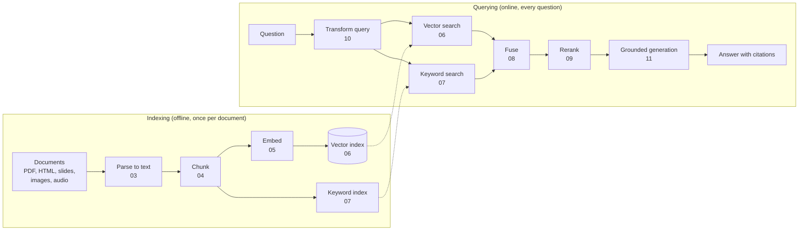

# RAG concepts, from the ground up

**[← Repository Home](../README.md)** · **[Course Plan](../COURSE_PLAN.md)** · **[Docs hub (raggy guides)](../docs/README.md)**

The weekly lessons teach raggy's code, and the [docs hub](../docs/README.md) explains raggy's design choices. **This folder teaches the general ideas**, with no raggy code required: what each technique is, why it exists, how it works inside, worked examples you can check by hand, diagrams, and links for further reading.

Read a concept page *before* the week that uses it. Each page stands alone.

---

## The whole picture on one page

The numbers are the concept pages below. Evaluation (12) measures every box; production (14) is about running the whole thing fast, cheaply and safely; agentic and graph RAG (15) turn the one-way pipeline into a loop; and 16 maps where each box can fail and how to fix it.

## Reading order

| # | Concept | What you'll understand | Used in raggy |
| --- | --- | --- | --- |
| 01 | [What is RAG?](01-what-is-rag.md) | Why LLMs need retrieval; RAG vs fine-tuning vs long context; the two phases; where RAG fails | Week 1 |
| 02 | [LLM basics for RAG](02-llm-basics.md) | Tokens, context windows, how generation works, temperature, why models hallucinate, what you pay for | Week 1 |
| 03 | [Document parsing](03-document-parsing.md) | What's really inside a PDF, HTML boilerplate, OCR, tables, normalisation, de-duplication | Weeks 3, 9 |
| 04 | [Chunking](04-chunking.md) | Why split documents; fixed, recursive, structural and semantic splitting; overlap; parent/child; contextual retrieval | Week 4 |
| 05 | [Embeddings](05-embeddings.md) | How text becomes a vector; how embedding models are trained; pooling, normalisation, query prefixes; choosing a model | Week 1 |
| 06 | [Vector similarity and search](06-vector-search.md) | Cosine, dot product and distance worked by hand; exact search; IVF, HNSW and quantisation; vector databases | Weeks 1, 5 |
| 07 | [Keyword search and BM25](07-keyword-search-bm25.md) | Inverted indexes; TF-IDF; BM25 worked by hand; why keywords still matter; learned sparse retrieval | Week 6 |
| 08 | [Hybrid search and rank fusion](08-hybrid-search.md) | Why combine vectors and keywords; score normalisation; reciprocal rank fusion worked by hand | Week 6 |
| 09 | [Reranking and cross-encoders](09-reranking.md) | The retrieve-then-rerank funnel; bi-encoders vs cross-encoders vs ColBERT; LLM rerankers; costs | Week 7 |
| 10 | [Query transformation](10-query-transformation.md) | Rewriting, multi-query, HyDE, step-back, decomposition, conversational condensing, routing | Week 7 |
| 11 | [Grounded generation](11-grounded-generation.md) | Prompt anatomy, context packing, lost-in-the-middle, citations, refusals, hallucination checks | Week 8 |
| 12 | [Evaluating RAG](12-evaluation.md) | Test sets, retrieval vs answer metrics, LLM-as-judge and its biases, RAGAS, noise and significance | Week 2, every week |
| 13 | [Multimodal RAG](13-multimodal-rag.md) | Images (OCR, vision models, CLIP, ColPali), tables, audio (speech-to-text), video | Weeks 9–11 |
| 14 | [RAG in production](14-production.md) | Latency, streaming, caching layers, cost per answer, tracing, security and permissions | Week 12 |
| 15 | [Agentic and graph RAG](15-agentic-and-graph-rag.md) | Agents and ReAct, Self-RAG and CRAG, multi-hop questions, knowledge graphs, GraphRAG | Bonus |
| 16 | [Where RAG fails](16-failure-modes.md) | The seven failure points (missing content to incomplete answers), diagnosing a wrong answer stage by stage, the fixes for each, and failures beyond the seven | Every week |

Also: **[RAG metrics, explained with examples](../docs/metrics-explained.md)**, the long worked guide to recall@k, MRR, nDCG, faithfulness and the rest.

## Glossary

| Term | Meaning | Page |
| --- | --- | --- |
| **ANN** | Approximate nearest neighbour search: finds *almost* the closest vectors, much faster than checking all | 06 |
| **BM25** | The standard keyword-ranking formula: rewards rare query words, with diminishing returns for repeats | 07 |
| **Bi-encoder** | A model that turns query and passage into vectors *separately*; fast, used for first-stage retrieval | 05, 09 |
| **Chunk** | A piece of a document small enough to embed and to put in a prompt | 04 |
| **Citation** | A marker in the answer, such as `[2]`, pointing at the passage that supports a claim | 11 |
| **Context window** | The maximum number of tokens an LLM can read and write in one call | 02 |
| **Cosine similarity** | The angle between two vectors: 1 means same direction, 0 unrelated | 06 |
| **Cross-encoder** | A model that reads query and passage *together* and outputs one relevance score; precise but slow | 09 |
| **Embedding** | A list of numbers (a vector) representing the meaning of a text | 05 |
| **Faithfulness** | Whether every claim in the answer is supported by the retrieved passages | 11, 12 |
| **Grounding** | Making the model answer *from the given passages*, not from memory | 11 |
| **Hallucination** | A fluent, confident statement that is false or unsupported | 02, 11 |
| **HNSW** | A graph-based ANN index: hop from neighbour to neighbour towards the query | 06 |
| **HyDE** | Search with an LLM-written *fake answer* instead of the question | 10 |
| **Hybrid search** | Combining vector search and keyword search | 08 |
| **Inverted index** | A map from each word to the documents containing it; the core of keyword search | 07 |
| **LLM-as-judge** | Using an LLM to grade answers against a rubric | 12 |
| **MRR** | Mean reciprocal rank: 1/(rank of the first relevant result), averaged | 12 |
| **Multi-hop** | A question that needs several facts, where a later search depends on an earlier result | 15 |
| **Recall@k** | The share of the relevant passages that appear in the top k results | 12 |
| **Reranker** | A second, more precise model that reorders the top candidates | 09 |
| **RRF** | Reciprocal rank fusion: merge rankings by summing 1/(k + rank) | 08 |
| **Token** | The unit an LLM reads and writes: about ¾ of an English word | 02 |
| **Top-k** | The k highest-ranked results kept from a search | 06 |

## How each page is laid out

1. **The problem**: what goes wrong without this idea.
2. **The idea**: in plain words, usually with a picture.
3. **How it works**: the mechanism, with a worked example small enough to check by hand.
4. **Variants and trade-offs**: the family of techniques, and when each one fits.
5. **Common mistakes**.
6. **In raggy**: where the idea appears in the course, for when you're ready for the code.
7. **Further reading**: papers, blog posts and docs, with a note on what each one is good for.
