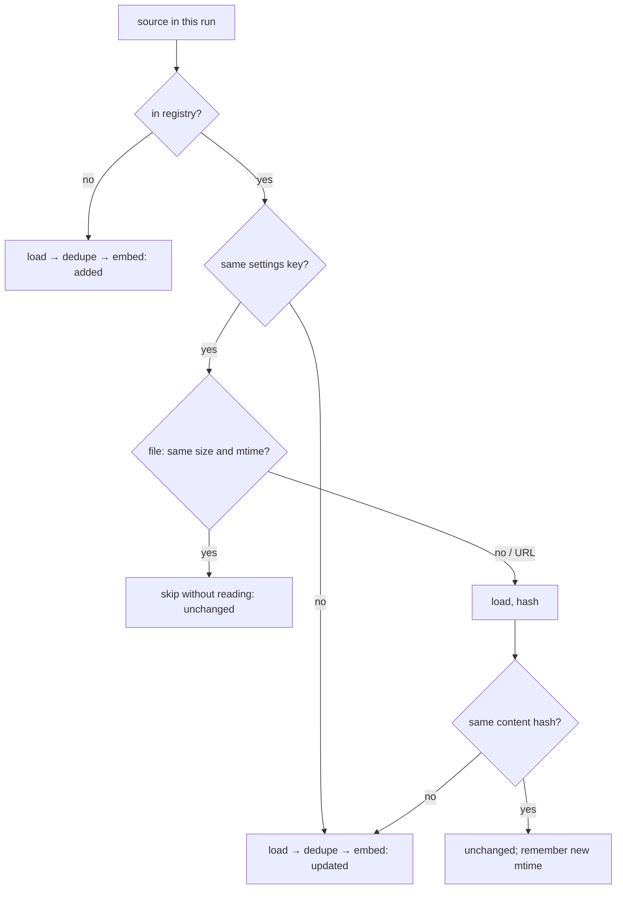

# Ingestion: getting clean text in, once

**[← Docs hub](README.md)** · **[Week 3 lesson](../lessons/week03-ingestion.md)**

> **New to the ideas?** The general concepts behind this page, with diagrams, worked examples and reading links: [03 Document parsing](../concepts/03-document-parsing.md).

This guide sits beside week 3. The lesson walks through raggy's code. This page explains the ideas underneath: why boilerplate hurts retrieval, what normalisation is for, how MinHash finds near-copies, and how incremental re-ingest decides what to do with each file. Numbers marked *computed* were printed by raggy's own functions.

---

## 1. Why the text you embed matters more than it looks

An embedding turns a whole chunk into one vector. Everything in the chunk pulls on that vector, not just the part you care about. A chunk that is 30% article and 70% menu, cookie banner and footer has a vector that's mostly about menus, cookie banners and footers.

That causes two failures:

- **Dilution.** The useful 30% is outvoted, so the chunk ranks lower for a question it does answer.
- **Look-alikes.** The same footer appears on every page, so every page grows a chunk that is almost nothing *but* footer. For a vague question, these near-identical chunks can fill the top-k by themselves. In the week 3 eval, the four chunks retrieved for "What is the lightest adult bike…?" were all footer chunks, from four different pages.

Main-content extraction removes the page around the article before chunking. On the `fictional-web` suite, extraction plus dedupe raised recall@4 from 0.758 to 0.939 (see the lesson, section 6).

### How main-content extractors decide

Trafilatura (and its relatives readability, jusText and boilerpipe) mix structural rules with text statistics:

- **Markup hints.** `<article>`, `<main>` and content-like class names are kept. `<nav>`, `<footer>`, `<aside>` and cookie or ad classes are dropped.
- **Link density.** Text that is mostly link text (menus, tag clouds, "related posts") is boilerplate.
- **Text density.** Long runs of sentences with punctuation are content. Short fragments are not.
- **Fallbacks.** When the main pass finds too little text, a second algorithm is tried.

It's a heuristic, so it can be wrong in both directions: it can keep a sidebar, or drop a short paragraph it took for boilerplate. That's why raggy keeps `RAGGY_HTML_EXTRACT=full` as a switch, and why the `fictional-web` test checks that every gold quote survives extraction.

## 2. Normalisation: one kind of text

Different loaders produce different "spellings" of the same text:

| Problem | Example | Rule |
| --- | --- | --- |
| Compatibility characters | `fi` ligature in a PDF, full-width digits | Unicode NFKC turns them into plain `fi`, `1` |
| Invisible characters | soft hyphen `U+00AD`, zero-width space `U+200B`, BOM | deleted |
| Line endings | `\r\n` from Windows, `\r` from old Macs | `\n` |
| Runs of spaces | `a   b` | one space, but **leading indentation is kept** (it is meaning in code and lists) |
| Blank-line runs | five empty lines | at most one blank line |
| Words split by a PDF | `exam-\nple` | joined, lower-case on both sides only (the PDF loader only) |

*Computed:* `normalize_text("Office hours:​  9–5\r\n\r\n\r\n\r\n    indented  code")` → `'Office hours: 9–5\n\n    indented code'`.

Normalisation runs before hashing as well as before chunking, so two copies that differ only in invisible characters get the same content hash and count as one document.

`NORMALIZE_VERSION` is part of the registry's settings key. Change a rule and bump it, and every source is re-indexed on the next ingest. Without that, the index would hold a mix of old-rule and new-rule text.

## 3. Duplicates: exact, then near

**Exact copies** are easy: hash the normalised text (SHA-256) and compare.

**Near copies** are the common case: an archived version with one changed price, a print view, the same article under a second URL with a different template. For these you need a *similarity*, and the standard one for documents is the **Jaccard similarity of shingles**.

### Shingles and Jaccard

A shingle is a run of *w* consecutive words (raggy uses *w* = 5). A document becomes the *set* of its shingles. Two documents' similarity is

> J(A, B) = |A ∩ B| / |A ∪ B|

*Computed* for two 20-word sentences that differ in one number (`costs 35 credits` vs `costs 30 credits`): each has 16 shingles, 11 are shared, the union is 21, so **J = 0.524**. One changed word breaks every shingle that contains it, which is up to 5. On a 20-word text that's a third of the shingles.

So shingle Jaccard is harsh on short texts. That's why raggy only checks near-duplicates for documents of at least 50 words (`MIN_WORDS`). Shorter ones are matched exactly or not at all. On a 155-word page, the same one-word change still leaves J ≈ 0.94, safely above the 0.9 threshold.

### MinHash: estimating J without comparing sets

Comparing every pair of documents' shingle sets is O(n²) in documents and expensive per pair. MinHash compresses each set into a short **signature**:

1. Pick a random hash function *h*. For a set S, record the shingle with the smallest *h* value, min_h(S).
2. Key fact: **P[min_h(A) = min_h(B)] = J(A, B)**. The smallest hash in A ∪ B is equally likely to be any element, and the two minimums match exactly when that element is in both sets.
3. Repeat with 128 independent hash functions. The fraction of positions where the two signatures agree estimates J, with a standard error of about √(J(1−J)/128): ±0.027 at J = 0.9.

"Independent" is the word that matters. raggy's hash functions are h(x) = (a·x + b) mod p. In the first version, p was 2⁶¹−1 and a and x were 32-bit numbers, so a·x was rarely larger than p and the modulo almost never wrapped. All 128 functions then ordered shingles in nearly the same way, so their minimums agreed or disagreed together. The estimate looked like it came from a handful of hashes: errors up to 0.27, on pages whose true similarity was 0.92. The fix was p = 2³¹−1 with a and b drawn below p, so the product wraps about 2³¹ times and still fits in 64 bits. `test_minhash_estimate_is_accurate` now measures the estimator's spread on 60 synthetic pairs and fails above 0.05. The lesson for any randomised algorithm: test the *statistics*, not just one example.

### LSH: only compare likely pairs

Even with signatures, comparing every pair is O(n²). **Locality-sensitive hashing** splits each 128-number signature into 16 *bands* of 8 numbers and buckets documents by each band. Two documents become *candidates* if any band matches exactly:

> P(candidate) = 1 − (1 − s⁸)¹⁶

| true similarity s | 0.3 | 0.5 | 0.7 | 0.8 | 0.85 | 0.9 |
| --- | --- | --- | --- | --- | --- | --- |
| P(candidate), *computed* | 0.001 | 0.061 | 0.613 | 0.947 | 0.994 | 1.000 |

The curve is an S with its steep part between 0.7 and 0.85. Pairs above the 0.9 threshold are almost always compared, and pairs below 0.5 almost never. Candidates are then checked against the signature estimate (≥ 0.9). *Computed:* finding duplicates among all 5,183 SciFact abstracts takes 1.1 s (there are none).

### Which copy to keep

raggy keeps the copy with the **shortest source path** (ties go alphabetically), on the guess that `returns.html` is canonical and `archive/2025/returns.html` is not. Across runs, the first-registered copy stays canonical. When a canonical copy is deleted or changes, its duplicates are re-examined in the same run, so their content never silently leaves the index.

The threshold is a trade-off. At 0.9, an archived page that differs in one price is dropped as a duplicate. If the archive is what you wanted to search, that's a loss. Set `RAGGY_DEDUPE=0` to index everything.

## 4. Incremental re-ingest as a decision table

Each source gets one row in a SQLite registry: content hash, size, mtime, the settings key it was indexed with, its MinHash signature and `duplicate_of`. On each ingest, every source falls into one case:

Three rules make it safe:

1. **Store first, registry second.** The vector store is saved, then the registry transaction is committed. If the process dies in between, the registry still describes the old state and the next run redoes the work. The opposite order could record a document as indexed when its chunks were never saved.
2. **Settings are part of identity.** The key holds the embedder, chunk size and overlap, the HTML mode, the normalisation version and the dedupe switch. A file whose bytes didn't change but whose chunks *would* change is re-indexed.
3. **"Deleted" means missing from a folder that was walked.** A file gone from `docs/` while `docs/` itself exists is removed from the index. A target that doesn't exist at all (a typo, an unmounted drive) removes nothing, and `raggy remove` is the explicit way to drop it. Nothing in raggy ever deletes or modifies your files.

The size-and-mtime shortcut is why an unchanged re-run is fast (*measured:* 0.22 s for 12 files, against 3.1 s for the first ingest). It can be fooled by a tool that rewrites a file with the same size and an old mtime, which is rare. `raggy ingest --full` re-reads and re-hashes everything.

## Further reading

- A. Broder, "On the resemblance and containment of documents" (1997): MinHash.
- J. Leskovec, A. Rajaraman, J. Ullman, *Mining of Massive Datasets*, chapter 3: shingling, MinHash and LSH, with the S-curve.
- A. Barbaresi, "Trafilatura: A Web Scraping Library and Command-Line Tool for Text Discovery and Extraction" (ACL 2021 demo).
- K. Lee et al., "Deduplicating Training Data Makes Language Models Better" (2021): near-duplicate removal at scale, and what duplicates cost.
