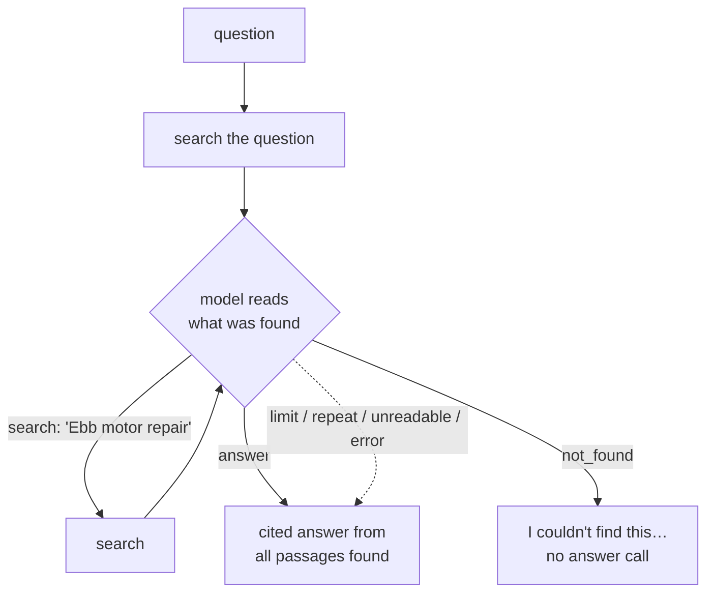

# Bonus week: Agentic and graph RAG — when one search isn't enough

**[← Week 12: Production](week12-production.md)** · **[Course Plan](../COURSE_PLAN.md)** · **[Agentic and graph RAG (guide)](../docs/agentic-and-graph-rag.md)**

---

**Time:** about 4 hours (1 reading, 1.5 reading and running the code, 1.5 on the experiments).
**Code for this week:** `git checkout bonus`
**Companion guide:** [`docs/agentic-and-graph-rag.md`](../docs/agentic-and-graph-rag.md): why multi-hop questions defeat single-pass retrieval, the retrieval loop, and how GraphRAG approaches the same problem from the index side.

**You're done when:**

1. `uv run pytest` passes (offline, no keys needed),
2. you've run `raggy ask "Which partner service centre can work on the motor of the bike whose box seats two children?" --agent` and read its list of searches, and
3. you can explain why the second search couldn't have been written before the first one ran.

## 1. Read first

| Read | Look for |
| --- | --- |
| [harnessy, week 2: The agent loop](https://github.com/krishankant/harnessy/blob/main/lessons/week2-agent-loop.md) | The loop this week reuses: call the model, run what it asks for, show it the result, repeat, and stop on purpose. |
| [ReAct](https://arxiv.org/abs/2210.03629) (Yao et al., 2022) | Reason, act, observe. Here, "act" is always a search. |
| [Interleaving Retrieval with Chain-of-Thought](https://arxiv.org/abs/2212.10509) (Trivedi et al., 2022): IRCoT | Retrieval guided by what the model learned so far, on multi-hop QA. |
| [From Local to Global: A GraphRAG Approach](https://arxiv.org/abs/2404.16130) (Edge et al., 2024) | The index-side alternative: entities, relations and community summaries. Note what it costs to build. |

## 2. The question one search can't answer

> "Which partner service centre can work on the motor of the bike whose box seats two children?"

The answer needs two facts from two documents:

1. `bike-models.md`: the Ebb E-Cargo has "a box that seats two children".
2. `service-centres.md`: Saltmarsh "is the only service centre that works on the Ebb E-Cargo's motor".

A single search embeds the whole question. It probably finds passage 1, because the question describes it closely. But passage 2 never says "two children"; it says "Ebb E-Cargo". The link between them is a **bridge entity** ("Ebb E-Cargo") that appears in neither the question nor the passage the question resembles. It's learned from the first result.

Twelve weeks made single-pass retrieval good. No ranking can fix a passage the query doesn't describe. The search itself has to change, after reading.

## 3. The loop



This is harnessy's week 2 agent loop with one tool. The model can only search, answer or give up.

| File | Lines | What it does |
| --- | --- | --- |
| `agent.py` | 132 | `run_agent`: search the question, then up to `RAGGY_AGENT_STEPS − 1` model-chosen searches; `parse_action`; `AgentResult` with every search, the passages, and why it stopped |
| `pipeline.py` | +12 | `ask` uses the loop when `RAGGY_AGENT=on` |
| `evals/runner.py` | +30 | With the agent on, the scored passages are what its searches gathered; each question records its searches and stop reason |
| `cli.py` | +15 | `raggy ask --agent`, which prints the searches |
| `evals/multihop/` | 15 questions | Twelve two-document questions and three unanswerable ones, over the fictional corpus |

## 4. Walkthrough

### 4.1 Decisions as JSON, not native tool calls

Claude, OpenAI and Ollama each have a native tool-calling format, and harnessy week 3 builds adapters for them. This loop needs one tool and three decisions, so it asks for JSON in plain text:

```json
{"action": "search", "query": "service centre Ebb E-Cargo motor"}
{"action": "answer"}
{"action": "not_found"}
```

That runs unchanged through raggy's one-method LLM interface (`complete`), on every provider, including small local models and the fake model in tests. `parse_action` reuses week 2's `parse_json_object`, which finds the first JSON object in a reply, so code fences and chatter around it don't matter.

### 4.2 What the model sees

Each decision prompt holds the question, the searches made so far, and the passages found so far (numbered, with their sources, each cut to 700 characters). The system prompt says: answer when the passages hold everything, otherwise search for the missing fact *using names the passages taught you*, and never repeat a search. That second rule is the whole point. It's how "the bike whose box seats two children" becomes a search for "Ebb E-Cargo".

### 4.3 The first search is free

The loop always starts by searching the question itself, without asking the model. Most questions are answered by it (every question in the earlier suites is single-hop), so the model's first decision is usually just "answer". Turning the agent on therefore costs one short extra call for most questions, not a full extra round of searching.

### 4.4 Stopping on purpose

harnessy's rule: an agent loop must end for a reason you can name. Here, `stopped` is one of:

| Reason | When | Answer |
| --- | --- | --- |
| `answer` | The model says it has enough | From all passages found |
| `not_found` | The model says the documents don't cover it | The refusal sentence, with no answer call |
| `limit` | `RAGGY_AGENT_STEPS` searches made (4) | From what it has |
| `repeat` | It asked for a search it already made | From what it has |
| `unreadable` | The reply wasn't a decision (counted as a failure) | From what it has |
| `error` | The decision call failed (counted as a failure) | From what it has |

Only `not_found` refuses. Every other ending still answers from what was gathered, so a confused model never costs the user an answer the first search already supported. Passages are de-duplicated across searches, and capped at 12.

### 4.5 The answer step doesn't change

The final answer goes through the same `answer_from` as always. Citations, the week 8 citation check, the refusal prompt and the week 12 answer cache all still apply. The agent decides only *what to read*.

## 5. The numbers

The `multihop` suite and the rule below were written before any run. Per the brief for this final release, the measurement wasn't run here. By the rule, **`RAGGY_AGENT` stays off by default**.

The rule, set before any run: the agent becomes the default if, on `multihop`, recall@10 over the gathered passages rises by at least 0.10 and correctness rises by more than the run-to-run noise (week 8: about 0.06, so run twice), *and* the earlier fictional suites don't lose correctness. Its extra cost (one decision call per question, plus one per extra search) is reported alongside.

To measure it:

```bash
uv run raggy eval --suite multihop --label single                 # one search, top 4
RAGGY_AGENT=on uv run raggy eval --suite multihop --label agent
RAGGY_TOP_K=8  uv run raggy eval --suite multihop --label single-k8   # the fair baseline: see below
RAGGY_AGENT=on uv run raggy eval --suite fictional --label agent     # does it hurt single-hop questions?
```

**A trap in the comparison** (week 4's rule: compare at equal context, holding constant what you don't mean to change). The agent's context is every passage it gathered, often 6–8, while single-pass gives the model 4. Some of any gain is just *more context*. The `single-k8` run gives single-pass the same amount of context. The agent's real gain is the difference between `agent` and `single-k8`, not between `agent` and `single`. The runs record `context_tokens`, so you can check that the sizes match.

What to expect, from how the suite is built:

- **recall@4 for single-pass is near 0.5:** it usually finds the passage the question describes, and misses the bridge.
- **The agent should find the second passage** when the first one names the bridge entity: "Ebb", "Kestrel", "Saltmarsh".
- **The unanswerable questions** (a battery for a bike that has none, a manager the documents never name) test the `not_found` path. They also test whether the agent searches until it finds something vaguely related and then answers from that.

## 6. Graph RAG, briefly

GraphRAG attacks the same problem from the other end: instead of searching again at question time, it connects facts at **index** time.

1. An LLM reads every chunk and extracts entities ("Ebb E-Cargo", "Saltmarsh Cycles") and relations ("Saltmarsh — repairs motor of → Ebb E-Cargo").
2. They become a graph, and the graph is split into communities of densely linked entities.
3. An LLM writes a summary of each community.
4. A question is answered from the relevant entities' neighbourhoods (local search), or from the community summaries (global search).

| | Agentic retrieval (this week) | GraphRAG |
| --- | --- | --- |
| Paid when | At question time: 1–4 decision calls per question | At index time: about one call per chunk, plus the summaries; once |
| Strength | Multi-hop questions over a normal index; nothing to rebuild | "Global" questions ("what are the main themes across all reports?") that no handful of passages answers |
| Weakness | Latency per question; the model can search badly | Extraction errors become graph errors; rebuild on change; heavy to build |
| Fits raggy | One file on top of the existing pipeline | A second index beside the vector store |

raggy doesn't build a graph. The bridge-entity questions in `multihop` are what a graph is good at, and the loop handles them at a fraction of the build cost, because the corpus is small and the hops are few. The guide sketches what a minimal graph index would look like in raggy, if your questions turn out to be global.

## 7. Why each choice

| Choice | Why | What it costs |
| --- | --- | --- |
| Always search the question first | Most questions need no second hop; no decision needed to start | A wasted search when the question is badly worded |
| JSON decisions over `complete()` | One loop on every provider and on small local models | No native tool-call validation; the reply is parsed |
| The model sees found passages (700 chars each) | Bridge entities are learned from what was found | A longer prompt at each step |
| Stop on repeat and at 4 searches | Bounded cost; harnessy's "stop on purpose" | A question needing 4+ hops is cut short |
| Fallbacks still answer | A confused model shouldn't lose a good first search | A failure is counted, not hidden |
| Off by default | Not yet measured; it adds a call to every question | Multi-hop questions miss their second fact |

## 8. Experiments and notes

Write your answers in `NOTES.md`.

1. Run the four eval commands in section 5. Is the agent's gain over `single-k8` real, by week 8's noise rule?
2. Ask m01 with `--agent`, and read the searches. Then rewrite `AGENT_SYSTEM` without the line about using names the passages taught you. What does the second search become?
3. Ask an unanswerable question (u1) with `--agent`. Does it stop with `not_found`, or search until something looks close and answer from that?
4. Set `RAGGY_AGENT_STEPS=2`, then `6`, on `multihop`. Where do extra steps stop helping, and what do they cost (use `RAGGY_PRICES` and `--timings`)?
5. Write a three-hop question over the fictional corpus. Hint: the bike assembled only in Fenwick → its replacement battery → who can fit it outside the workshops → their opening hours. How many steps does the agent take?

## 9. The end of the course

Thirteen weeks: from 770 lines that embed, search and answer, to a pipeline that reads PDFs, slides, spreadsheets, pictures, podcasts and videos; searches with vectors, keywords and a reranker; answers with checked citations and honest refusals; streams, caches, traces and costs every answer; and, when one search isn't enough, searches again.

One habit runs through every week: **write the rule before the run, and believe the measurement over the intuition.** Hybrid search, reranking, packing and the refusal gate all sounded better than they measured on these suites, and the defaults show it.

---

**Tested with:** Python 3.13.14 on an Apple M2 with 8 GB of RAM.
