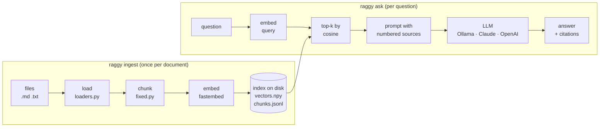

# Week 1: Naive RAG, end to end

**[← Course Plan](../COURSE_PLAN.md)** · **[Embeddings & Vector Search](../docs/embeddings-and-vector-search.md)** · **Week 2: Evals before optimisation →** *(coming)*

---

**Time:** about 5 hours (1.5 reading, 2.5 reading and running the code, 1 on notes and experiments).
**Code for this week:** `git checkout week-01`
**Companion guide:** [`docs/embeddings-and-vector-search.md`](../docs/embeddings-and-vector-search.md)

**You're done when:**

1. `uv run pytest` passes (48 tests, offline, no keys needed), and
2. you've indexed the sample corpus, asked it a question it can answer and one it can't, and can explain every stage that ran in between.

## 1. Read first

| Read | Look for |
| --- | --- |
| [Retrieval-Augmented Generation for Knowledge-Intensive NLP Tasks](https://arxiv.org/abs/2005.11401) (Lewis et al., 2020): abstract and section 1 only | The original idea: a model that *looks things up* before it writes, instead of relying only on what it memorised in training. |
| [Introducing Contextual Retrieval](https://www.anthropic.com/news/contextual-retrieval) (Anthropic): the first half | A clear picture of the standard pipeline (chunk → embed → retrieve → generate) and where it loses information. Week 4 comes back to the second half. |
| [`docs/embeddings-and-vector-search.md`](../docs/embeddings-and-vector-search.md) (this repo) | What an embedding is, and why "cosine similarity" is just a dot product once vectors have length 1. You need this for section 3.3. |

## 2. What you're building this week

A language model only knows what it saw in training, and it will confidently make things up about everything else. RAG (retrieval-augmented generation) fixes that by splitting the job in two:

1. **Retrieve:** find the few passages in *your* documents that are most relevant to the question.
2. **Generate:** give the model those passages and the question, and tell it to answer from the passages only, citing them.

The model stops being the source of facts and becomes a reader of your sources. That's the whole idea. Everything in the next eleven weeks makes one of these two steps more accurate, faster or able to read more kinds of files.

This week builds the simplest version that works end to end. It's deliberately naive: every stage uses the most obvious technique, so you can see each one clearly and so week 2 has a baseline to measure against.



**Two phases, two speeds.** Ingest is slow and happens once per document: the embedding model runs over every chunk. Asking is fast and happens per question: only the question is embedded, and the search is a matrix multiplication. Almost every RAG system has this shape, from a laptop to a search engine.

### The code, file by file (768 lines including docstrings)

| File | Stage | What it does |
| --- | --- | --- |
| `raggy/types.py` | all | `Document`, `Chunk`, `Hit`, `Citation`, `Answer`: the data passed between stages |
| `raggy/ingest/loaders.py` | load | a file or folder becomes `Document`s (`.txt`, `.md`, `.markdown`) |
| `raggy/chunking/fixed.py` | chunk | fixed 800-character windows with 100 characters of overlap |
| `raggy/embed/base.py` | embed | the `Embedder` interface and `normalize()` |
| `raggy/embed/fastembed_embedder.py` | embed | the real model: `BAAI/bge-small-en-v1.5`, local, 384 numbers per text |
| `raggy/embed/fake.py` | embed | a bag-of-words stand-in so tests run offline in milliseconds |
| `raggy/store/numpy_store.py` | store/search | one matrix, exact search, saved as three files |
| `raggy/generate/prompt.py` | generate | the system prompt, the numbered-source prompt, citation parsing |
| `raggy/generate/llm.py` + adapters | generate | one `complete(system, user)` interface for Ollama, Claude and OpenAI |
| `raggy/generate/answer.py` | generate | retrieved hits + question → `Answer` |
| `raggy/pipeline.py` | all | `Raggy.ingest / search / ask / sources`: wires the stages together |
| `raggy/cli.py` | all | `raggy ingest | search | ask | sources` |

## 3. Walkthrough, stage by stage

### 3.1 Load: files become Documents

`load_path` accepts a file or a folder, walks folders recursively, keeps supported suffixes, skips hidden paths (`.git`, `.venv` and so on) and returns documents sorted by path, so runs are repeatable.

```python
SUPPORTED_SUFFIXES: frozenset[str] = frozenset({".txt", ".md", ".markdown"})
```

A file that isn't valid UTF-8 produces a warning and is skipped. It doesn't crash the whole ingest. One bad file in a folder of thousands shouldn't stop the other 999, and that rule matters more as the corpus grows.

### 3.2 Chunk: why split documents at all?

You can't hand the model every document for every question. It would be slow, expensive and, past a point, wouldn't fit. And you can't embed a whole document as one vector either: a 40-page manual squashed into 384 numbers averages away every specific fact in it. So documents are cut into **chunks**, small enough that each vector stands for one idea and that a handful of them fit in a prompt.

This week's chunker is the bluntest possible: a sliding window of characters.

```python
    step = size - overlap
```

With `size=800` and `overlap=100`, chunk 0 covers characters 0 to 800, chunk 1 covers 700 to 1500, and so on. The overlap exists so a sentence cut by one boundary appears whole in the neighbouring chunk. Each `Chunk` records its `start` and `end` offsets, so we can always trace it back to the exact spot in the source. Week 9 uses that to cite page numbers.

**Why 800 characters?** It's roughly 150 to 200 words: about a paragraph. Smaller chunks give sharper vectors but lose context ("it costs 340 credits", but what does?). Larger chunks keep context but blur the vector. 800/100 is a common starting point, not a measured optimum. Week 4 measures it.

### 3.3 Embed: text becomes a direction

An embedding model turns text into a list of numbers (a vector) such that texts with similar *meaning* point in similar directions. We use `BAAI/bge-small-en-v1.5` through [fastembed](https://github.com/qdrant/fastembed): a 67 MB model that produces 384 numbers per text and runs on a laptop CPU via ONNX, with no PyTorch and no GPU.

Here is a real run on this repo's code (fastembed 0.9.0):

```
query: "how long do refunds take?"
  "Refunds are issued within 14 days."      → 0.845
  "The office cat is called Biscuit."       → 0.333
```

Notice that the query never uses the word "issued", and the first sentence never says "take". The model matched on meaning, which is what keyword search can't do. The guide works through the arithmetic.

Two details in `fastembed_embedder.py` are worth knowing:

```python
        vectors = list(self._model.passage_embed(texts, batch_size=self.batch_size))
```

```python
        return normalize(next(iter(self._model.query_embed(text))))
```

- **Queries and passages are embedded differently.** Many retrieval models were trained with a different prefix for questions than for documents, because a question ("how long do refunds take?") doesn't look like its answer ("Refunds are paid back within 14 days…"). `query_embed` and `passage_embed` add the right prefix for you.
- **Every vector is normalised to length 1.** After that, the dot product of two vectors *is* their cosine similarity, so search is one matrix multiplication (next section).

The `Embedder` interface is two methods and a name. The name is saved in the index, because vectors from two different models live in unrelated spaces, and comparing them gives meaningless scores without any error. `NumpyStore` refuses that mix outright:

```python
                f"index was built with '{self.embedder}' but this run uses "
```

### 3.4 Store and search: one matrix

The whole "vector database" this week is a numpy array with one row per chunk, plus the chunks themselves in a JSON-lines file. Search is:

```python
        scores = self.vectors @ np.asarray(query_vec, dtype=np.float32)  # cosine: rows are unit length
        k = min(k, len(scores))
        top = np.argpartition(-scores, k - 1)[:k]  # the k best, unordered: O(n)
        top = top[np.argsort(-scores[top])]  # then sort only those k
```

One multiplication scores every chunk at once. `argpartition` finds the best `k` without sorting all *n* scores, and only those `k` get sorted. This is **exact** (brute-force) search: it never misses the true best match. It costs *n × 384* multiply-adds per query, which is nothing at a few thousand chunks and starts to matter at millions. Week 5 swaps in an approximate index and measures what that trades away.

Re-ingesting a file replaces its chunks instead of duplicating them (`add` calls `remove_source` first), so running `raggy ingest` twice on the same folder is safe. It still re-embeds everything every time, though. Week 3 makes ingest incremental with content hashes.

### 3.5 Generate: the prompt does the grounding

The retrieved chunks are pasted into the prompt as numbered sources, best first:

```
Sources:

[1] (source: returns-and-refunds.md)
faulty. Gift cards cannot be refunded. If you return a bike after 30 days …

[2] (source: returns-and-refunds.md)
# Returns and refunds …

Question: How long until I get my money back after returning a bike?
```

The system prompt (in `prompt.py`) sets three rules:

```python
- Use only facts stated in the sources. Do not use outside knowledge.
- After each claim, cite the source it came from, like [1] or [2][3].
- If the sources do not contain the answer, reply with exactly: {NOT_FOUND}
```

- **"Only the sources"** turns the model from an oracle into a reader. It can still disobey, and week 8 checks it.
- **Numbered citations** make every claim checkable. `parse_citations` reads the `[n]` markers back out of the answer and maps them to chunks. Numbers the model invents (`[9]` with only four sources) are dropped.
- **A fixed "not found" sentence** gives code something exact to detect. Week 2's evals use it to score whether the system correctly refuses questions the documents can't answer. Refusing correctly counts as a right answer.

And one cheap shortcut: if retrieval returns nothing, `generate_answer` returns the not-found sentence without calling the model at all.

### 3.6 One interface, three model providers

```python
class LLM(Protocol):
    name: str  # "provider:model", shown in output and later in traces

    def complete(self, system: str, user: str) -> str: ...
```

RAG needs nothing more from a model than "system prompt and user prompt in, text out". Three adapters implement it:

| Provider | `RAGGY_LLM=` | Default model | Notes |
| --- | --- | --- | --- |
| Ollama (local, free) | `ollama` *(default)* | `qwen3.5:4b` | Through Ollama's OpenAI-compatible endpoint, so the OpenAI adapter covers it. Thinking is switched off (see below). |
| Anthropic | `anthropic` | `claude-opus-5-5` | Explicit `effort="medium"`; opts into server-side refusal fallbacks; a `refusal` stop reason becomes an `LLMError`. |
| OpenAI | `openai` | from `OPENAI_MODEL` | Chat Completions. |

**A real problem we hit while building this.** `qwen3.5:4b` is a "thinking" model: by default it reasons at length before answering. On the 8 GB M2 this course was built on, with the machine already deep in swap, the first request **timed out**. With thinking off, a warm request took **1.7 s**, and a full `raggy ask` about 15 s. The fix is one line in the Ollama path of `openai_llm.py`:

```python
            extra["reasoning_effort"] = "none"
```

A grounded RAG answer is mostly reading and quoting, which doesn't need long reasoning. The lesson generalises: **measure on the hardware you have**, and turn off features that cost more than they give for this task.

Every adapter turns provider errors into `LLMError` with a fix hint ("is Ollama running (`ollama serve`)…?"), and the CLI prints that one line instead of a traceback.

## 4. Run it

**Setup** (once):

```bash
uv sync
ollama pull qwen3.5:4b        # or set RAGGY_LLM=anthropic / openai in .env
cp .env.example .env          # optional: only for hosted models
```

**Index the sample corpus.** It's six short documents about *Brightwater Bikes*, a company invented for this course so the model can't answer from memory:

```
$ uv run raggy ingest samples/week01
Indexed 6 documents as 12 chunks into .raggy
```

The first run downloads the 67 MB embedding model. After that it took 10.8 s, most of which is loading the model.

**Look at retrieval on its own.** This is the most useful debugging habit in RAG: when an answer is wrong, first check whether the right passage was even retrieved.

```
$ uv run raggy search "how long until I get my money back?" -k 3
[1] 0.753  returns-and-refunds.md (chunk 1)
    faulty. Gift cards cannot be refunded. If you return a bike after 30 days but within 60 days, we offer store credit instead of a refund, minus a 10% restocking fee.
[2] 0.731  returns-and-refunds.md (chunk 0)
    # Returns and refunds You can return any unused bike or accessory within 30 days of delivery. "Unused" means ridden less than 10 km, with no damage and all original packaging. To start a return, email…
[3] 0.633  warranty.md (chunk 1)
    anty. To make a claim, bring the bike to either workshop or email warranty@brightwater.example with photos and your order number. Most claims are decided within five working days. As a goodwill gestur…
```

Look at the first characters of hits 1 and 3: **`faulty.`** and **`anty.`** The fixed-size chunker cut in the middle of words. Retrieval still worked here, but you can see the weakness that week 4 fixes.

**Ask a question it can answer** (Ollama, `qwen3.5:4b`, 15.8 s):

```
$ uv run raggy ask "How long until I get my money back after returning a bike?"
Based on the provided sources, refunds are paid back to the original payment method within **14 days** of the return arriving at the warehouse [2].
If the bike is returned after 30 days but before 60 days, you receive store credit instead of a refund, though the timeline for that credit isn't specified in the text. Note that gift cards and custom-built Heron frames generally cannot be refunded unless they are faulty [1][2].
Sources:
[2] returns-and-refunds.md — "# Returns and refunds You can return any unused bike or accessory within 30 days of delivery. "Unuse…"
[1] returns-and-refunds.md — "faulty. Gift cards cannot be refunded. If you return a bike after 30 days but within 60 days, we off…"
```

**Ask for a specific fact buried mid-document** (13.8 s):

```
$ uv run raggy ask "Which Brightwater bike comes in an XS frame size, and how much does it weigh?"
The only Brightwater model sold in an XS frame size is the **Kestrel Gravel**. It weighs **10.2 kg** [1].
Sources:
[1] bike-models.md — "# The Brightwater range (2026) ## Heron Commuter A steel city bike with an 8-speed hub gear, hub dyn…"
```

**Ask something the documents don't cover.** The two models behave differently:

```
$ uv run raggy ask "Does Brightwater sell skateboards?"            # Ollama qwen3.5:4b
Based on the provided sources, there is no mention of Brightwater selling skateboards. The documented product range includes bicycles such as the Heron, Kestrel, and Ebb models [3], but no information regarding skateboards is available in the documents.
I couldn't find this in the documents.

$ RAGGY_LLM=anthropic uv run raggy ask "Does Brightwater sell skateboards?"   # claude-opus-5-5, 8.7 s
I couldn't find this in the documents.
```

Both are *right*, but only Claude followed the "reply with exactly" rule. The small local model added commentary first. That matters as soon as code depends on the exact sentence, as week 2's refusal metric does. Keep this in mind: **prompt rules are requests, not guarantees**, and how well they're followed depends on the model.

Useful flags: `-k 6` retrieves more chunks, `--show-context` prints the retrieved chunks above the answer, and `raggy sources` lists what's indexed.

## 5. Why each choice

| Choice | Why | What it costs |
| --- | --- | --- |
| Local embedding model by default | Free, private (documents never leave the machine), no rate limits, and it works offline | Hosted models can be more accurate. Week 2 makes that a measurable question rather than a matter of taste |
| fastembed (ONNX) rather than sentence-transformers (PyTorch) | A small install, fast on CPU, and fine on 8 GB of RAM | Fewer models to choose from |
| Normalise every vector | Cosine similarity becomes a dot product, so search is one matrix multiply | None: direction is what carries meaning here |
| Exact numpy search | Simple, correct and easy to read; fast up to tens of thousands of chunks | Linear in corpus size, which week 5 fixes |
| Save the embedder name in the index | Mixing models gives silently wrong scores, and failing loudly is better | You must re-ingest after changing models |
| Numbered sources + `[n]` citations | Every claim can be traced to a passage | The model can still cite the wrong number (week 8) |
| A fixed not-found sentence | Lets code and evals recognise a refusal | Small models don't always reply with it exactly (seen above) |
| Interfaces for embedder, store and LLM | Each later week swaps one piece and leaves the others alone | A little indirection |
| Fakes in tests | 48 tests in about a second, with no network or keys | Fakes can't test answer *quality*; that's what evals are for (week 2) |

## 6. What breaks, and which week fixes it

The pipeline works, but here are the places where it will let you down, each with the week that deals with it:

| Weakness you can see today | Fixed in |
| --- | --- |
| No way to tell whether a change made answers better or worse. "It looked fine on three questions" isn't evidence | **Week 2**: evals with retrieval and answer metrics |
| Only `.md` and `.txt`; no URLs; every ingest re-embeds everything; a file you delete from a folder stays in the index until you remove it | **Week 3**: loaders, URLs, incremental ingest |
| Chunks cut mid-word (`faulty.`, `anty.`); a heading separated from the text under it | **Week 4**: structure-aware chunking |
| Exact search slows down linearly as the corpus grows | **Week 5**: a real vector database and ANN |
| Exact names, codes and rare words ("Kestrel", "E-Cargo", an order number) can be missed by meaning-based search | **Week 6**: hybrid keyword + vector search |
| The top-k ranking is rough. The best chunk isn't always first | **Week 7**: reranking |
| The model can ignore the "exactly" rule or cite the wrong source; snippets show the chunk start, not the sentence used | **Week 8**: grounded generation and citation checks |
| PDFs, Office files, images, audio, video | **Weeks 9 to 11** |

## 7. Experiments and notes

Write your answers in `NOTES.md`. They become your write-up at the end of the course.

1. Run `raggy search` with `-k 12` (every chunk in the sample corpus). Where does the right chunk rank for each of the three questions above? What's the score gap between the right chunk and the first wrong one?
2. Ask a question using words that appear in *no* document but mean the same thing as something that does (for example "When can I come in to fix my own bike for free?"). Does retrieval find the community repair evening? Why can embeddings do this?
3. Change the `chunk_size` default in `raggy/config.py` to 200, delete `.raggy/`, re-ingest, and repeat experiment 1. Then try 2000. What changes? You'll measure this properly in week 4.
4. Change `RAGGY_EMBED_MODEL` without re-ingesting, then run a search. Read the error. Why is failing better than returning results?
5. Ask the same unanswerable question with Ollama and with a hosted model. Which follows the "exactly" rule? Try rewording the rule in `SYSTEM_PROMPT` to see if the small model complies better, then revert. You'll measure this in week 2.

---

**Tested with:** Python 3.13.14, fastembed 0.9.0, numpy 2.5.4, anthropic 2.2.0, openai 3.37.0, Ollama 0.40.6 with `qwen3.5:4b`, on an Apple M2 with 8 GB of RAM. All outputs above are copied from real runs.
