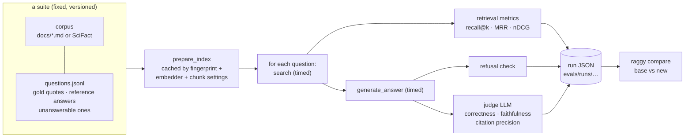

# Week 2: Evals before optimisation

**[← Week 1: Naive RAG](week01-naive-rag.md)** · **[Course Plan](../COURSE_PLAN.md)** · **[Evaluating RAG (guide)](../docs/evaluating-rag.md)** · **[Week 3: Ingestion →](week03-ingestion.md)**

> **New to the ideas?** The general concepts behind this page, with diagrams, worked examples and reading links: [12 Evaluating RAG](../concepts/12-evaluation.md).

---

**Time:** about 5 hours (1 reading, 2.5 reading and running the code, 1.5 on the experiments).
**Code for this week:** `git checkout week-02`
**Companion guide:** [`docs/evaluating-rag.md`](../docs/evaluating-rag.md): every metric worked by hand.

**You're done when:**

1. `uv run pytest` passes (114 tests, offline, no keys needed),
2. you've run `raggy eval --suite fictional --retrieval-only` and can say, for one question it missed, *why* it missed, and
3. you can explain why recall@4 is the ceiling on answer quality in this pipeline.

## 1. Read first

| Read | Look for |
| --- | --- |
| [BEIR: A Heterogeneous Benchmark for Zero-shot Evaluation of IR Models](https://arxiv.org/abs/2104.08663) (Thakur et al., 2021): sections 1 and 3 | Why retrieval is measured on many labelled datasets, and why nDCG@10 is the headline number. SciFact, our public benchmark, is one of them. |
| [Judging LLM-as-a-Judge](https://arxiv.org/abs/2306.05685) (Zheng et al., 2023): sections 1 and 3 | Using a strong model to grade answers works, and it has known biases: favouring its own outputs, longer answers, and the first option it's shown. You'll see a version of this in section 6. |
| [`docs/evaluating-rag.md`](../docs/evaluating-rag.md) (this repo) | recall@k, MRR and nDCG worked on one tiny example. You need it for section 4.2. |

## 2. Why evals come before every optimisation

Week 1 ended with a list of weaknesses: chunks cut mid-word, exact codes possibly missed, a small model ignoring the "exactly" rule. The next ten weeks fix them. But every fix is also a *change*, and changes break things. Without measurement you can't tell:

- whether a fix helped at all ("it looked better on three questions"),
- whether it helped one kind of question and hurt another,
- whether it's worth what it costs in speed or money.

So this week adds no retrieval or generation features. It builds the ruler. From week 3 on, every lesson ends with `raggy compare evals/baselines/week01-fictional.json <new run>`, and claims without numbers don't go in.

A good RAG eval answers two separate questions, because the pipeline can fail in two places:

1. **Retrieval:** did the evidence reach the model? This is cheap and deterministic, and needs no LLM.
2. **Generation:** given the evidence, did the model answer correctly, stay inside the sources, cite properly, and refuse when it should? This needs a judge.

Always read retrieval first. If the evidence was never retrieved, the model can't produce a correct grounded answer, and tuning the prompt is wasted effort.

## 3. What you're building this week



### The code, file by file (678 new lines in `raggy/evals/`)

| File | What it does |
| --- | --- |
| `raggy/evals/dataset.py` | `EvalQuestion`, `GoldSpan`; loads `questions.jsonl`; finds each gold quote in the corpus as a character span (`resolve_gold`); `chunk_gold` says which gold spans a chunk overlaps |
| `raggy/evals/metrics.py` | `retrieval_metrics` (recall@k, nDCG@k, MRR), `collapse_to_documents`, `mean`, `percentile` |
| `raggy/evals/judge.py` | the two versioned judge prompts, `Judge.judge` → `Verdict`, `is_refusal`, a forgiving JSON parser |
| `raggy/evals/suites.py` | the `fictional` and `scifact` suites; BEIR loader; checksum-verified download |
| `raggy/evals/runner.py` | `prepare_index` (cached eval index) and `run_suite` (the loop, timings and aggregates) |
| `raggy/evals/report.py` | save/load run JSON, the printed table, `format_compare` |
| `evals/fictional/` | 12 Brightwater documents (week 1's six plus six new) and 41 questions |
| `evals/baselines/` | the committed week-1 baselines that every later week compares against |

Small changes to week-1 code:

- **`Raggy.ingest_documents`:** ingests in-memory `Document`s with batched embedding and a progress callback. `ingest(paths)` now uses it.
- **`NumpyStore.add`:** skips the stale-source scan when nothing is being replaced.
- **`Config`:** gains `judge_provider`/`judge_model`, and a bad `RAGGY_TOP_K` now prints one line instead of a traceback (deferred from week 1).
- **CLI:** gains `eval` and `compare`.

## 4. Walkthrough

### 4.1 A suite: a corpus that never changes, plus questions

The **fictional suite** is Brightwater Bikes again, so the model can't answer from memory. It has six new documents (service centres, a parts catalogue with codes like `BW-CH-1142`, accessories, bike fitting, a privacy policy, a cycle-to-work scheme) and 41 questions in `evals/fictional/questions.jsonl`:

```json
{"id": "f13", "question": "What is part BW-CH-1142?", "answerable": true,
 "reference": "An 8-speed chain with 116 links for the Heron Commuter, 24 credits.",
 "gold": [{"source": "parts-catalogue.md", "quote": "BW-CH-1142 | 8-speed chain, 116 links | Heron Commuter | 24 credits"}],
 "tags": ["exact-term"]}
{"id": "u05", "question": "What is the part code for Kestrel Gravel brake rotors?",
 "answerable": false, "reference": null, "gold": [], "tags": ["unanswerable"]}
```

Every question has a **tag**, so a later week can say "hybrid search raised `exact-term` from X to Y" instead of moving one blended average. The tags are `lookup`, `paraphrase` (the question shares few words with the passage), `exact-term` (codes, names, numbers to match exactly), `numeric` (needs arithmetic or a range), `multi-doc` and `unanswerable`.

The 8 **unanswerable** questions sit close to the corpus on purpose: brake *rotors* when the catalogue lists brake *pads*, the Fenwick workshop's phone number when only the partner shops' numbers are listed. "Do you sell skateboards?" is too easy to refuse to teach anything.

The corpus is a **copy** of week 1's samples plus the new files, frozen under `evals/`. If the docs a suite reads could change, last month's numbers would describe a different test. The suite's *fingerprint* (a sha256 of every doc and the questions file) is stored with its index, so editing a single character forces a rebuild.

### 4.2 Gold evidence as quotes, located as spans

Look at `gold` above: a **verbatim quote**, not a chunk id. `resolve_gold` turns each quote into a character span, matching the quote's words with any whitespace between them, so a line break in the document doesn't break a correct quote. Then:

```python
def chunk_gold(chunk: Chunk, gold: list[Located]) -> set[int]:
    """Indices of the gold spans this chunk overlaps."""
    return {
        i for i, g in enumerate(gold)
        if g.source == chunk.source and chunk.start < g.end and g.start < chunk.end
    }
```

Week 1's chunks already store `start`/`end` offsets, which is why this is one line. And because nothing here mentions chunk ids, week 4 can replace the chunker and the labels stay valid.

A quote that isn't found raises `GoldNotFoundError: question f07: quote not found in 'shipping.md': '…'` **before** any model call. `tests/week02/test_dataset.py::test_fictional_questions_resolve` checks every quote in the real dataset on every test run.

The metrics themselves (recall@k, MRR, nDCG@k, and why a second chunk covering the same evidence earns nothing) are worked by hand in the [guide](../docs/evaluating-rag.md). Read it now if you skipped it.

### 4.3 The judge: two separate questions

`raggy/evals/judge.py` asks a judge model two things, in two calls, because they need different evidence:

| Call | Judge sees | Returns | Becomes |
| --- | --- | --- | --- |
| correctness | question, **reference answer**, candidate | `{"verdict": "correct" \| "partial" \| "incorrect"}` | 1 / 0.5 / 0 |
| grounding | **the numbered sources the model saw**, candidate | `{"faithful": bool, "citations": [{"n", "supported"}]}` | faithfulness, citation precision |

The split matters. An answer can be *correct but unfaithful*: right because the model already knew the fact, not because the documents said it. In a company RAG system that's a defect. The model's "knowledge" will be wrong as soon as the policy changes.

Three things keep the judge honest:

- **Strict JSON, parsed forgivingly.** `parse_json_object` finds the first balanced `{…}`, so a code fence or a sentence of chatter doesn't lose a verdict. Anything unparseable becomes `judge.error`: that question is left out of the averages, counted, and listed under the table. The run keeps going.
- **No judge call for a refusal.** A refused answerable question scores correctness 0 without spending a call.
- **Versioned prompts.** `JUDGE_VERSION = "judge-v1"` is saved in every run. Change a word of the prompt and you've changed the ruler, so bump the version and re-measure the baseline.

**Refusal is measured without a judge.** The fixed not-found sentence from week 1 pays off here. `is_refusal` looks for it anywhere in the reply (the small local model likes to explain first), ignoring case and curly apostrophes.

**Which model judges?** `RAGGY_JUDGE` / `RAGGY_JUDGE_MODEL`. The default is Claude when `ANTHROPIC_API_KEY` is set, otherwise local Ollama. `raggy eval` prints `judge: <model>` *before* it starts, because a silent fallback burned a 15-minute run while this lesson was being written (section 6.3).

### 4.4 The runner and the run file

`run_suite` makes one pass over the questions:

1. resolve all gold quotes (fail fast),
2. build or reuse the suite's index in `.raggy/evals/<suite>/`, never your own index,
3. per question: time the search, score it, generate an answer from the top `RAGGY_TOP_K` chunks (timed), check for refusal, and judge.

Everything lands in one JSON file, `evals/runs/<suite>/<timestamp>-<label>.json`. It holds the config (embedder, chunk settings, LLM, judge, judge version), the git commit, the index build time, the aggregate metrics, the same metrics **per tag**, error counts, and per question the top 10 retrieved chunks with their gold matches, the answer, the citations and the verdict with its reason.

That last part matters most. A metric tells you *that* something changed. The per-question records tell you *what*. `raggy compare base.json new.json` prints the deltas.

### 4.5 SciFact: a public benchmark, and checking the ruler

The fictional suite is small enough to read, but 33 answerable questions is a small sample (section 5). The **scifact** suite is BEIR's copy of [SciFact](https://allenai.org/data/scifact): 5,183 paper abstracts and 300 scientific claims, with expert labels for which abstracts support or refute each claim. raggy downloads it on first use into `evals/data/` (gitignored, about 3 MB zipped). It is never committed because its licence is CC BY-NC 2.0. The URL and SHA-256 are pinned in `suites.py`, and a mismatch stops the run before a byte is trusted.

SciFact's labels are per document, so the suite retrieves `3 × 100` chunks, keeps each abstract's best chunk, and scores the first 100 distinct abstracts. That is how the published BEIR/MTEB numbers are computed, which lets us do something important: **check our ruler against someone else's.**

## 5. Run it

**Retrieval only** (free, no LLM, about 2 s):

```
$ uv run raggy eval --suite fictional --retrieval-only --label week01-retrieval
Suite fictional: 41 questions (33 answerable, 8 unanswerable)  label: week01-retrieval
Embedder BAAI/bge-small-en-v1.5 · chunks 800/100 · top_k 4 · scored per chunk
LLM — · judge —
Index: 12 documents → 24 chunks in 1.12 s

Retrieval (answerable questions)
  recall@1                 0.727
  recall@4                 0.939
  recall@10                1.000
  mrr                      0.848
  ndcg@1                   0.758
  ndcg@4                   0.853
  ndcg@10                  0.874

Latency (ms)
  retrieve_ms_p50          4.500
  retrieve_ms_p95          6.130

By tag            n   recall@4      mrr  correct
  exact-term      5      1.000    0.900        —
  lookup         14      1.000    0.881        —
  multi-doc       2      1.000    1.000        —
  numeric         8      0.875    0.828        —
  paraphrase     12      0.917    0.836        —
  unanswerable    8          —        —        —
```

**The full baseline**, answers from `openai:gpt-5.5` and graded by `openai:gpt-5.4` (2 min 26 s, about 100 hosted calls). This is `evals/baselines/week01-fictional.json`:

```
$ RAGGY_JUDGE=openai RAGGY_JUDGE_MODEL=gpt-5.4 uv run raggy eval --suite fictional --label week01
judge: openai:gpt-5.4 (set RAGGY_JUDGE / RAGGY_JUDGE_MODEL to change)
…
Answers
  correctness              0.864
  faithfulness             1.000
  citation_precision       1.000
  refusal_accuracy         0.951
  unanswerable_refused     1.000
  answerable_refused       0.061

Latency (ms)
  retrieve_ms_p50           12.8
  retrieve_ms_p95           18.8
  generate_ms_p50         1379.4
  generate_ms_p95         2591.1

By tag            n   recall@4      mrr  correct
  exact-term      5      1.000    0.900    1.000
  lookup         14      1.000    0.881    0.964
  multi-doc       2      1.000    1.000    1.000
  numeric         8      0.875    0.828    0.750
  paraphrase     12      0.917    0.836    0.750
  unanswerable    8          —        —        —
```

The retrieval rows (cut above) are **identical** to the retrieval-only run. Retrieval is deterministic: same index, same query, same numbers. That's what makes small retrieval deltas trustworthy. Answer scores are not deterministic: a second run with the same models moves them by a few hundredths.

**SciFact** (retrieval only by design; the first run embeds 12,933 chunks). This is `evals/baselines/week01-scifact.json`:

```
$ uv run raggy eval --suite scifact --label week01
Suite scifact: 300 questions (300 answerable, 0 unanswerable)  label: week01
Embedder BAAI/bge-small-en-v1.5 · chunks 800/100 · top_k 4 · scored per document
Index: 5183 documents → 12933 chunks in 707.04 s

Retrieval (answerable questions)
  recall@1                 0.585
  recall@10                0.842
  recall@100               0.960
  mrr                      0.691
  ndcg@1                   0.610
  ndcg@10                  0.721
  ndcg@100                 0.747

Latency (ms)
  retrieve_ms_p50           47.8
  retrieve_ms_p95           63.2
```

**The ruler check: nDCG@10 = 0.721.** A published BEIR table lists bge-small-en-v1.5 on SciFact at **0.713** ([mxbai-edge-colbert report, arXiv 2510.14880](https://arxiv.org/abs/2510.14880)). Our number is 0.008 higher, which is plausible: we score each abstract by its best 800-character chunk, where the published setup embeds whole abstracts. Had we got 0.45 or 0.95, the harness would have a bug, and no later week's number could be trusted. **Validate the instrument on a known answer before you measure an unknown one.**

Compare two runs:

```
$ uv run raggy compare evals/baselines/week01-fictional.json evals/runs/fictional/<new>.json
```

## 6. Reading the baseline

### 6.1 Where retrieval fails, and which week fixes it

In the retrieval-only run, ten answerable questions scored recall@1 below 1. Four of them show the main patterns:

| Question | Gold at rank | What went wrong | Fixed in |
| --- | --- | --- | --- |
| f01 "How long do refunds take to arrive?" | 2 | Right document, wrong chunk. The answer sits wholly inside chunk 0 (characters 0–800), but chunk 1 wins: a 167-character leftover tail of the same file that talks only about refunds and store credit. A long chunk's embedding is an average over several topics, so a short single-topic chunk can outrank it. | **Week 4** (chunks that follow the document's structure) |
| f13 "What is part BW-CH-1142?" | 2 | An exact code. To an embedding, `BW-CH-1142` is a vague "part-number-ish" string, so the catalogue's *other* chunk (more table rows, none of them this code) outranks the one that contains it. | **Week 6** (BM25 matches the literal code) |
| f11 "When can I come and fix my own bike for free with your tools?" | 5 | Paraphrase: the passage says "community repair evening", the question says none of those words. Rank 5 is outside the 4 chunks the model sees. | **Week 7** (reranking), week 4 (headers) |
| f33 "How much does a staff member pay for a 1,000-credit bike after probation?" | 8 | The answer needs "20% off bikes" plus arithmetic, and the question is dominated by "1,000-credit bike", which pulls in pricing chunks. | Weeks 6–7 |

The **numeric** (recall@4 0.875) and **paraphrase** (0.917) tags are the weakest, and they are where the two refusals of answerable questions came from: f11 and f33 are exactly the questions whose gold fell outside the top 4. `answerable_refused = 0.061` (2 of 33) is a *retrieval* number wearing an answer-metric costume. The model refused correctly given what it was shown. That's what "recall@4 is the ceiling" means in practice.

On SciFact, 53 of 300 claims don't have all their labelled abstracts in the top 10. Look at a few before blaming retrieval. For "Arterioles have a larger lumen diameter than venules.", the labelled abstract is titled "Scaffold-based three-dimensional human fibroblast culture provides a structural matrix…", which from the title alone doesn't look related. Benchmark labels are made by people and contain surprises. Read the abstract before you call it a miss.

### 6.2 The answers: what the judge marked down

With retrieval at 0.939, the model (gpt-5.5) did well: no unsupported claims, every citation supported, and all 8 unanswerable questions refused. The judge's "partial" verdicts are instructive:

- **f08** (battery warranty) answered "three years or 800 full charge cycles" but left out "replaced free below 70% capacity". That is fair: the reference has it, and the question ("how long is it guaranteed") arguably invites it.
- **f17** (Ebb motor repair) answered "Saltmarsh Cycles in Port Edda … motor and battery … Phone: 0161 555 0142", and the judge marked it **incorrect** for "adding unsupported information about battery repairs". But the source says *"works on the Ebb E-Cargo's motor and battery"*. The judge is wrong here. The correctness judge never sees the sources, so it treated a true extra detail as an invention.

So judges make mistakes too. **Read the reasons** in the run file for every question that changes between two runs, not only the score.

### 6.3 What the eval caught in its own dataset

The most useful findings of week 2's first runs weren't about the pipeline. They were bugs in the questions:

- **"Unanswerable" wasn't.** `u01` originally asked "Do you offer free international shipping to Japan?" The model answered *"No. Delivery is only to addresses on the mainland and the Arlen Islands [1]."* That's a correct, grounded inference. The question was replaced ("Do you offer gift wrapping on orders?").
- **References asked for more than the question.** f06's reference added the delivery time, and f20's added the frame bag's price. A strict judge marked correct answers "partial" for leaving out facts nobody asked for. Both references were trimmed to what the question asks. Rule: *a reference answer contains what the question asks for, and nothing else.*
- **A silent judge fallback.** The first full run was graded by local `qwen3.5:4b`, because the Anthropic key in `.env` was empty and the default fell back to Ollama. It took 15 minutes, had 2 unparseable verdicts, and disagreed with the hosted judges on several answers. On f24 it complained the answer "omits the condition that the bike must cost over 1,500 credits", but the answer states exactly that. The fix was a line printed before every run: `judge: <model>`.
- **Retrieval latency under memory pressure.** In that same run, with Ollama holding several GB of RAM, retrieval p50 was 597 ms instead of 4.5 ms, most likely because the embedding model kept being swapped out to disk and back. Latency numbers describe a machine *and its load*. Compare latency only between runs made under the same conditions.

Every eval suite has bugs like these at first. Finding them is part of the job, which is why the questions file is small, readable and tested.

### 6.4 Ingest speed: the first scale number

SciFact took **707 s to embed 12,933 chunks**, about 18 chunks per second, on an 8 GB M2 that was swapping heavily. Querying the result is fast (p50 48 ms, including embedding the question). This is the "two phases, two speeds" shape from week 1 at real size. Thousands of documents are fine to *search* with the numpy store; what's slow is *building* the index. Week 3 (only re-embed what changed) and week 5 (embedding cache, batching, a real vector database) attack that number.

## 7. Why each choice

| Choice | Why | What it costs |
| --- | --- | --- |
| Gold as quotes located as spans | Survives any change to chunking; typos fail loudly | Writing a question means copying an exact quote |
| Count each gold item once (no credit for duplicates) | Duplicate chunks waste context slots, and the metric shouldn't reward that | Numbers differ slightly from tools that count chunk-level relevance |
| Separate correctness and grounding calls | "Right" and "from the documents" are different properties | Two judge calls per answer |
| Refusal measured by the fixed sentence, not a judge | Free, deterministic, and impossible to argue with | Depends on the model using the sentence (week 1's lesson) |
| Default judge hosted, local fallback | Judge quality matters (section 6.3); the fallback keeps evals usable offline | A local judge's scores are noisy; always check the `judge:` line |
| Judge ≠ answer model | Models favour their own outputs (Zheng et al.) | Needs access to a second strong model |
| SciFact downloaded, checksum-pinned, not committed | Licence (CC BY-NC); the exact bytes behind the baseline | Needs network once |
| Document-level SciFact scoring | Comparable with published numbers, so the ruler can be checked | A different number from the chunk-level fictional suite |
| Separate index per suite under `.raggy/evals/` | An eval must never touch your own index | Disk space for one more index |
| Run files keep per-question detail | Metrics say *that*, records say *what* | Bigger files (SciFact's is about 600 KB) |

## 8. Experiments and notes

Write your answers in `NOTES.md`.

1. Run `uv run raggy eval --suite fictional --retrieval-only` twice and diff the two run files' `metrics` blocks. Then run the full eval twice. Which numbers move between identical runs, and by how much? That's your noise floor: a later week's "improvement" smaller than that is not an improvement.
2. Pick f11 from your run file. With `uv run raggy search "When can I come and fix my own bike for free with your tools?" -k 6`, find the gold chunk. What is ranked above it, and why would a meaning-based embedding prefer that?
3. Set `RAGGY_TOP_K=6`, re-run the full fictional suite, and `raggy compare` it with the baseline. Did `answerable_refused` drop? Did anything get *worse* (latency, faithfulness, correctness on unanswerable questions)?
4. Write two new unanswerable questions that are hard to refuse, add them to a *copy* of the questions file, and run against the copy. (Look at `fictional_suite(root)`.) Did the model refuse? If it answered, was the answer an inference from the documents, like u01's?
5. Run the same full eval with `RAGGY_JUDGE=ollama` and with a hosted judge. On which questions do the judges disagree, and who is right when you read the sources yourself?
6. Change one sentence in `CORRECTNESS_SYSTEM`, bump `JUDGE_VERSION` to `judge-v1-exp`, and re-run. How much did correctness move without any change to the pipeline? Revert afterwards.

---

**Tested with:** Python 3.13.14, fastembed 0.9.0, numpy 2.5.4, anthropic 2.2.0, openai 3.37.0, on an Apple M2 with 8 GB of RAM. Answer model `openai:gpt-5.5`, baseline judge `openai:gpt-5.4`. The intended default judge, Claude, wasn't usable for the committed baseline because the Anthropic key ran out of credit mid-run. Re-judge with Claude and compare when you have a key. All outputs above are copied from real runs.
