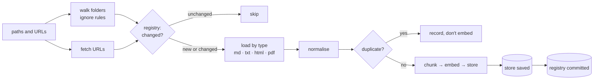

# Week 3: Ingestion — files, folders, URLs

**[← Week 2: Evals](week02-evals.md)** · **[Course Plan](../COURSE_PLAN.md)** · **[Ingestion (guide)](../docs/ingestion.md)** · **[Week 4: Chunking →](week04-chunking.md)**

---

**Time:** about 5 hours (1 reading, 2.5 reading and running the code, 1.5 on the experiments).
**Code for this week:** `git checkout week-03`
**Companion guide:** [`docs/ingestion.md`](../docs/ingestion.md): boilerplate, normalisation, MinHash and LSH worked through, and the re-ingest decision table.

**You're done when:**

1. `uv run pytest` passes (203 tests, offline, no keys needed),
2. you've run `raggy ingest` on a folder twice and can say why the second run read no files, and
3. you can explain, from the `fictional-web` numbers in section 6, which of the two fixes (extraction or dedupe) mattered more, and why.

## 1. Read first

| Read | Look for |
| --- | --- |
| [Trafilatura: A Web Scraping Library and Command-Line Tool for Text Discovery and Extraction](https://aclanthology.org/2021.acl-demo.15/) (Barbaresi, ACL 2021 demo) | How a main-content extractor separates an article from the page around it, and how it was evaluated against other extractors. |
| [Mining of Massive Datasets](http://www.mmds.org/), chapter 3, sections 3.1–3.4 (Leskovec, Rajaraman, Ullman) | Shingling, MinHash and the LSH "S-curve". Section 4.7 of this lesson uses all three. |
| [`docs/ingestion.md`](../docs/ingestion.md) (this repo) | The worked numbers behind sections 4.2, 4.6 and 4.7. |

## 2. Why ingestion is an accuracy problem

Week 1 read `.md` and `.txt` files and nothing else. Week 2 measured that pipeline on clean Markdown. Real corpora aren't clean Markdown. They are web pages wrapped in menus, footers and cookie banners, PDFs, folders full of build output, and the same document saved twice. Every one of those reaches the embedding model unless ingestion stops it, and the embedding can't tell the article from the noise around it.

This week has the biggest measured gain so far, and it's in ingestion, not in a cleverer model. On the web-site version of the fictional corpus:

| | before week 3 (every visible word, duplicates kept) | after (main content, duplicates removed) |
| --- | --- | --- |
| recall@4 | 0.758 | **0.939** |
| answer correctness | 0.773 | **0.909** |
| answerable questions refused | 18.2% | **6.1%** |

The pipeline after week 3 scores the same on web pages as week 1 did on clean Markdown (recall@4 0.939 on both). The second job this week is speed: a corpus of thousands of files can't be re-embedded every time one file changes.

## 3. What you're building this week



### The code, file by file (587 lines in `raggy/ingest/`)

| File | Lines | What it does |
| --- | --- | --- |
| `ingest/loaders/__init__.py` | 92 | The loader registry: `SUFFIXES` (file suffix → kind), `LOADERS` (kind → function), `load_bytes`, `load_file`, `load_path` |
| `ingest/loaders/text.py` | 22 | UTF-8 text; Markdown's first `#` heading becomes the title |
| `ingest/loaders/html.py` | 91 | `main`: trafilatura → Markdown. `full`: every visible word, the baseline |
| `ingest/loaders/pdf.py` | 24 | The text layer with pypdf, page by page, de-hyphenated |
| `ingest/normalize.py` | 37 | One kind of text from every loader |
| `ingest/walk.py` | 44 | Folders: hidden files, `node_modules`, `.raggyignore` and `.gitignore` |
| `ingest/fetch.py` | 88 | URLs: content type picks the loader; size and status checks |
| `ingest/dedupe.py` | 100 | SHA-256 for exact copies, MinHash + LSH for near copies |
| `ingest/registry.py` | 89 | One SQLite row per source |
| `pipeline.py` | +228 | `Raggy.ingest` (the incremental sync), `Raggy.remove`, `Raggy.documents` |

Also new: `raggy remove`, `raggy ingest --full`, the `fictional-web` eval suite, and two settings, `RAGGY_HTML_EXTRACT` and `RAGGY_DEDUPE`.

**Libraries added** (current releases, pinned in `uv.lock`): trafilatura 2.3.1 (Apache-2.0) for HTML, pypdf 6.21.2 (BSD) for PDF text, pathspec 1.1.1 (MPL-2.0) for gitignore patterns, and httpx 0.28.1 (BSD) for fetching. httpx was already installed as a dependency of the model SDKs. It's declared now because raggy imports it.

## 4. Walkthrough

### 4.1 One registry of loaders

A loader is a function from bytes to `(text, title)`. Two small tables choose it:

```python
LOADERS = {"text": text.load, "markdown": text.load_markdown, "html": html.load, "pdf": pdf.load}
SUFFIXES = {".txt": "text", ".md": "markdown", ".markdown": "markdown",
            ".html": "html", ".htm": "html", ".pdf": "pdf"}
```

`load_bytes(data, source, kind, options)` runs the loader, normalises its text and fills the metadata: `name`, `title`, `type`, plus `kind` (`file` or `url`) and `modified` (the file's mtime, or the server's `Last-Modified` header). Files and URLs share it, so a PDF loads the same way from disk and from the web. Week 9 adds DOCX, PPTX and spreadsheets as one function and one table line each.

A loader that can't produce text raises `LoadError` with the reason: not UTF-8, a broken PDF, a page with no text, a scanned PDF with no text layer. The ingest counts that source as `failed`, prints why, and carries on with the rest. One bad file never stops a run of thousands.

### 4.2 Normalisation

`normalize_text` applies Unicode NFKC, deletes invisible characters, unifies line endings, and collapses runs of spaces while keeping each line's indentation. Every loader's output goes through it before anything else sees the text, for two reasons:

- **Hashing.** Two copies that differ only in a byte-order mark or a zero-width space must hash the same, or dedupe misses them.
- **Matching.** `fi` (one ligature character, common in PDFs) and `fi` are different strings to a tokenizer. After NFKC they're the same.

Did it change the existing benchmarks? On the clean fictional Markdown, every retrieval metric is identical to week 1 (recall@4 0.939, MRR 0.848). On SciFact, see section 6.4. Normalisation is insurance for messy input, not a gain on clean input, and the numbers say exactly that.

### 4.3 HTML: main content, not the page

`html.load` in `main` mode calls trafilatura:

```python
body = trafilatura.extract(data, output_format="markdown", include_tables=True,
                           include_comments=False, include_images=False)
```

Markdown output matters. Headings stay `#` and `##`, lists stay lists, and tables stay pipe rows (`| BW-CH-1142 | 8-speed chain, 116 links | …`), so week 4's structure-aware chunker has structure to work with. The title comes from the page's own `<title>`.

Two details came from running it on real pages:

- In trafilatura 2.x, `bare_extraction(...)` returns an empty `text` for Markdown output. Only `extract(...)` renders it. The test `test_html_main_drops_boilerplate` caught this before any page was ingested.
- On the live Wikipedia page, the output still had `<sup>` tags and Markdown escapes (`2023<sup>\[update\]</sup>`). `_tidy` strips a short list of inline tags and unescapes brackets and underscores. It doesn't unescape `\|`, because in a table cell that's a literal pipe.

`full` mode is a standard-library `HTMLParser` that keeps every visible text node and skips `<script>`, `<style>` and `<head>`. It's a deliberately naive baseline, and it's what "before week 3" means in section 6.

### 4.4 PDF: the text layer only

`pdf.load` reads each page's text with pypdf and joins the pages with blank lines. `dehyphenate` re-joins words a PDF split across lines (`exam-\nple` → `example`), but only between lower-case letters, so codes like `BW-\nCH` are left alone. A PDF whose pages have no text, usually a scan, fails with "no text found (scanned pages need OCR, which arrives in week 9)". Page numbers in citations, tables and layout are week 9 too.

### 4.5 Folders and ignore rules

`iter_files(root)` walks with `os.walk` and **prunes folders before descending**. A hidden folder, `node_modules`, `__pycache__`, or anything matched by `root/.raggyignore` or `root/.gitignore`, is never entered. A project folder with a 200,000-file `node_modules` costs nothing. Patterns use gitignore syntax through pathspec's `GitIgnoreSpec`, so `drafts/`, `*.log` and `build` mean what they mean in git. Only the root folder's ignore files are read. Nested `.gitignore` files are not.

### 4.6 The registry and incremental re-ingest

`.raggy/registry.sqlite` holds one row per source: content hash, size, mtime, the settings key, MinHash signature, `duplicate_of`, title, type, chunk count and timestamps. `Raggy.ingest` uses it to put every source in one of these outcomes:

| Outcome | When | Cost |
| --- | --- | --- |
| unchanged | same settings, and same size and mtime (not even read), or same content hash | a `stat`, or a read and a hash |
| added / updated | new, or content or settings changed | load, chunk, embed |
| duplicate | its text matches a document already indexed | load, hash, MinHash; no embedding |
| removed | missing from a folder that was walked, or newly ignored | drop its chunks |
| failed | couldn't be loaded or fetched | reported; an older indexed copy is kept |

The settings key is a JSON blob:

```python
{"embedder": ..., "chunk_size": ..., "chunk_overlap": ..., "html_extract": ...,
 "normalize": NORMALIZE_VERSION, "dedupe": ...}
```

Change the chunk size and every file is re-indexed even though its bytes didn't change. Without that, the index would hold chunks of two sizes and nobody would know.

The order of the last two lines of `_sync` is the most important decision in this file:

```python
store.save()  # first the store ...
reg.commit()  # ... then the registry: a crash between the two means redo, never loss
```

Registry writes stay in an open SQLite transaction until `commit()`. If the process dies after the store is saved but before the commit, the registry still describes the old state, and the next run re-indexes those files. The reverse order could record a file as indexed whose chunks were never saved, and it would be skipped forever. `test_registry_commit_after_store_save` makes the commit fail and checks that the next run re-indexes.

**What "deleted" means.** A file that has gone from a folder you ingested (`docs/b.md` deleted while `docs/` exists) is removed from the index. A *target* that doesn't exist at all (`raggy ingest docs-typo`, or a drive that isn't mounted) removes nothing:

```
not found: docs-typo (nothing removed; `raggy remove docs-typo` drops what it held)
```

The alternative, treating a vanished folder as "everything in it was deleted", wipes an index because a USB drive wasn't plugged in. `raggy remove` is the explicit way to drop a source, a folder or a URL prefix. It only ever removes from the index. Nothing in raggy deletes or modifies your files, and several tests assert that the files still exist afterwards.

### 4.7 Duplicates

`DuplicateIndex.find(hash, signature)` checks for an exact hash match first, then near-duplicates with MinHash and LSH: 128-number signatures, 16 bands of 8, and an estimated Jaccard similarity of 0.9 or more over 5-word shingles. The guide works through the numbers. The short version:

- one changed word on a 155-word page leaves a similarity of about 0.94, so it's caught,
- two unrelated pages that share only a footer score 0.0 after extraction and 0.39 before, so they're not caught,
- texts under 50 words are matched exactly or not at all, because shingle overlap is meaningless on a sentence.

**When MinHash was wrong.** The first version passed all its example tests and still estimated a pair of pages at 0.656 when their true similarity was 0.924. The hash functions `(a·x + b) mod (2⁶¹−1)`, with 32-bit `a` and `x`, almost never wrapped around the prime. So the 128 "independent" hashes ordered shingles in nearly the same way, and the estimator had the spread of a handful of hashes, not 128. The fix was a smaller prime, `2³¹−1`, with `a` and `b` below it. The new test measures the estimator's *spread* on 60 pairs (it was 0.12; it must be under 0.05). It was caught because the eval's duplicate count looked wrong and was checked against a brute-force Jaccard. Test randomised code by its statistics.

Which copy is kept? The one with the shortest path, so `returns-and-refunds.html` beats `archive/returns-and-refunds-2025.html`. When the kept copy is deleted, changes, or is removed with `raggy remove`, its duplicates are re-examined on the next ingest, so their content comes back into the index instead of silently disappearing (`test_duplicate_promoted_when_canonical_deleted` and two siblings).

**Benchmarks are never deduped.** SciFact's corpus is part of the benchmark's definition, and dropping an abstract would make our numbers incomparable with published ones. So `Suite.dedupe` is `False` for SciFact. (It has no duplicates anyway: 0 among 5,183 abstracts, found in 1.1 s.)

### 4.8 URLs

`fetch_url` makes one GET with redirects followed, a 20-second timeout and a `raggy/<version>` user agent. The response's `Content-Type` picks the loader. A URL's path often says nothing (`/pdf/2005.11401` is a PDF), and only a missing or generic type (`application/octet-stream`) falls back to the path's suffix. Bodies are read in pieces and refused past 20 MB. HTTP errors become `FetchError: <url>: HTTP 503`.

A URL has no mtime, so it's re-fetched on every ingest and skipped if its content hash is unchanged. A failed re-fetch keeps the chunks from the last good fetch. raggy fetches the URLs you give it and doesn't follow links. Crawling is a different tool with different manners (robots.txt, rate limits).

## 5. Run it

### 5.1 A folder, twice, then edits

From a scratch copy of the fictional docs (the index path is shortened to `…/index` below):

```
$ raggy ingest docs
Indexed into …/index: 12 added, 0 updated, 0 unchanged, 0 removed, 0 duplicates, 0 failed (24 chunks embedded)
real 3.08

$ raggy ingest docs   # again
Indexed into …/index: 0 added, 0 updated, 12 unchanged, 0 removed, 0 duplicates, 0 failed (0 chunks embedded)
real 0.22
```

The second run read no files: twelve `stat` calls matched the registry. It didn't load the embedding model either, because there was nothing to embed. Now change one file, delete one, and copy one into `archive/`:

```
$ sed -i '' 's/within 14 days/within 10 days/' docs/returns-and-refunds.md
$ rm docs/staff-handbook.md
$ mkdir docs/archive && cp docs/warranty.md docs/archive/warranty-2025.md
$ raggy ingest docs
Indexed into …/index: 0 added, 1 updated, 10 unchanged, 1 removed, 1 duplicates, 0 failed (2 chunks embedded)

$ raggy ingest docs-typo
not found: docs-typo (nothing removed; `raggy remove docs-typo` drops what it held)
Indexed into …/index: 0 added, 0 updated, 0 unchanged, 0 removed, 0 duplicates, 0 failed (0 chunks embedded)
```

Two chunks were embedded instead of 24: only the changed file was redone.

### 5.2 A web page and a PDF

```
$ raggy ingest https://en.wikipedia.org/wiki/Retrieval-augmented_generation https://arxiv.org/pdf/2005.11401
Indexed into …/index: 2 added, 0 updated, 0 unchanged, 0 removed, 0 duplicates, 0 failed (122 chunks embedded)
real 16.22

$ raggy search "who introduced retrieval-augmented generation" -k 3
[1] 0.807  https://en.wikipedia.org/wiki/Retrieval-augmented_generation (chunk 7)
    relevant retrieved information into the LLM via prompt engineering of the user's original query. Newer implementations (as of 2023<sup>\[update\]</sup>) can also incorporate specific augmentation modu…
[2] 0.794  https://arxiv.org/pdf/2005.11401 (chunk 6)
    rpose fine-tuning approach which we refer to as retrieval-augmented generation (RAG). We build RAG models where the parametric memory is a pre-trained seq2seq transformer, and the non-parametric memor…
[3] 0.786  https://arxiv.org/pdf/2005.11401 (chunk 0)
    Retrieval-Augmented Generation for Knowledge-Intensive NLP Tasks Patrick Lewis†‡, Ethan Perez⋆, Aleksandra Piktus†, Fabio Petroni†, Vladimir Karpukhin†, Naman Goyal†, Heinrich Küttler†, Mike Lewis†, W…
```

This output is from **before** the `_tidy` fix in 4.3. Hit [1] shows the leftover `<sup>\[update\]</sup>` that led to it. `raggy sources` at that point also showed the arXiv PDF's title as `2005`: the PDF has no title metadata, and the fallback took the "stem" of `2005.11401`. Both were fixed with a test each, in the commit after this run. The PDF is the RAG paper itself (Lewis et al., 2020), so hits [2] and [3] answer the question better than the Wikipedia chunk does. Week 7's reranker exists for exactly this.

Re-ingesting the page fetched it again, found the same hash, and embedded nothing:

```
$ raggy ingest https://en.wikipedia.org/wiki/Retrieval-augmented_generation   # again
Indexed into …/index: 0 added, 0 updated, 1 unchanged, 0 removed, 0 duplicates, 0 failed (0 chunks embedded)
```

### 5.3 The eval

```bash
uv run raggy eval --suite fictional-web --retrieval-only                         # after week 3 (the defaults)
RAGGY_HTML_EXTRACT=full RAGGY_DEDUPE=0 uv run raggy eval --suite fictional-web --retrieval-only   # before
```

`fictional-web` is the fictional corpus as 14 pages of a shop's web site, built by `evals/fictional-web/make_pages.py`. Every page has the same template: a cookie banner, a 27-link menu, a search box, a "popular help articles" sidebar, a newsletter form and a footer of links. Two pages are copies, as on real sites: the shipping article again in the help-centre layout, and last year's returns page, archived, identical except that the replacement box cost 20 credits. The questions and gold quotes are the fictional suite's, so the numbers compare directly. (`test_web_gold_resolves_in_both_modes` checks that extraction loses none of the evidence. `resolve_gold` now treats `|` as an optional separator, so a table-row quote matches with or without the pipes.)

## 6. What it changed

### 6.1 Retrieval: four settings

All four runs: retrieval only, `BAAI/bge-small-en-v1.5`, 800/100 chunks, 33 answerable questions.

| `RAGGY_HTML_EXTRACT` / `RAGGY_DEDUPE` | docs → chunks | recall@1 | recall@4 | recall@10 | MRR | nDCG@4 |
| --- | --- | --- | --- | --- | --- | --- |
| `full` / `0` (before week 3) | 14 → 52 | 0.621 | 0.758 | 0.879 | 0.709 | 0.697 |
| `full` / `1` | 13 → 48 | 0.652 | 0.818 | 0.939 | 0.746 | 0.744 |
| `main` / `0` | 14 → 28 | 0.727 | 0.939 | 1.000 | 0.829 | 0.838 |
| `main` / `1` (the default) | 12 → 24 | 0.758 | 0.939 | 1.000 | 0.873 | 0.872 |
| *week 1 on clean Markdown, for reference* | 12 → 24 | 0.727 | 0.939 | 1.000 | 0.848 | 0.853 |

Reading the table:

- **Extraction is the big fix.** It takes recall@4 from 0.758 to 0.939, six more questions out of 33 with their evidence in the model's context. It also halves the chunk count, from 52 to 28: half of what was being embedded was template.
- **Dedupe helps more when extraction is off** (+0.060 recall@4) **than when it's on** (+0.000 recall@4, +0.044 MRR). With full pages, the duplicate's boilerplate competes too. With clean text, the copy only pushes the right chunk down a rank or two, which MRR sees and recall@4 doesn't.
- **Dedupe works better after extraction.** In `full` mode it caught only the archived copy (true similarity 0.92). The help-centre copy has the same article in a different template, and its whole-page similarity is 0.79, below the threshold. After extraction both copies are just the article (similarity 0.93 and 1.0), and both are caught. Clean first, then compare.
- After week 3, the web version scores the same as clean Markdown on recall and slightly higher on MRR (0.873 vs 0.848). That difference is about one question moving one rank: it's noise, not a sign that trafilatura's Markdown is better than the original.

### 6.2 Where boilerplate hurt, question by question

From the `full`/`0` run file (`questions[].retrieved`):

- **f31** "What is the lightest adult bike…?": the top four chunks were chunk 3 of `service-centres`, `cycle-to-work-scheme`, `archive/returns-and-refunds-2025` and `staff-handbook`. Each one is that page's footer (newsletter, link columns). On a question with no strong keywords, four copies of the same footer beat the one chunk with the bike weights.
- **f22** "Can I return a helmet I tried on?": the top four were two chunks of `returns-and-refunds` and two of its archived copy. The answer is in `accessories` (the hygiene seal) and it didn't make the cut. This is the duplicate cost from week 2's nDCG section, measured: four slots, two documents.
- **f19** (Arlen Islands repairs): both copies of the shipping article took slots, and the service-centres chunk with the answer wasn't retrieved.
- **f27** "Who is the data protection officer?": counted as *found*, because the top chunk overlaps the gold quote, but the chunk ends at `Our data p`. The name is in the next chunk, which is mostly sidebar and ranked lower. Boilerplate shifted the chunk boundaries onto the answer. The model saw half a sentence and refused. Week 4 (chunking) is about exactly this.

### 6.3 Answers

Same answer model and judge as the week 1 baseline (`openai:gpt-5.5` answering, `openai:gpt-5.4` judging, `judge-v1`), committed as `evals/baselines/week03-fictional-web-before.json` and `week03-fictional-web.json`:

```
$ raggy compare evals/baselines/week03-fictional-web-before.json evals/baselines/week03-fictional-web.json
metric                  week03-full-dedupe0-answers  week03-main-dedupe1-answers     delta
recall@1                                      0.621                        0.758    +0.136
recall@4                                      0.758                        0.939    +0.182
recall@10                                     0.879                        1.000    +0.121
mrr                                           0.709                        0.873    +0.164
ndcg@1                                        0.636                        0.788    +0.152
ndcg@4                                        0.697                        0.872    +0.175
ndcg@10                                       0.740                        0.893    +0.153
correctness                                   0.773                        0.909    +0.136
faithfulness                                  1.000                        1.000    +0.000
citation_precision                            1.000                        1.000    +0.000
refusal_accuracy                              0.854                        0.951    +0.098
unanswerable_refused                          1.000                        1.000    +0.000
answerable_refused                            0.182                        0.061    -0.121
retrieve_ms_p50                                32.4                         11.8   -20.590
retrieve_ms_p95                                96.6                         58.8   -37.790
generate_ms_p50                              1722.0                       1839.3  +117.330
generate_ms_p95                              3215.4                       2850.4  -365.030
base: BAAI/bge-small-en-v1.5 · chunks 800/100 · llm openai:gpt-5.5 · judge judge-v1 · html full · dedupe off
new: BAAI/bge-small-en-v1.5 · chunks 800/100 · llm openai:gpt-5.5 · judge judge-v1 · html main · dedupe on
```

The column alignment and the `html … · dedupe …` line are new this week. Before, long labels ran into each other (`week03-full-dedupe0-answersweek03-main-dedupe1-answers`) and the two runs' ingest settings weren't shown. Retrieval is faster too (p50 32 → 12 ms), because the index has half as many chunks. Latency in these runs also includes noise from other work on the machine, so don't read more into it than that.

Seven questions changed grade. Five improved because the evidence now reached the model: f07, f19, f27 and f31 went from refused to correct, and f22 from incorrect to partial. f08 improved from partial to correct. **f14 got worse** (correct → partial). Both runs retrieved the right table row. The second answer said "costs 42 credits and fits the Kestrel Gravel" and left out "45 mm gravel tyre". That's answer-model variation, not ingestion. Week 2's noise-floor experiment is the reminder: one question either way is within noise. Six better and one worse is not.

Faithfulness and citation precision stay at 1.000 in both runs. The model didn't invent anything from the boilerplate. It just couldn't find the answers, and refused, as week 1's prompt tells it to. With a model less disciplined about refusing, the same boilerplate would show up as wrong answers instead of refusals. Week 8 makes that discipline something the pipeline checks, not something it hopes for.

### 6.4 The other two suites

- **fictional** (clean Markdown): identical to week 1 on every retrieval metric. Normalisation changed nothing on clean text.
- **SciFact:** identical to week 1 on every retrieval metric (nDCG@10 0.721, recall@100 0.960), with all 5,183 abstracts normalised and re-embedded (12,932 chunks in 716 s). SciFact is clean text, and it isn't deduped (section 4.7). This is the check that week 3 broke nothing on a corpus it wasn't built for.

### 6.5 Speed

- First ingest of 12 Markdown files: 3.1 s, mostly loading the embedding model. A re-run with nothing changed: 0.22 s, with no file read and no model loaded.
- One changed file: 2 chunks embedded instead of 24.
- Dedupe over all 5,183 SciFact abstracts: 1.1 s.
- A real web page plus the RAG paper's PDF: 16 s, almost all of it embedding 122 chunks.

## 7. Why each choice

| Choice | Why | What it costs |
| --- | --- | --- |
| Main-content extraction on by default | +0.18 recall@4 on web pages; half the chunks | A heuristic: it can keep a sidebar or drop a short paragraph. `RAGGY_HTML_EXTRACT=full` is the escape hatch |
| Trafilatura, Markdown output | Good published extraction quality, Apache-2.0, keeps headings and tables for week 4 | Pulls in lxml (imported lazily, so `raggy ask` doesn't pay for it) |
| pypdf for PDF text | Pure Python, BSD, enough for text layers | No layout, tables or OCR; that's week 9 |
| Normalise before hashing and chunking | Copies that differ invisibly hash the same; ligatures match | NFKC can change meaning in rare cases (`²` → `2`) |
| Registry in SQLite | Transactional, in the standard library, one file | One more file to keep beside the vector store |
| Size + mtime shortcut, then content hash | Unchanged re-runs read nothing; touched-but-identical files embed nothing | A rewrite with the same size and an old mtime is missed; `--full` exists for that |
| Settings key per source | Changing chunk size or HTML mode can't leave a mixed index | Any setting change re-embeds everything |
| Store saved before registry committed | A crash means redo, never loss | A crash can cost one batch of re-embedding |
| Missing target removes nothing | An unmounted drive is not a deletion | Stale sources stay until `raggy remove` |
| MinHash + LSH at 0.9 over 5-word shingles | Catches archived and mirrored pages in O(n); 1.1 s for 5k docs | An archived page with one changed fact is dropped; `RAGGY_DEDUPE=0` keeps everything |
| Shortest path wins | Usually the canonical copy | Wrong for layouts where the canonical page has the longer path |
| Benchmarks never deduped | Keeps published numbers comparable | — |
| Content type before suffix for URLs | `/pdf/2005.11401` is a PDF | A server that lies about its type gets the wrong loader |
| No crawling | Fetching what you asked for is predictable and polite | Each page has to be named |

## 8. Experiments and notes

Write your answers in `NOTES.md`.

1. Ingest a folder, then `touch` one file and ingest again. Which outcome did it get, and how many chunks were embedded? Now append a space to the end of a line and ingest again. Why is that one `unchanged` too? (Look at `normalize_text`.)
2. Run `raggy ingest --full` on the same folder and time it against a normal re-run. On a folder of a few hundred files, what does the size-and-mtime shortcut save?
3. Ingest a news article or blog post you know with `RAGGY_HTML_EXTRACT=full`, then again with `main` into a different `RAGGY_INDEX_DIR`. Compare `raggy search` results for a question about the article. What did `main` remove, and did it remove anything you wanted?
4. In `evals/fictional-web/make_pages.py`, change the archived page so it differs from the current one in a whole sentence, not one word. Regenerate, and run `raggy eval --suite fictional-web --retrieval-only`. Is it still caught as a duplicate? Work out why from the shingle arithmetic in the guide.
5. Lower `NEAR_DUP` to 0.5 and ingest the fictional-web pages in `full` mode with `raggy ingest`. What gets marked as a duplicate, and why is that a disaster? (Hint: what do all pages share?)
6. Make a two-page PDF with one sentence hyphenated across a line break and ingest it. Search for the whole word. Then disable `dehyphenate` and try again.

---

**Tested with:** Python 3.13.14, trafilatura 2.3.1, lxml 6.1.3, pypdf 6.21.2, pathspec 1.1.1, httpx 0.28.1, fastembed 0.9.0, numpy 2.5.4, openai 3.37.0, on an Apple M2 with 8 GB of RAM. Answer model `openai:gpt-5.5`, judge `openai:gpt-5.4`. All outputs above are copied from real runs. Where an output shows a bug that was fixed afterwards, the text says so.
