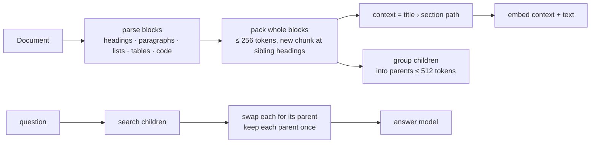

# Week 4: Chunking — where to cut

**[← Week 3: Ingestion](week03-ingestion.md)** · **[Course Plan](../COURSE_PLAN.md)** · **[Chunking (guide)](../docs/chunking.md)** · **Week 5: Scale →** *(coming)*

---

**Time:** about 5 hours (1 reading, 2.5 reading and running the code, 1.5 on the experiments).
**Code for this week:** `git checkout week-04`
**Companion guide:** [`docs/chunking.md`](../docs/chunking.md): tokens vs characters, the three splitters, parent/child, contextual retrieval, and how to compare chunkers fairly.

**You're done when:**

1. `uv run pytest` passes (372 tests, offline, no keys needed),
2. you can explain why recall@4 alone would have picked the wrong chunker this week, and why SciFact vetoed the runner-up, and
3. you've run `raggy search` on the manual with two chunkers and can point to a question where the cut decided the answer.

## 1. Read first

| Read | Look for |
| --- | --- |
| [Introducing Contextual Retrieval](https://www.anthropic.com/news/contextual-retrieval) (Anthropic, 2024) | Why a chunk loses meaning when it's cut from its document, and the per-chunk context fix. Section 6.4 tests it here. |
| [`docs/chunking.md`](../docs/chunking.md) (this repo) | Sections 2 (tokens), 5 (parent/child) and 7 (fair comparison) before you read the results. |

## 2. Why chunk boundaries decide what can be found

Retrieval returns chunks. A fact that a boundary cuts in half can't be retrieved whole, and a chunk holding five topics has a vector that matches none of them well. Weeks 1 to 3 cut every 800 characters, wherever that landed: mid-sentence, mid-table-row, between a heading and its first paragraph.

This week adds three ways to cut by structure, two ways to give a chunk more context, and, as important as either, a way to compare them without fooling yourself. The result, measured on answer correctness:

| | fixed 800 chars (weeks 1–3) | **structure 256 + parents 512 (new default)** |
| --- | --- | --- |
| manual (one long document) | 0.854 | **1.000** |
| fictional (12 short docs) | 0.864 | **0.894** |
| fictional-web | 0.909 | **0.970** |
| answerable questions refused | 4.2 / 6.1 / 6.1% | **0 / 3.0 / 0%** |
| SciFact nDCG@10 (public benchmark) | 0.721 | 0.712 |

The cost is context: the model reads about 1,000–1,800 tokens per question instead of about 550–760. The SciFact line is there because it stopped a better-looking choice (section 6.5).

## 3. What you're building this week



### The code, file by file (527 lines in `raggy/chunking/`)

| File | Lines | What it does |
| --- | --- | --- |
| `chunking/tokens.py` | 22 | `simple_count` for tests; real runs use the embedding model's tokenizer |
| `chunking/recursive.py` | 145 | Cut at paragraphs → lines → sentences → words → characters, then pack sentence units with overlap. `pack` is shared with the structure chunker |
| `chunking/structure.py` | 136 | Markdown blocks, section paths, tables split between rows with their header row, code split between lines |
| `chunking/__init__.py` | 74 | `ChunkSettings`, `chunk_document` (dispatch, headers on or off), parents built from children |
| `chunking/contextual.py` | 118 | Optional LLM-written chunk context, cached in SQLite, 8 calls in parallel |
| `chunking/fixed.py` | 32 | Week 1's character windows, unchanged: the baseline |

Also changed: `Chunk` gains `context` and `parent_*` fields (old index files still load), `embed_text`, parent expansion in `Raggy.search`, the prompt and the judge show the section path, chunk settings join the registry key and the eval cache key, and every run records `context_tokens`. New suite: `manual`. One dependency is now declared: `tokenizers` (0.23.3, Apache-2.0). fastembed already installed it, but raggy now imports it directly to count tokens, so it's named in `pyproject.toml` (week 3's rule: declare what you import).

**Upgrading an existing index:** the chunk settings are part of each source's settings key, so the first `raggy ingest` after updating re-embeds everything once. To keep week 3's chunks, set `RAGGY_CHUNKER=fixed RAGGY_PARENT_TOKENS=0`.

## 4. Walkthrough

### 4.1 Tokens, not characters

bge-small reads 512 tokens and **silently drops the rest**. The model's own tokenizer is configured to truncate at 512, so even counting with it would stop at 512. `FastEmbedEmbedder.count_tokens` uses a copy with truncation switched off:

```python
self._tokenizer = Tokenizer.from_str(self._model.model.tokenizer.to_str())
self._tokenizer.no_truncation()
```

Characters per token vary from 4.9 (plain prose) to 3.1 (a parts-table row) to 2.4 (code), so a character limit can't be both safe and efficient. Chunk sizes are now in tokens. Config refuses sizes that can't fit beside a 64-token header, and `ingest_documents` refuses to embed any text over the model's limit rather than let it be truncated.

### 4.2 The structure chunker

`parse_blocks` turns Markdown into headings, paragraphs, lists, tables and fenced code, each with exact character offsets. `chunk_structure` then packs whole blocks. One rule took a failing test to get right: **a heading at the same or a higher level than the section we're in starts a new chunk**. The first version compared it with the chunk's *first* heading, so after one long section had been split, the next sibling heading (`## Exchanges`) joined the previous section's last chunk. `test_structure_context_path` caught it.

Oversized blocks are split by their own grain. A table goes between rows, with the header row added to each piece's context (so `| E07 | Charging interrupted | … |` keeps its column names). Code goes between lines. Anything else goes by sentences, then words, then characters. Each chunk's context is its section path, *measured* on the manual:

```
Ebb E-Cargo owner's manual › 5. Battery and charging › Charging in the cold
### Charging in the cold

The battery only accepts charge between 5 °C and 40 °C. If you bring the bike in from below 5 °C, wait at least one hour bef…
```

The invariant every chunker keeps is `chunk.text == doc.text[start:end]`. The context is embedded and shown to the answer model, but it isn't in the span, so week 2's gold spans and the citations still point at the document's real characters. A property test runs every chunker over 40 random Markdown documents (headings, tables, code, 400-word walls of text, 30-character "words") and all three eval corpora. It checks exact offsets, coverage of every non-space character, order, and the size limit.

### 4.3 Parent/child retrieval, and the two bugs the evals found

With `RAGGY_PARENT_TOKENS=512`, the small chunks (256 tokens by default) are what's searched, and each one found is swapped for its 512-token parent. `Raggy.search` asks the store for `4k` children, maps them to parents, keeps each parent once, and returns `k`.

The first two versions were wrong in ways no unit test of mine anticipated. The eval numbers exposed both:

1. **Parents that stopped at section headings.** The first version built parents with the same chunker, so a parent stopped at the same headings as its children and was often just the child's section again. The staff handbook's f11 ("When can I fix my own bike for free with your tools?") showed it. Structure chunking ranked the "Community repair evening" section first (score 0.709), but the *when*, "first Thursday of each month", sits in the sibling "Hours" section. A parent's job is to bring in that neighbour.
2. **Children that straddled two parents.** The second version chunked parents separately, ignoring headings. Its boundaries didn't line up with the children's, so a child could lie half in one parent and half in the next. The symptom was impossible on its face: parent recall@4 on the manual (0.875) came out *below* the plain children's (0.896), although a child's parent always contains the child. The fix builds parents *from* the children (consecutive children grouped up to 512 tokens), so containment holds by construction. `test_every_child_inside_its_parent` checks it on 40 random documents.

The lesson for your own systems: when a number contradicts a property you know must hold, the code is wrong, not the number.

### 4.4 Contextual retrieval

`RAGGY_CHUNK_CONTEXT=llm` asks the answer model, once per chunk, for one or two sentences situating the chunk in its document. The prompt is `<document>…</document>` followed by `<chunk>…</chunk>`, with the document first so providers that cache prompt prefixes can reuse it. Results are cached in `context-cache.sqlite` by document hash, chunk span, model and prompt version, and only successes are cached. A failed call leaves that chunk with its header, is counted, and is retried next time. Two practical details:

- The eval rebuilds its index when settings change. The rebuild now keeps `context-cache.sqlite`, because it's paid-for output that doesn't depend on those settings. Week 2's "only delete a folder raggy made" guard learned to treat a folder holding only that cache as raggy's own (`test_eval_folder_with_only_the_cache_is_rebuilt`).
- LLM context is trimmed word by word if context + chunk would pass the model's token limit.

## 5. A suite where chunking can matter

The first measurements on the existing suites were almost all ties, and the reason was the data, not the chunkers. *Measured:* the 12 fictional documents are 181–327 tokens each, so most of them are one or two chunks under any strategy. A chunking comparison on that corpus measures noise.

So this week adds **`evals/manual`**: one fictional owner's manual for the Ebb E-Cargo, 3,022 tokens and 18 numbered sections. It has spec, error-code, range, maintenance, tyre-pressure and troubleshooting tables, numbered firmware-update steps, and cross-references ("E07: see section 5, *Charging in the cold*"). It comes with 24 answerable questions (tagged `table`, `steps`, `cross-section`, `numeric`, `paraphrase`, …) and 5 unanswerable ones that sound like they belong ("What torque should the steering link bolts be tightened to?"). As in week 2, it's fictional so the model can't answer from memory, and every gold quote is checked by a test.

```bash
uv run raggy eval --suite manual --retrieval-only
```

## 6. The numbers

### 6.1 Retrieval: ten settings

Retrieval only, `BAAI/bge-small-en-v1.5`, top 4. `ctx` is the median number of tokens the answer model would read per question.

| | Setting (`RAGGY_…`) | manual r@1 | r@4 | MRR | ctx | fictional r@4 | MRR | ctx |
| --- | --- | --- | --- | --- | --- | --- | --- | --- |
| A | `CHUNKER=fixed` (weeks 1–3) | 0.667 | 0.938 | 0.790 | 761 | 0.939 | 0.848 | 545 |
| B | `recursive`, 256 tokens, no headers | 0.646 | 0.812 | 0.781 | 994 | 1.000 | 0.856 | 771 |
| C | `structure`, 256, no headers | 0.562 | 0.938 | 0.744 | 611 | 0.939 | 0.854 | 394 |
| D | `structure`, 256, headers | 0.646 | 0.896 | 0.787 | 666 | 0.939 | 0.839 | 471 |
| E | D + parents 1,024 | 0.688 | 1.000 | 0.833 | 3,081 | 0.970 | 0.915 | 1,016 |
| F | `structure`, 128, headers | 0.792 | 0.896 | 0.858 | 426 | 0.970 | 0.851 | 356 |
| G | `structure`, 448, headers | 0.688 | 0.896 | 0.808 | 681 | 0.939 | 0.870 | 506 |
| J | F + parents 512 | **0.854** | 0.979 | **0.906** | 1,751 | **1.000** | **0.949** | 1,018 |
| K | F + contextual retrieval (LLM) | 0.792 | 0.854 | 0.843 | 615 | — | — | — |
| **L** | **D + parents 512 (the default)** | 0.667 | **1.000** | 0.802 | 1,773 | 0.970 | 0.915 | 1,016 |

fictional-web follows fictional (J: recall@4 1.000, MRR 0.949; L: 1.000, 0.932). Every run behind these tables is in `evals/baselines/week04/` (`<suite>-<setting>-retrieval.json` and `-answers.json`).

What the table says:

- **Small, structure-aware chunks are the most precise.** F has the best recall@1 on the manual among the plain chunkers (0.792 against fixed's 0.667), with the smallest context. One idea per vector.
- **But small chunks lose neighbours.** F's recall@4 (0.896) is below fixed's (0.938). Question m05 (the Tour-mode range with 80 kg) has its answer in the range table, and F didn't rank that table in its top 4.
- **Parents put the neighbours back.** J searches like F and answers with 512-token parents: best recall@1 and MRR on every suite. L does the same with 256-token children: less precise at rank 1 on the manual, but every manual question's evidence is in its top 4.
- **Huge parents are not retrieval any more.** E's 1,024-token parents give the model the whole 3,000-token manual (ctx 3,081). Its recall@4 of 1.000 is "we sent everything", not "we found it".
- **Recursive is the weakest on the long document.** It packs sentences across section boundaries, so its chunks mix topics.
- **Headers alone (C → D) were mixed at 256 tokens.** On the manual, recall@1 and MRR rose, and recall@4 fell by one question. They matter more as chunks get smaller and lose their own context (F).

### 6.2 Recall@4 would have picked the wrong chunker

The plan said to choose the default by mean recall@4 over the fictional suites. That rule picks **B** (recursive): recall@4 1.000 on both. B wins because the fictional documents are so short that its 256-token chunks are often *whole documents*, and four whole documents usually contain the answer. On the long manual, B is the worst setting (0.812).

That's the trap from the guide's section 7: **at a fixed k, bigger chunks win recall for free.** So the decision used two fairer views:

- **Equal token budget.** For each setting, how many hits fit in ~800 tokens, and the recall at that k (computed from the 10 hits saved per question). On the manual: fixed reaches 0.938 with 4 hits, and F reaches 0.979 with 7.
- **Answer correctness** on all three suites, which is what you care about.

### 6.3 Answers

Same answer model and judge as every earlier baseline (`openai:gpt-5.5` answering, `openai:gpt-5.4` judging, `judge-v1`):

| Setting | manual | fictional | fictional-web | mean | answerable refused | ctx (manual) |
| --- | --- | --- | --- | --- | --- | --- |
| A fixed (weeks 1–3) | 0.854 | 0.864 | 0.909 | 0.876 | 4.2 / 6.1 / 6.1% | 761 |
| F structure 128, top 4 | 0.917 | 0.924 | 0.939 | 0.927 | 4.2 / 0 / 0% | 426 |
| F8 structure 128, top 8 | 0.938 | 0.939 | 0.939 | 0.939 | 0 / 0 / 0% | 875 |
| J structure 128 + parents 512 | 0.979 | **0.939** | 0.924 | 0.947 | 0 / 0 / 0% | 1,751 |
| **L structure 256 + parents 512** | **1.000** | 0.894 | **0.970** | **0.955** | 0 / 3.0 / 0% | 1,773 |

Faithfulness and citation precision are 1.000 everywhere, except one unsupported citation in F8 on fictional (0.985).

Between A and L, six manual questions changed grade, and all six improved. m11 ("What happens when the battery gets down to 5%?") was missed outright by fixed chunks (recall@4 0, judged incorrect), and m02, m07, m12, m16 and m23 went from partial to correct. On fictional, f11 (section 4.3's staff-handbook question), f17, f30 and f33 improved. **f05 got worse:** "Why is the first frame line called Heron?" was answered by fixed chunks, but L's retrieval missed it (recall@4 0) and the model refused. A small, honest regression. The company history is a single 256-token chunk, mostly about the founding and the cooperative, and the mascot sentence is its last line. Fixed 800-character windows happened to put that sentence in a short final chunk about the Heron line, which matched the question. Under L the document ranked 5th, one place outside the top 4. A bigger chunk blurs a small fact. That's the cost side of the size trade-off.

**The default is L**: `RAGGY_CHUNKER=structure`, `RAGGY_CHUNK_TOKENS=256`, `RAGGY_CHUNK_OVERLAP_TOKENS=32`, `RAGGY_CHUNK_HEADERS=1`, `RAGGY_PARENT_TOKENS=512`. It has the best mean correctness (0.955), and it keeps SciFact within the limit set before the runs (section 6.5). J, F8 and L are each within about one question per suite of each other on answers, which is about the run-to-run noise of one judged run. F8 reads about half as much context, so if cost matters more to you than the last point of accuracy, set `RAGGY_PARENT_TOKENS=0 RAGGY_TOP_K=8`. Generation latency is the same within noise for all of them (p50 1.4–1.8 s).

### 6.4 Contextual retrieval

Measured twice, both retrieval only:

- fictional and fictional-web, with D's settings (structure 256 + headers): 33 LLM calls each (about 30 s of ingest). MRR 0.857 against 0.839 (fictional) and 0.825 against 0.848 (web).
- manual, with F's settings (structure 128 + headers): 37 calls. Recall@4 0.854 against 0.896, MRR 0.843 against 0.858.

Within noise, and if anything slightly negative. On these corpora, the free section-path header already tells each chunk where it is. Anthropic reported large gains on corpora whose chunks lose their subject when cut out ("the company's revenue grew 3%": which company?). Our documents name their subject in every section heading. So it stays a switch, off by default, cached for when your documents are the other kind. Experiment 5 asks you to find a corpus where it helps.

### 6.5 SciFact

The rule, written into the plan before any run: the default must not lower SciFact nDCG@10 by more than 0.01 against week 3. SciFact is a public benchmark the course didn't write, so it's the guard against tuning to our own questions.

| Setting | chunks | recall@1 | recall@10 | recall@100 | MRR | nDCG@10 | Δ vs week 3 |
| --- | --- | --- | --- | --- | --- | --- | --- |
| A fixed (week 3) | 12,932 | 0.585 | 0.842 | 0.960 | 0.691 | 0.721 | — |
| B recursive 256 | 9,638 | 0.575 | 0.835 | 0.960 | 0.684 | 0.715 | −0.006 |
| D structure 256 | 9,638 | 0.578 | 0.834 | 0.960 | 0.682 | 0.712 | −0.009 |
| F / J structure 128 (± parents) | 18,161 | 0.561 | 0.830 | 0.940 | 0.669 | 0.702 | **−0.019** |
| **L structure 256 + parents** | 9,638 | 0.578 | 0.834 | 0.960 | 0.682 | 0.712 | −0.009 |

**J failed the rule.** Its 128-token children split each abstract into three or four pieces. A scientific claim matches the abstract as a whole better than any one piece, and recall@100 fell from 0.960 to 0.940: about six claims' worth of relevant abstracts left the top 100. Parents can't help here: SciFact scores documents, and the document ranking comes from the children. J was the leading candidate on our own suites, and the rule written before the runs is what stopped it. L uses 256-token children (one or two per abstract), stays within the limit, and turned out better on answers anyway.

SciFact abstracts are short and have no Markdown structure, so every chunker here is close to fixed windows on them, and none beats week 3. The honest summary: structure-aware chunking helps documents that have structure, and costs a little on documents that don't.

## 7. Why each choice

| Choice | Why | What it costs |
| --- | --- | --- |
| Sizes in model tokens | The model truncates by tokens, silently; chars/token varies 2.4–4.9 | A tokenizer call per unit at ingest |
| Refuse over-limit embeds | Truncation would index a vector of half a chunk | An ingest can fail on a pathological setting (it names the chunk) |
| Structure-aware packing | Chunks end at block boundaries; tables and code stay whole | Markdown only; other text falls back to sentences |
| Sibling heading → new chunk | One chunk, one topic | Short sections make small chunks |
| Section path as context, not in the span | Better vectors; gold spans and citations stay exact | 64 tokens of headroom kept for it |
| 256-token children | Best mean answer correctness with parents; keeps SciFact within 0.01 | Less precise at rank 1 than 128-token children on the long manual |
| 512-token parents built from children | Neighbouring sections come back; containment by construction | 2–3× the context tokens per question |
| Parents ignore section boundaries | That's where the missing neighbour is | A parent can mix two topics |
| Contextual retrieval off by default | No measured gain here; costs a call per chunk | You have to turn it on and measure your own corpus |
| A long-document eval suite | Short docs can't tell chunkers apart | One more corpus to keep correct |
| Decide on answers + equal budget, not recall@4 | Bigger chunks win recall@4 for free | Answer runs cost money; one judge run is noisy |

## 8. Experiments and notes

Write your answers in `NOTES.md`.

1. Run `uv run raggy search "How far can I ride in Tour mode carrying 80 kg?" -k 4` against an index of `evals/manual` built with `RAGGY_CHUNKER=structure RAGGY_CHUNK_TOKENS=128 RAGGY_PARENT_TOKENS=0`, then with `RAGGY_PARENT_TOKENS=512`. Where is the range table in each list, and why?
2. Set `RAGGY_CHUNK_TOKENS=64`. What happens to recall@1 and recall@4 on the manual? Is there a size below which the section path does all the work?
3. Write a Markdown document with one 3,000-token table and ingest it with `structure`. Print the chunks with `raggy search`. Does every piece carry the column names? What would a fixed-size chunker have given the embedding model for row 200?
4. Re-run the answer eval for L twice on the manual. How far apart are the two runs? Is L's lead over F8 or J bigger than that?
5. Find or write a document where chunks lose their subject ("It ships within two days." under a heading that doesn't name the product). Measure `RAGGY_CHUNK_CONTEXT=llm` against headers only. How many calls did it make, and what did they cost?
6. Change `HEADER_BUDGET` to 0 and set `RAGGY_CHUNK_TOKENS=510`. Ingest the manual. What stops you, and why is that better than what weeks 1–3 would have done?

---

**Tested with:** Python 3.13.14, fastembed 0.9.0, tokenizers 0.23.3, numpy 2.5.4, openai 3.37.0, on an Apple M2 with 8 GB of RAM. Answer model `openai:gpt-5.5`, judge `openai:gpt-5.4`. All numbers come from the runs committed in `evals/baselines/week04/`.
