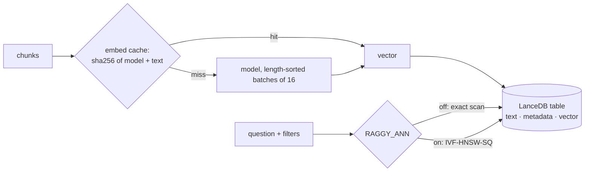

# Week 5: Scale — tens of thousands of documents

**[← Week 4: Chunking](week04-chunking.md)** · **[Course Plan](../COURSE_PLAN.md)** · **[Vector search at scale (guide)](../docs/vector-search-at-scale.md)** · **Week 6: Hybrid search →** *(coming)*

---

**Time:** about 5 hours (1 reading, 2 reading and running the code, 2 on the experiments; the first FiQA ingest alone takes about 45 minutes).
**Code for this week:** `git checkout week-05`
**Companion guide:** [`docs/vector-search-at-scale.md`](../docs/vector-search-at-scale.md): exact vs IVF vs HNSW, what nprobes and refine do, and when you need approximate search.

**You're done when:**

1. `uv run pytest` passes (410 tests, offline, no keys needed),
2. you've ingested a folder twice with different `RAGGY_PARENT_TOKENS` and seen the second run embed nothing, and
3. you can say, from section 6, why raggy's default is exact search even though the ANN index is three times faster.

## 1. Read first

| Read | Look for |
| --- | --- |
| [`docs/vector-search-at-scale.md`](../docs/vector-search-at-scale.md) (this repo) | Section 1 (exact search is a matrix multiply), section 3 (recall is measured against exact search) and section 4 (when you need ANN). |
| [Efficient and robust approximate nearest neighbor search using HNSW graphs](https://arxiv.org/abs/1603.09320) (Malkov & Yashunin, 2016): sections 1 and 4 | How a layered graph finds near neighbours by visiting a few hundred vectors instead of all of them. |

## 2. What "scale" turned out to mean

The spec planned this week as "move to a real vector database, because numpy brute force stops being good enough". The measurements say something more useful. At tens of thousands of documents, **searching is not the slow part. Embedding is.**

On FiQA (57,638 forum posts, 73,422 chunks), on an 8 GB Apple M2:

| | time |
| --- | --- |
| Embedding every chunk, the first time | **2,745 s** (45 minutes, 26.7 chunks/s) |
| Rebuilding the same index after a settings change, with the embedding cache | **79 s** (0 chunks embedded) |
| One search at `raggy ask` depth, exact, numpy | 2.5 ms (p50) |
| One search at `raggy ask` depth, exact, LanceDB | 15 ms (p50) |
| Generating the answer (week 4's runs) | about 1,500 ms |

So this week's three changes, in order of what they're worth:

1. **An embedding cache.** No text is ever embedded twice by the same model.
2. **Faster embedding.** Texts are batched by length: +41% measured.
3. **LanceDB as the store**, for incremental writes, filters, and the full-text index week 6 needs. Its approximate (ANN) index is built and measured, and left off by default, because exact search is already fast enough.

## 3. What you're building this week



### The code, file by file

| File | Lines | What it does |
| --- | --- | --- |
| `embed/cache.py` | 92 | `EmbeddingCache` (SQLite) and `CachedEmbedder`, which wraps any embedder and embeds only the misses, each distinct text once |
| `embed/fastembed_embedder.py` | +13 | Sorts texts by length before batching and restores the order after |
| `store/base.py` | 110 | The `VectorStore` protocol, shared errors, `Filters` (SQL with quoted values, or a Python predicate), and `make_store` |
| `store/lance_store.py` | 138 | LanceDB: replace-by-source writes, exact or ANN search, filters, and index building in `finish()` |
| `evals/suites.py` | +30 | `download_beir` for any BEIR dataset, and the `fiqa` suite |
| `evals/bench_embed.py`, `evals/bench_search.py` | 85 | The two benchmarks quoted below, so you can rerun them |

Also new: `Chunk.meta` (each chunk carries its document's type, title and modified date), `--type` / `--source` / `--after` on `raggy search` and `raggy ask`, the `RAGGY_STORE`, `RAGGY_EMBED_CACHE`, `RAGGY_ANN`, `RAGGY_ANN_NPROBES` and `RAGGY_ANN_REFINE` settings, and an `ann_overlap@k` metric in the eval. **New dependency:** `lancedb` 0.40.0 (Apache-2.0; it brings `pyarrow` 26). It's embedded, a folder on disk like SQLite, with no server.

## 4. Walkthrough

### 4.1 The embedding cache

`CachedEmbedder.embed_documents(texts)` hashes `model name + "\0" + text` for each text, looks every hash up in one SQLite query, embeds only the misses (each distinct text once, even if it repeats in the batch), stores them, and returns the vectors in input order. The model name is part of the key, so changing `RAGGY_EMBED_MODEL` can never serve another model's vectors.

The cache sits *under* everything that changes chunks, so it pays off well beyond re-ingesting a file:

| change | what gets re-embedded |
| --- | --- |
| `RAGGY_PARENT_TOKENS`, `RAGGY_ANN`, `RAGGY_STORE`, dedupe, filters | nothing: the children's text is unchanged |
| `RAGGY_CHUNK_HEADERS`, chunk size, chunker | only chunks whose embedded text changed |
| a new eval run after any of the above | the eval keeps its cache across rebuilds (`CACHE_FILES`) |

Queries aren't cached. Each is new, and embedding one takes about 3 ms.

### 4.2 Faster embedding: sort by length

A batch of texts is padded to its longest member. Mixing a 20-token title with a 250-token chunk makes the model compute 230 tokens of padding. `FastEmbedEmbedder.embed_documents` now sorts its input by length, embeds in batches of 16, and puts the vectors back in input order. Measured with `evals/bench_embed.py` on the same 800 FiQA texts:

```
$ uv run python evals/bench_embed.py evals/data/fiqa 800
input order          21.3 texts/s
sorted by length     30.1 texts/s
```

Two things that *didn't* help, both measured before the plan was written: batches of 64 (9.2 texts/s, against 11.7 for 16 in the same test), and fastembed's 4 worker processes (1.5 texts/s). Each worker loads its own copy of the model, and on an 8 GB machine the copies fight for memory.

### 4.3 LanceDB as the store

`LanceStore` keeps one table, `chunks`, under `index_dir/lance`: the chunk's text, context and parent span, its document's `doc_type`, `title` and `modified`, and the vector. Three details matter:

- **Replace by source.** `add()` first deletes every row of the incoming sources, then appends. Re-ingesting a changed file can't leave its old chunks behind (`test_lance_reingest_replaces_rows`).
- **Scores match NumpyStore.** With `distance_type("dot")`, Lance returns `_distance = 1 − dot`, so `score = 1 − _distance`. `test_lance_add_search_roundtrip` checks the same top hits and scores within 1e-5 of the numpy store.
- **Filters are SQL with quoted values.** `Filters(doc_type, source_prefix, modified_after)` becomes `doc_type = 'pdf' AND starts_with(source, '/docs/') AND modified >= '2026-01-01'`. `starts_with` is literal, so the `_` in a file path isn't a wildcard as it would be with `LIKE`, and a `'` in a value is doubled. The filter runs *inside* the search (`prefilter=True`), so "the 4 best PDFs" returns 4 PDFs. The test feeds it `pdf' OR '1'='1` and gets no rows.

`raggy search "refund rules" --type pdf --source ~/contracts --after 2026-01-01` exercises all three.

### 4.4 Two bugs the scale run found

1. **The eval's "is the index still there?" check** looked for the numpy store's `meta.json`. With LanceDB as the default, every eval would have rebuilt its index. The week 2–4 cache tests went red the moment the default changed, which is what they're for.
2. **Every search reopened the store.** For the numpy store that meant re-reading 113 MB of vectors for every question. The first FiQA run with the numpy store crawled at about 2.5 s per question, and its latency numbers would have been measuring disk reads. `Raggy` now keeps the store it opened and drops it after any write (`test_search_reuses_the_open_store_until_a_write`). Every number below was measured after this fix.

### 4.5 The ANN index

With `RAGGY_ANN=on`, ingest ends by building LanceDB's `IvfHnswSq` index (k-means partitions, an HNSW graph in each, 8-bit vectors) once the table has 1,000 rows, and `optimize()` folds later rows into it. Rows added after the index was built are still found, because Lance scans them exactly (`test_ann_finds_rows_added_after_index`). `RAGGY_ANN_NPROBES` (20) and `RAGGY_ANN_REFINE` (4) trade speed for recall. The eval also runs exact search for each question and records `ann_overlap@k`: how much of exact search's top k the approximate search found.

## 5. The scale suite: FiQA

`raggy eval --suite fiqa` downloads BEIR's copy of FiQA-2018 (57,638 posts from a finance Q&A forum, and 648 test questions with relevance labels), pins its SHA-256, and scores whole documents like SciFact. It's about 10× SciFact, big enough that the first ingest takes 45 minutes on this laptop, which is exactly why the embedding cache exists.

FiQA is downloaded, never committed. The dataset carries no licence statement, so raggy doesn't redistribute it. And like SciFact, it's a benchmark, so it's never deduplicated.

## 6. The numbers

### 6.1 Quality: the store and the index don't change what's found

Default chunking from week 4 (structure, 256 tokens, parents 512), retrieval only:

| suite | setting | nDCG@10 | recall@100 | ANN overlap@10 |
| --- | --- | --- | --- | --- |
| FiQA | numpy exact | 0.385 | 0.675 | — |
| FiQA | LanceDB exact | 0.385 | 0.675 | — |
| FiQA | LanceDB ANN (nprobes 20) | 0.385 | 0.675 | 1.000 |
| SciFact | numpy exact | 0.712 | 0.960 | — |
| SciFact | LanceDB exact | 0.712 | 0.960 | — |
| SciFact | LanceDB ANN (nprobes 20) | 0.712 | 0.960 | 1.000 |

nprobes 10 and 50 gave identical numbers (runs not committed). On these real embeddings the ANN index lost nothing: overlap 1.000 at depth 10. Compare the guide's random vectors, where the same index kept only 10% at 100,000 vectors. Real embeddings cluster by topic, and random vectors don't. Never trust an ANN default you haven't measured on your own vectors.

For scale, BEIR reports 0.236 for BM25 on FiQA, which week 6 will check against. SciFact's 0.712 is week 4's number, unchanged by the store.

### 6.2 Latency: measure at the depth users actually search

The eval's latency (per question, query embedding included) is measured at the eval's depth. Document-level scoring down to rank 100 means fetching about 1,200 chunks per question:

| suite | numpy exact p50 / p95 | LanceDB exact | LanceDB ANN |
| --- | --- | --- | --- |
| FiQA (73,422 chunks) | 7.3 / 9.5 ms | 56.7 / 59.8 ms | 72.1 / 77.4 ms |
| SciFact (9,638 chunks) | 5.9 / 9.1 ms | 31.3 / 41.3 ms | 38.9 / 42.7 ms |

At that depth the ANN index is *slower* than exact search. It fetches `refine × 1,200` candidates and re-scores them. But `raggy ask` fetches 16 chunks (top 4, times 4 for parents), not 1,200. `evals/bench_search.py` times exactly that, on the same 73,422 vectors for all three:

```
$ uv run python evals/bench_search.py .raggy/evals/fiqa/lance evals/data/fiqa 300 16
numpy exact  p50   2.49 ms  p95   2.97 ms
lance exact  p50  15.07 ms  p95  17.53 ms
lance ann    p50   4.48 ms  p95   5.25 ms
ann overlap@16 vs exact: 0.990  (73422 chunks, 300 questions)
```

At ask depth, ANN is 3.4× faster than LanceDB's exact scan and finds 99% of the same chunks. The numpy matrix is faster still: it's an in-memory multiply, with no columnar reads and no query engine.

### 6.3 The decision

The rule, written into the plan before any run: ANN is on by default only if exact search's p95 latency on FiQA is over 100 ms, *and* ANN keeps nDCG@10 within 0.005.

- **The quality condition holds:** nDCG@10 is identical.
- **The latency condition fails:** exact p95 is 17.5 ms at ask depth, and 59.8 ms even at eval depth.

**So the default stays exact** (`RAGGY_ANN=off`). At this scale, ANN would save about 10 ms on an answer that takes 1,500 ms, in exchange for a 1% chance per chunk of missing the true neighbour. Turn it on when your corpus is 10–100× bigger: the guide's arithmetic puts LanceDB's exact scan at 50 ms around 200,000 vectors.

And the store? The default is **LanceDB** although numpy searches faster. NumpyStore keeps every vector in memory and rewrites all of them on every save; LanceDB appends and deletes in place. LanceDB filters inside the search, and it carries the full-text index week 6 adds. 15 ms is the price, and section 2's table shows it's the cheapest stage of a question. `RAGGY_STORE=numpy` remains for small corpora and as the exact reference.

### 6.4 Ingest

| | chunks | time | embedded | from cache |
| --- | --- | --- | --- | --- |
| FiQA, first ingest | 73,422 | 2,745 s | 73,327 | 95 |
| FiQA, rebuilt for the numpy store | 73,422 | 80 s | 0 | 73,422 |
| FiQA, rebuilt with the ANN index | 73,422 | 88 s | 0 | 73,422 |
| SciFact, first ingest with the week 4 chunker | 9,638 | 417 s | 9,638 | 0 |
| SciFact, rebuilt for numpy | 9,638 | 15 s | 0 | 9,638 |

The 95 cache hits on the first FiQA ingest are chunk texts that occur more than once inside FiQA itself: the cache embedded each one once. Building the ANN index for 73,422 vectors added about 8 seconds.

## 7. Why each choice

| Choice | Why | What it costs |
| --- | --- | --- |
| Embedding cache keyed by model + text | Embedding is 97% of ingest; most re-runs re-embed text already seen | A SQLite file about the size of the vectors |
| Length-sorted batches of 16 | +41% throughput, measured | A sort per batch |
| No worker processes | Measured 6× slower on 8 GB: one model copy per worker | Ingest uses about 2 cores |
| LanceDB default store | Incremental crash-safe writes, filters in the search, week 6's full-text index | 15 ms per search instead of 2.5 ms |
| Exact search by default | Rule written before the runs: exact p95 17.5 ms ≪ 100 ms | 10 ms per search that ANN would save |
| ANN measured with overlap against exact | Needs no labels; isolates what the index loses | One extra exact search per question in ANN eval runs |
| Filters as quoted SQL, prefiltered | Values can't inject; "top 4 PDFs" returns 4 PDFs | Filters only on columns copied onto chunks (type, title, modified, source) |
| FiQA downloaded, checksum-pinned, not committed | No licence to redistribute; exact bytes behind the numbers | A 45-minute first ingest |

## 8. Experiments and notes

Write your answers in `NOTES.md`.

1. Ingest a folder. Change `RAGGY_PARENT_TOKENS` and ingest again, then change `RAGGY_CHUNK_HEADERS`. How many chunks were embedded each time, and why the difference?
2. Run `evals/bench_embed.py` with 200, 800 and 2,000 texts. Does the speedup from sorting grow or shrink? Why would a corpus of equal-length texts gain nothing?
3. Build FiQA with `RAGGY_ANN=on`, then run `evals/bench_search.py` with k = 4, 16, 100 and 1,000. Where does ANN stop being faster than exact search, and why (look at `refine_factor`)?
4. Set `RAGGY_ANN_NPROBES=1` and `RAGGY_ANN_REFINE=1`, then rebuild and rerun the FiQA eval. What happens to `ann_overlap@10` and to nDCG@10? Is there a setting that's faster than the default *and* keeps overlap above 0.99?
5. Index the course folder itself and try `raggy search "chunk size" --type markdown --source lessons/`. Then try a `--source` value containing a quote. What does the SQL look like (`Filters(...).sql()`)?
6. Compare numpy and LanceDB on the time `raggy ingest` takes after changing one file in a folder of 10,000 chunks. Which part of NumpyStore makes it slower, and how does LanceDB avoid it?

---

**Tested with:** Python 3.13.14, lancedb 0.40.0, pyarrow 26.0.0, fastembed 0.9.0, numpy 2.5.4, on an Apple M2 with 8 GB of RAM. Every number above is from the runs committed in `evals/baselines/week05/`, or from the two benchmark scripts with the output shown.
