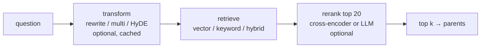

# Week 7: Reranking and query transforms

**[← Week 6: Hybrid search](week06-hybrid-search.md)** · **[Course Plan](../COURSE_PLAN.md)** · **[Reranking (guide)](../docs/reranking.md)** · **[Week 8: Grounded generation →](week08-grounded-generation.md)**

> **New to the ideas?** The general concepts behind this page, with diagrams, worked examples and reading links: [09 Reranking and cross-encoders](../concepts/09-reranking.md) · [10 Query transformation](../concepts/10-query-transformation.md).

---

**Time:** about 4 hours (1 reading, 1.5 reading and running the code, 1.5 on the experiments).
**Code for this week:** `git checkout week-07`
**Companion guide:** [`docs/reranking.md`](../docs/reranking.md): bi-encoders against cross-encoders, listwise LLM ranking, the three query transforms, and latency budgets.

**You're done when:**

1. `uv run pytest` passes (466 tests, offline, no keys needed),
2. you've run `raggy ask "..." --rerank local --timings` and read the stage table, and
3. you can explain why the reranker moves recall@1 from 0.80 to 0.95 and is still off by default.

## 1. Read first

| Read | Look for |
| --- | --- |
| [`docs/reranking.md`](../docs/reranking.md) (this repo) | Why a cross-encoder reads the question and the passage *together*, and why that's too slow to run over a whole index. |
| [Passage Re-ranking with BERT](https://arxiv.org/abs/1901.04085) (Nogueira & Cho, 2019) | The two-stage pattern this week builds: a cheap retriever, then a precise ranker over its top few. |
| [Precise Zero-Shot Dense Retrieval without Relevance Labels](https://arxiv.org/abs/2212.10496) (Gao et al., 2022): HyDE | Embedding a *hypothetical answer* instead of the question. Note which collections it helped. |

## 2. Retrieve wide, rank narrow

Week 6 left raggy with two retrievers and a fusion. Both rank by a score computed *separately* for the question and each chunk. An embedding model encodes the question once and every chunk once, ahead of time; similarity is a dot product. That's what makes search over a million chunks take milliseconds. It's also its limit: the model never sees the question and the passage side by side.

A **cross-encoder** reads both at once, in one pass, and outputs one relevance score. It's far more precise, and far too slow to run over the index, so it runs over the top 20 the retriever already found. This week adds that stage, plus three ways to change the *question* before retrieval:

- **rewrite:** an LLM turns a chatty question into a search query.
- **multi:** an LLM writes three phrasings; each is searched and the rankings are fused (week 6's RRF).
- **HyDE:** an LLM writes a short passage that *would* answer the question, and that passage is embedded instead.

Every stage is timed against a budget, and every technique has a rule, written before any run, that decides whether it's on by default.

## 3. What you're building this week



| File | Lines | What it does |
| --- | --- | --- |
| `retrieve/rerank.py` | 110 | `CrossEncoderReranker` (fastembed, default `Xenova/ms-marco-MiniLM-L-6-v2`, 0.08 GB), `LLMReranker` (listwise, JSON ranking), `make_reranker`; failures fall back to retrieval order and are counted |
| `retrieve/transforms.py` | 99 | rewrite / multi / HyDE prompts (`qt-v1`), a SQLite cache keyed by model + prompt version + question, fallback to the original question |
| `pipeline.py` | +60 | Stages timed into `last_timings`; rerank only the top `RAGGY_RERANK_CANDIDATES`; HyDE's keyword side keeps the original question |
| `config.py`, `cli.py` | +30 | `RAGGY_RERANK`, `RAGGY_RERANK_MODEL`, `RAGGY_RERANK_CANDIDATES`, `RAGGY_QUERY_TRANSFORM`, `RAGGY_BUDGETS`; `--rerank`, `--transform`, `ask --timings` |
| `evals/` | +50 | Per-stage p50/p95 against budgets, `over_budget`, and a count of fallbacks with a ⚠ line when any happened |

No new dependencies: fastembed already ships cross-encoders.

## 4. Walkthrough

### 4.1 The cross-encoder

`CrossEncoderReranker.rerank(question, hits)` scores each `(question, passage)` pair in batches of 16 and reorders the hits by that score. The passage is `source_text(hit)`, the context header and then the chunk, so if the pair is longer than the model's 512 tokens, the truncation cuts the chunk's tail, not its header.

Only the top `RAGGY_RERANK_CANDIDATES` (20) are reranked; anything deeper keeps its retrieval order. The eval asks for about 1,200 chunks per question on the document-scored suites, and reranking all of them was infeasible (minutes per question). Reranking the top 20 is also what the setting means in production.

### 4.2 The LLM reranker

`LLMReranker` sends the question and the numbered candidates and asks for `{"ranking": [ids]}`. A ranking can come back partial, with unknown ids or with duplicates. Unknown ids are dropped, duplicates are kept once, and candidates the model left out are appended in their original order. Unparseable output keeps the retrieval order and counts a failure.

### 4.3 Query transforms

Each transform is one LLM call per question, cached in `transform-cache.sqlite`, so an eval rerun pays nothing. Multi-query variants that repeat the original are dropped before retrieval, so they can't double-count in the fusion. With HyDE in hybrid mode, the keyword side searches the *original* question: an invented passage would bring invented keywords.

### 4.4 Fallbacks must be loud

A transform or reranker that fails falls back to the plain path by design: a search shouldn't fail because an optional stage did. But in an eval, a silent fallback reports the *baseline's* numbers under the technique's name. That happened during this week's first grid: the OpenAI account ran out of credit, every LLM call failed, and the runs looked like "LLM reranking changes nothing".

Runs now record `fallbacks` and `fallback_of` per stage, and the report prints:

```text
⚠ 278 of 300 rerank calls failed and fell back: these numbers are not that technique's (check the model / API key)
```

That line later caught a second credit outage on its first run.

A second bug the grid surfaced: the eval index cache was keyed by file names and bytes, not by paths. A git worktree of the same repo has the same bytes at different paths, so it reused an index whose chunks pointed at the other checkout, and every gold span missed (recall 0.000). The cache key now includes a hash of the document paths.

## 5. The numbers

All runs are retrieval only, with week 6's defaults (vector search, structure chunks, parents). LLM stages use gpt-5.5.

### 5.1 Rerankers

recall@1 / recall@4 / MRR:

| suite | none | MiniLM-L-6 (local) | bge-reranker-base (local) | LLM (gpt-5.5) |
| --- | --- | --- | --- | --- |
| fictional (33) | 0.848 / 0.970 / 0.915 | 0.970 / 1.000 / 0.985 | 0.939 / 1.000 / 0.965 | **1.000 / 1.000 / 1.000** |
| fictional-web (33) | 0.879 / 1.000 / 0.932 | 0.970 / 1.000 / 0.985 | **1.000 / 1.000 / 1.000** | **1.000 / 1.000 / 1.000** |
| manual (24) | 0.667 / 1.000 / 0.806 | 0.917 / 1.000 / 0.958 | not run (see 5.4) | **1.000 / 1.000 / 1.000** |

On the public benchmarks (nDCG@10 / recall@100):

| suite | none | MiniLM-L-6 |
| --- | --- | --- |
| SciFact (300) | 0.712 / 0.960 | 0.710 / 0.960 |
| FiQA (648) | 0.385 / 0.675 | 0.389 / 0.675 |

Rerank latency, p50 / p95 per question (20 candidates):

| | MiniLM-L-6 | bge-reranker-base | LLM |
| --- | --- | --- | --- |
| fictional suites | 0.40–0.47 s / 0.44–0.51 s | 3.9–4.1 s / 4.5–4.6 s | 7.4–7.9 s / 9.0–10.2 s |
| SciFact / FiQA | 0.60 s / 0.66–0.71 s | — | — |

The headline is recall@1. On the three fictional suites, its mean goes from 0.798 with no reranker to 0.952 with a 0.08 GB local model, and to 1.000 with the LLM. recall@4 barely moves, because the right chunk was almost always in the top 4 already. Reranking fixes the *order*.

On SciFact and FiQA, MiniLM does nothing (−0.002 / +0.004). One likely reason: MiniLM-L-6 learned relevance from web search queries (MS MARCO), and neither scientific claims nor finance forum posts look like those. It's also reranking a strong retriever's list: bge-small already ranks SciFact well, so there's less wrong order to fix than over BM25.

### 5.2 Query transforms

recall@1 / recall@4 / MRR (none = the first column above):

| suite | rewrite | multi | HyDE |
| --- | --- | --- | --- |
| fictional | 0.879 / 1.000 / 0.934 | 0.848 / 1.000 / 0.917 | not measured |
| fictional-web | 0.848 / 1.000 / 0.919 | 0.909 / 1.000 / 0.947 | 0.879 / 1.000 / 0.934 |
| manual | 0.750 / 1.000 / 0.858 | 0.667 / 1.000 / 0.812 | 0.792 / **0.958** / 0.866 |

Transform latency: 1.7–2.2 s p50 per question for rewrite and multi, 3.0–3.5 s for HyDE (it writes a longer text).

The transforms move recall@1 up and down by a question or two, inside the noise of a 33-question suite. HyDE *lost* a manual question at recall@4: the invented passage drifted toward a different section of the manual. The fictional HyDE run and the SciFact transform runs weren't completed. The first was lost to an index clash (two worktrees' runs sharing one index folder), and the second to the credit outage. Section 5.3 shows why neither changes the decision.

### 5.3 The decision

The rules, written into the plan before any run:

- **Reranking** is on by default if (a) mean recall@4 over the three fictional suites rises, (b) SciFact nDCG@10 rises by at least 0.01 without lowering FiQA's, and (c) its p95 latency is within the 500 ms budget.
- **A query transform** is on by default only if (a) mean recall@4 over the three fictional suites rises by at least 0.03, and (b) SciFact nDCG@10 rises by at least 0.01.

Applied:

- MiniLM: (a) passes, 0.990 → 1.000. (b) fails, SciFact −0.002. (c) fails at p95 on the fictional suite (512 ms) and on SciFact and FiQA (655–708 ms). **Off.**
- bge-reranker-base and the LLM reranker fail (c) by 9× and 20×. **Off.**
- Every transform fails (a) before SciFact is needed: the baseline mean recall@4 is already 0.990, so the most any technique can add is +0.010, under the +0.03 bar. **Off.**

So the defaults don't change: `RAGGY_RERANK=none`, `RAGGY_QUERY_TRANSFORM=none`.

That isn't "reranking doesn't work". It took recall@1 from 0.80 to 0.95 on the fictional suites, which is the difference between the answer being the first passage the model reads and the third. The rule weighed that against two things: no gain on the public benchmarks, and half a second per question on an 8 GB laptop. If your questions look like the fictional suites (product names, policies, a manual), and half a second is fine for you, turn it on: `RAGGY_RERANK=local`. Whether the better order changes the *answers* is worth measuring on your own suite, with repeated runs: week 8 shows why one answer run isn't enough.

### 5.4 An 8 GB note

`bge-reranker-base` (1.04 GB) ran on two suites. On the manual run, the machine was swapping (7.4 of 8 GB swap used, two questions in 5.7 minutes), and the run was stopped. Its 4 s latency on the other suites already includes some memory pressure. The small default, configurable to a larger model, is the spec's rule for heavy local models, and this is why.

## 6. Why each choice

| Choice | Why | What it costs |
| --- | --- | --- |
| Rerank the top 20 only | A cross-encoder is ~1,000× slower per passage than a dot product | Anything the retriever ranked below 20 can't be rescued |
| MiniLM-L-6 as the local default | 0.08 GB, 0.4 s per question on CPU, and most of the recall@1 gain | Trained on web queries: no gain on SciFact |
| Listwise LLM reranking | One call ranks all 20; the model compares passages to each other | 7–10 s and a paid call per question |
| Transforms cached by model + prompt version + question | Eval reruns are free; a prompt change invalidates exactly its own entries | A stale cache if you edit a prompt without bumping `qt-v1` |
| HyDE's keyword side uses the original question | Invented passages contain invented keywords | Hybrid + HyDE is only half HyDE |
| Fallbacks counted and printed | A silent fallback reports baseline numbers under a technique's name | One more line in the report |
| Budgets per stage (`RAGGY_BUDGETS`) | Latency regressions show per stage, not just in total | Budgets are this M2's; set your own |

## 7. Experiments and notes

Write your answers in `NOTES.md`.

1. Run `raggy ask "How long do refunds take?" --rerank local --timings` and then `--rerank none`. Which stage dominates? Now set `RAGGY_RERANK_CANDIDATES=50`. How does rerank time scale?
2. Find a fictional question where MiniLM moved the right chunk to rank 1 (compare the `none` and `minilm` runs in `evals/baselines/week07/`). What did the retriever's top chunk have in common with the question that the right one didn't?
3. Set `RAGGY_QUERY_TRANSFORM=hyde` and print the hypothetical passage for a manual question (it's in `transform-cache.sqlite`). Why might an invented answer land near the wrong section?
4. The LLM reranker reached 1.000 recall@1 on all three suites. Estimate its cost per 1,000 questions from its prompt size (20 passages of about 300 tokens). Is it worth it for your use?
5. Rewrite the reranking rule for a collection where answers are long reports and latency doesn't matter. Which conditions would you keep?

---

**Tested with:** Python 3.13.14, fastembed 0.9.0 (cross-encoders), gpt-5.5 for the LLM stages, on an Apple M2 with 8 GB of RAM. All numbers are from the runs committed in `evals/baselines/week07/`.
