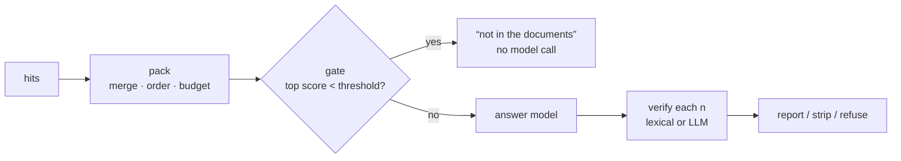

# Week 8: Grounded generation — packing, citation checks, refusals, caching

**[← Week 7: Reranking](week07-rerank-and-query-transforms.md)** · **[Course Plan](../COURSE_PLAN.md)** · **[Grounded generation (guide)](../docs/grounded-generation.md)** · **[Week 9: Rich documents →](week09-rich-documents.md)**

> **New to the ideas?** The general concepts behind this page, with diagrams, worked examples and reading links: [11 Grounded generation](../concepts/11-grounded-generation.md).

---

**Time:** about 4 hours (1 reading, 1.5 reading and running the code, 1.5 on the experiments).
**Code for this week:** `git checkout week-08`
**Companion guide:** [`docs/grounded-generation.md`](../docs/grounded-generation.md): what goes into the context window and in what order, checking citations lexically and with a model, calibrating "not in the documents", and when prompt caching pays.

**You're done when:**

1. `uv run pytest` passes (495 tests, offline, no keys needed),
2. you've run `raggy ask` with `RAGGY_CITATION_CHECK=lexical` and found a sentence it flags, and
3. you can explain why two runs with identical context scored 0.924 and 0.879, and what that does to every comparison in this course.

## 1. Read first

| Read | Look for |
| --- | --- |
| [`docs/grounded-generation.md`](../docs/grounded-generation.md) (this repo) | The three things packing does, the lexical support score worked by hand, and why a refusal threshold must be calibrated on different questions from the ones it's measured on. |
| [Lost in the Middle](https://arxiv.org/abs/2307.03172) (Liu et al., 2023) | Models use the start and end of a long context better than the middle. Note how long the contexts were before the effect was large. |
| Anthropic's [prompt caching guide](https://docs.claude.com/en/docs/build-with-claude/prompt-caching) | The minimum cacheable prefix, and why the cached part must come first and be byte-identical. |

## 2. From "retrieved" to "answered"

Weeks 4–7 decided *which* passages reach the model. This week is about what happens next:

- **Packing:** the passages are merged where they overlap, ordered and fitted to a token budget.
- **Citation checks:** every `[n]` in the answer is checked against passage n, before the user sees it.
- **The refusal gate:** "not in the documents" is answered without calling the model when retrieval found nothing close.
- **Prompt caching:** the parts of a prompt that repeat are marked so the provider can serve them from a cache.

And every LLM call now reports its token usage, so cost is measured, not guessed.

## 3. What you're building this week

| File | Lines | What it does |
| --- | --- | --- |
| `generate/pack.py` | 74 | Merge overlapping or touching passages from one source; order sources by best score, passages within a source by position; fit `RAGGY_CONTEXT_TOKENS`, cutting a lone oversized passage at a sentence end |
| `generate/verify.py` | 145 | Split the answer into sentences with their markers; lexical support (share of a sentence's content words found in the cited passage) or an LLM check; actions `report`, `strip`, `refuse` |
| `pipeline.py`, `config.py` | +70 | `Raggy.context()`, `answer_from()`, the per-mode refusal gate, `Answer.unsupported` |
| `generate/*_llm.py` | +40 | `complete(..., cache_prefix=)`: Claude gets a `cache_control` block, OpenAI caches long prefixes automatically; a `usage` dict on every adapter |
| `chunking/contextual.py` | +3 | Contextual retrieval (week 4) sends the whole document as the cacheable prefix |
| `evals/calibrate_gate.py`, `evals/cache_probe.py` | 39, 23 | Pick a gate threshold on half the questions and test it on the other half; measure cached input tokens |

## 4. Walkthrough

### 4.1 Packing

With parent expansion (week 4), two children of one parent become the same parent twice, and neighbouring chunks overlap by 32 tokens. `pack()` merges passages from one source whose spans overlap or touch, keeping the best score. It orders sources by that score, and passages within a source by position, so the text reads the way it was written. Then it keeps the best passages that fit the budget.

### 4.2 Citation checks

`verify()` splits the answer into sentences, each with the markers that follow it. For lexical checking, a sentence's support from passage n is the share of its content words (stop words removed, numbers kept) that appear in passage n. Below `RAGGY_CITATION_THRESHOLD` (0.5), the marker is unsupported. The LLM check sends each sentence beside its cited passage and asks supported or not. A reply it can't parse keeps the answer unchanged and counts a failure.

Then the action:

- `report` keeps the text and lists unsupported markers in `Answer.unsupported`.
- `strip` deletes just those markers.
- `refuse` replaces an answer with no supported citation left by the fixed refusal sentence.

### 4.3 The refusal gate

Week 2's unanswerable questions are refused by the model itself, when the prompt tells it to answer only from the passages. The gate is a cheaper path: if the best retrieved score is below a threshold, answer "I couldn't find this in the documents" without calling the model at all. Scores mean different things per retrieval mode (cosine for vector, an RRF sum for hybrid), so the gate is per mode: `RAGGY_REFUSAL_GATE="vector=0.62"`.

`evals/calibrate_gate.py` sets the threshold to the lowest top score of any answerable question in the odd-numbered half. It then measures the effect on the even-numbered half, which it never saw. Calibrating and measuring on the same 41 questions would make any threshold look perfect.

### 4.4 Usage and caching

Every adapter now counts calls, input and output tokens, and cached reads and writes, and eval runs record the answer model's `llm_usage`. Contextual retrieval (week 4) makes one call per chunk, and each call repeats the whole document. That document is now sent as `cache_prefix`, so the provider can serve it from its prompt cache instead of re-processing it for every chunk.

## 5. The numbers

Answer runs use gpt-5.5 answers and a gpt-5.4 judge, as in earlier weeks. The plan called for all three fictional suites. The OpenAI account ran out of credit after the first, so the fictional suite (33 answerable questions plus 8 unanswerable) is what was measured. The fictional-web and manual runs, and the LLM verifier, weren't completed, and the decisions below say where that matters.

### 5.1 First: how much does a run move on its own?

| fictional | correctness | faithfulness | citation precision | refusal accuracy | context tokens p50 / p95 |
| --- | --- | --- | --- | --- | --- |
| week 7 defaults | 0.924 | 1.000 | 1.000 | 0.976 | 1,016 / 1,137 |
| + packing | 0.939 | 1.000 | 1.000 | 0.976 | 1,016 / 1,137 |
| + packing + lexical check, `report` | 0.879 | 1.000 | 1.000 | 0.976 | 1,016 / 1,137 |
| + packing + lexical check, `strip` | 0.894 | 1.000 | 1.000 | 0.976 | 1,016 / 1,137 |

Look at the first three rows. Packing changed nothing on this suite: the context token counts are identical, so the model read the same passages. `report` mode doesn't change the answer text at all. So these three runs gave the model *the same input*, and correctness still ranged from 0.879 to 0.939. Six questions (f06, f09, f10, f13, f22, f33) flipped between "correct" and "partial" from run to run. The answer model and the judge both sample.

**This is the most important number of the week:** on a 33-question suite, two identical runs can differ by 0.06 in correctness. Every earlier comparison of answer correctness in this course had the same noise. That's why the rules lean on retrieval metrics, which are deterministic, and on large or repeated differences. Experiment 1 asks you to measure the noise on your own suite.

### 5.2 Citation checks

The lexical check flagged two citations in the `report` run (f22's [1], f29's [3]) and one in the `strip` run (f29's [3]). The judge rated citation precision 1.000 in both runs, so the flagged citations were *supported*. They were paraphrases, where the sentence used different words from the passage. Stripping them removed correct citations.

### 5.3 The refusal gate

Calibrated on the 20 odd-position questions of the week 7 default run, the vector threshold is **0.632**. On the 21 held-out questions:

| | gated by the threshold |
| --- | --- |
| unanswerable (4) | 1 of 4 |
| answerable (17) | **1 of 17**, wrongly |

The model itself already refused all 8 unanswerable questions (unanswerable refusal 1.000), so the gate can only save model calls, and it does so by wrongly refusing about 1 answerable question in 17. Score distributions of answerable and unanswerable questions overlap: a question about something *near* the documents scores like one about the documents.

### 5.4 Prompt caching

Contextual retrieval on the manual (24 chunks, a document prefix of about 3,070 tokens), with an empty context cache so every chunk made a real call, using gpt-5.5 (`evals/cache_probe.py`):

| input tokens | served from the provider's cache | share |
| --- | --- | --- |
| 79,438 | 53,504 | **67%** |

Not 100%, because the calls run 8 at a time: the first ones go out before any cache entry exists. Cached input is billed at a fraction of the normal rate, so caching pays wherever a long prefix repeats: contextual retrieval, or a fixed system prompt with long instructions. It can't pay for *answers*, where the prefix is the retrieved passages and they differ for every question. Claude only caches prefixes of at least 512 tokens (on Opus 5.5), and OpenAI only from 1,024.

### 5.5 The decisions

The rules, written before the runs:

- **Packing** is on if mean correctness over the three fictional suites doesn't drop and context tokens fall, or if correctness rises. On fictional, context tokens didn't fall (identical), and the +0.015 correctness is inside the 0.06 noise. The other two suites weren't measured. **Off.** It stays available (`RAGGY_PACK=1`): its win is on collections with overlapping parents or neighbouring hits, which these suites barely produce.
- **Lexical check with `strip`** is on if citation precision rises and correctness doesn't drop by more than 0.03. Citation precision was already 1.000, so it can't rise, and the check's flags were false positives. **Off.**
- **LLM check:** not measured. **Off.**
- **Refusal gate:** on only if unanswerable refusal stays at 1.000 *and* answerable refusal doesn't rise, on held-out questions. It wrongly refused 1 of 17. **Off.**
- **Caching:** on wherever it applies (contextual retrieval). It doesn't change outputs, only cost.

So week 8's defaults are week 7's, plus caching and usage counts. Like week 6, the honest result is mostly "measured, and not worth turning on here". The noise finding in 5.1 changes how to read every answer metric from here on.

## 6. Why each choice

| Choice | Why | What it costs |
| --- | --- | --- |
| Merge only same-source passages that overlap or touch | Duplicate text wastes context and splits one citation in two | Passages one sentence apart stay separate |
| Lexical support with a 0.5 threshold | Free, instant, catches wrong numbers and wrong topics | Paraphrase reads as unsupported (5.2) |
| Gate per retrieval mode | A cosine of 0.6 and an RRF sum of 0.03 aren't comparable | One threshold to calibrate per mode |
| Split-half calibration | A threshold tuned on its own test set looks perfect | Half the questions per side: wide error bars |
| Cache the document, not the chunk | The document repeats across calls; the chunk doesn't | Parallel first calls miss (67%, not 100%) |
| Token usage on every adapter | Cost is priority 3: measure it | A few lines per adapter |

## 7. Experiments and notes

Write your answers in `NOTES.md`.

1. Run the fictional suite twice with no changes (`raggy eval --label noise-a`, then `noise-b`) and `raggy compare` them. How large is the correctness difference? How many questions would a change have to flip before you'd believe it?
2. Find f29's flagged sentence in `evals/baselines/week08/fictional-lexreport.json`. Compute its lexical support by hand, as in the guide. What threshold would have passed it, and what would that threshold let through?
3. Set `RAGGY_REFUSAL_GATE=vector=0.632` and ask a question about something *near* the documents (a product the shop doesn't sell). Is it gated? Then ask one the gate wrongly refuses.
4. Run `uv run python evals/cache_probe.py openai <model>` twice in a row. Why does the second run show 0 calls?
5. Set `RAGGY_CONTEXT_TOKENS=600` and `RAGGY_PACK=1`. Which questions lose their answer, and is the passage that was cut the one with the answer?

---

**Tested with:** Python 3.13.14, gpt-5.5 (answers) and gpt-5.4 (judge), on an Apple M2 with 8 GB of RAM. All numbers are from the runs committed in `evals/baselines/week08/`.
