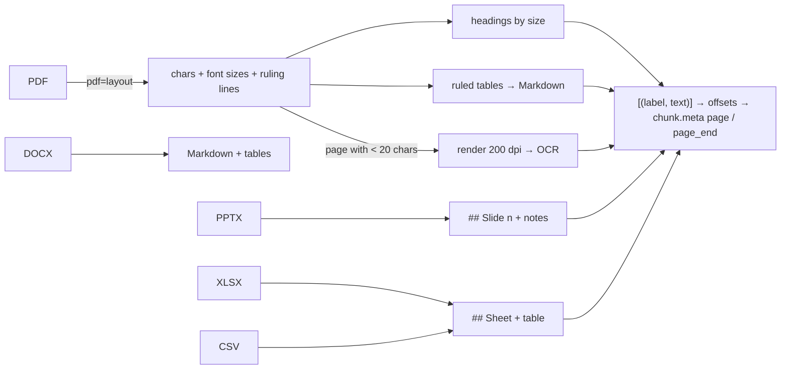

# Week 9: Rich documents — PDF layout, tables, OCR and Office files

**[← Week 8: Grounded generation](week08-grounded-generation.md)** · **[Course Plan](../COURSE_PLAN.md)** · **[Rich documents (guide)](../docs/rich-documents.md)** · **Week 10: Images →** *(coming)*

---

**Time:** about 4 hours (1 reading, 1.5 reading and running the code, 1.5 on the experiments).
**Code for this week:** `git checkout week-09`
**Companion guide:** [`docs/rich-documents.md`](../docs/rich-documents.md): what a PDF really stores, how headings and tables are rebuilt from it, what OCR costs, and why slides and sheets need locations.

**You're done when:**

1. `uv run pytest` passes (520 tests, offline, no keys needed),
2. you've run `raggy ingest evals/rich/docs` and `raggy ask "When does the Fenwick workshop close for stocktaking?"`, and seen a citation with a page, and
3. you can say why the measured gain this week came from one scanned page, not from the tables.

## 1. Read first

| Read | Look for |
| --- | --- |
| [`docs/rich-documents.md`](../docs/rich-documents.md) (this repo) | Why "extract text from a PDF" is a reconstruction; the 1.2× font-size rule for headings; why borderless tables are left alone. |
| [pdfplumber's README](https://github.com/jsvine/pdfplumber), "Extracting tables" | The `lines` and `text` strategies. raggy uses `lines` only; the README's examples show why `text` over-detects. |

## 2. Where week 3 left off

Week 3's loaders handle Markdown, text, HTML and PDF. Its PDF loader reads the text layer with pypdf, which has three blind spots that real collections hit at once:

- **Tables** come out one cell per line, with the rows gone.
- **Scanned pages** have no text layer. pypdf returns an empty string without complaint, and the page silently isn't in the index.
- **Pages** aren't recorded, so a citation can only point at the whole file.

Office files weren't loaded at all: a folder of Word reports, slide decks and spreadsheets was skipped.

This week adds a layout-aware PDF loader with OCR for scans, loaders for DOCX, PPTX, XLSX and CSV, and a location (page, slide or sheet) on every chunk and citation. Then it measures them on a new suite whose answers live in exactly those places.

## 3. What you're building this week



| File | Lines | What it does |
| --- | --- | --- |
| `ingest/loaders/pdf_layout.py` | 89 | Headings from font size (≥ 1.2× the median, up to three levels), ruled tables as Markdown, reading order by position, OCR for pages with fewer than 20 characters |
| `ingest/ocr.py` | 27 | RapidOCR (PaddleOCR models in ONNX, bundled, offline), loaded on the first scan only |
| `ingest/loaders/office.py` | 99 | DOCX (heading styles, tables in place), PPTX (one section per slide, tables, speaker notes), XLSX (one table per sheet, cached formula values) |
| `ingest/loaders/csv_loader.py` | 21 | Delimiter sniffed (`, ; tab \|`), read as one Markdown table |
| `ingest/loaders/tables.py` | 24 | Every table from every format becomes one Markdown pipe-table shape |
| `pipeline.py`, `store/lance_store.py`, `generate/prompt.py` | +48 | Label offsets → `chunk.meta["page"]` / `["page_end"]`; two new columns (old tables gain them in place); `p. 1–2` in prompts and citations |
| `evals/rich/` | — | A generator for six documents and 28 questions (24 answerable, 4 not) |

New dependencies: `pdfplumber`, `rapidocr` (with `onnxruntime`), `python-docx`, `python-pptx`, `openpyxl`, and `reportlab` in the dev group (it only generates the test PDFs).

## 4. Walkthrough

### 4.1 Rebuilding a PDF page

`pdf_layout.load` reads every character's font size across the document and takes the median as body size. Bigger sizes, at least 1.2× the median, are headings, ranked into `#`, `##` and `###`. On each page, `find_tables()` finds cells bounded by drawn lines. Those characters are removed from the body text, and the table is written once as Markdown. Then text lines and tables are sorted by their vertical position, so a table stays where it was on the page.

The headings matter beyond looks: week 4's structure chunker splits on `#` lines and puts the section path in every chunk's header. A PDF section is now chunked the way a Markdown section is.

### 4.2 Scans and OCR

A page whose text layer has fewer than 20 characters is a scan. It's rendered at 200 dpi and passed to RapidOCR. The model loads on the first scan in a run (about 1 s), and each page after that takes about 0.5 s. A page with a text layer never touches OCR.

With `RAGGY_OCR=off`, raggy doesn't skip silently. It warns `1 page(s) look scanned and were skipped: set RAGGY_OCR=on`, and a PDF that is all scans fails to load with the same hint.

### 4.3 Office files and CSV

- **Word** documents have paragraph styles. "Heading 2" becomes `##`, and tables are written in place, in document order.
- **PowerPoint** decks become one `## Slide n: Title` section per slide: its text boxes and tables, then `Speaker notes: ...`. Notes often carry the qualification the slide leaves out. On the test deck, the slide says "90 km" and the notes say "about 70 km with 80 kg in the box".
- **Excel** workbooks become one `## Sheet: Name` section per sheet, with the first non-empty row as the header. Formulas are read as the values Excel last saved (`data_only=True`).
- **CSV** files get their delimiter sniffed. The test file uses semicolons, as many European exports do.

One detail came from a test: python-pptx returns a new proxy object each time you access a shape, so `shape is slide.shapes.title` is always false and every title was repeated as body text. The loader compares `shape_id` instead (`test_pptx_slides_titles_notes_and_labels`).

### 4.4 Locations

Loaders may now return `[(label, text), ...]` instead of one string: `("p. 2", ...)`, `("slide 4", ...)` or `("sheet Stock", ...)`. `load_bytes` joins the parts and records where each label starts. After chunking, `page_label(pages, start, end)` gives each chunk its first label and, if it crosses a boundary, its last. Citations then read:

```text
[1] fleet-prices.pdf, p. 2
[2] ebb-launch.pptx, slide 4
[3] parts-stock.xlsx, sheet Stock
```

An index built before week 9 has no `page` columns. `LanceStore` adds them in place on open (`add_columns`), so old indexes keep working and gain locations on the next ingest.

### 4.5 A suite where losing a format is the measurement

Every suite so far required each gold quote to be found in the corpus, and failed loudly otherwise. That's right for catching typos. But under `pdf=text`, the scanned page has no text, so its three gold quotes can't be found: that's exactly what this week sets out to measure, not a typo.

So the `rich` suite is *non-strict*. A gold quote that no loaded document contains counts as a miss, its question id is listed in the run's `gold_missing`, and recall uses the question's full gold count. One test keeps the honesty check: under layout + OCR, every quote must resolve (`test_rich_gold_resolves_with_layout_and_ocr`). Every other suite stays strict.

## 5. The numbers

### 5.1 The rule, written before the runs

`pdf=layout` and `ocr=on` become the defaults if `rich` recall@4 rises against `pdf=text`, *and* the three fictional suites (Markdown and HTML, which PDF parsing can't touch) stay identical, *and* a scanned page costs under 5 s.

### 5.2 Retrieval

| suite | `pdf=text` (week 3) | `pdf=layout` + OCR |
| --- | --- | --- |
| rich (24 answerable): recall@1 / recall@4 / MRR | 0.833 / 0.875 / 0.847 | **1.000 / 1.000 / 1.000** |
| fictional (33): recall@1 / recall@4 / MRR | 0.848 / 0.970 / 0.915 | 0.848 / 0.970 / 0.915 |
| fictional-web (33) | 0.879 / 1.000 / 0.932 | 0.879 / 1.000 / 0.932 |
| manual (24) | 0.667 / 1.000 / 0.806 | 0.667 / 1.000 / 0.806 |

By where the answer lives (`rich`, recall@4):

| tag | text | layout + OCR |
| --- | --- | --- |
| pdf-table, pdf-text, docx-table, docx-text, slide, slide-notes, sheet, csv | 1.00 | 1.00 |
| scanned (3) | **0.00** | **1.00** |

The whole retrieval difference is the scanned page. Under `pdf=text`, its three questions have no chunk to find (`gold_missing: r08, r09, r10`).

### 5.3 Answers

Retrieval can't see table structure: the gold quote `5-9 | 4,700 credits | 4 weeks` matches the text-mode chunk too, because the eval treats `|` and line breaks alike. Structure should show when a model has to read a row, so answers were measured as well (gpt-5.5 answers, gpt-5.4 judge, as in earlier weeks):

| `rich` | text | layout + OCR |
| --- | --- | --- |
| correctness | 0.875 | **1.000** |
| faithfulness | 1.000 | 1.000 |
| citation precision | 1.000 | 1.000 |
| refusal accuracy | 0.893 | **1.000** |
| correctness on table questions (pdf-table, docx-table, sheet, csv) | 1.000 | 1.000 |

Under text mode, the three scan questions got "I couldn't find this in the documents". That's the honest reply, and it was the only failure. The table questions were answered correctly in *both* modes: gpt-5.5 read the one-cell-per-line output, counted the columns from the header and rebuilt the rows.

So on these documents, layout mode's tables bought nothing measurable. That's a finding about this test, not a proof that structure never matters. The tables here are small (at most four columns and nine rows), have no empty cells and fit in one chunk. The guide lists where the inference breaks: wide tables, empty cells (every later value shifts a column), tables split across chunks, and smaller models. Experiment 2 asks you to find one.

An honest note on the first answer run: it scored the table questions 0.5–0.75 in both modes. The cause was the reference answers, not the model. They included facts the question didn't ask for (the lead time on a price question), and the judge marked focused, correct answers "partial". The references were trimmed to what each question asks, and both modes were rerun. Week 2's rule, that a reference answer holds exactly what the question asks, applies to every suite you write.

### 5.4 Cost

Load time per page or part, on this laptop (Apple M2, 8 GB):

| | per page / slide / sheet |
| --- | --- |
| PDF, `text` | 29 ms |
| PDF, `layout` (text pages) | 19 ms |
| PDF, scanned page with OCR | 0.54 s (1.21 s for the first, which loads the models) |
| PPTX / XLSX / DOCX | 11 / 33 / 35 ms |

### 5.5 The decision

- `rich` recall@4 rises: 0.875 → 1.000. ✓
- The fictional suites are identical, to the third decimal, on all three. ✓
- A scanned page costs 0.54 s warm and 1.21 s cold, under 5 s. ✓

**So `RAGGY_PDF=layout` and `RAGGY_OCR=on` are the new defaults.** Pages with a text layer don't pay for OCR at all, and a scan without OCR contributes nothing, so OCR's only risk (a misread) applies to pages that would otherwise be lost. `RAGGY_PDF=text` keeps week 3's behaviour.

## 6. Why each choice

| Choice | Why | What it costs |
| --- | --- | --- |
| pdfplumber for layout | Characters with position and size, plus ruling lines and `find_tables` | Slower than pypdf on huge files; no column detection |
| Headings by font size ≥ 1.2× median | Works without any tagging; feeds week 4's structure chunker | Bold body-size headings are missed; big pull quotes become headings |
| Ruled tables only | Drawn lines are unambiguous | Borderless tables stay as text lines |
| OCR only below 20 characters | Pages with text never pay; scans never vanish | A page with a text header over a scanned body isn't OCR'd |
| RapidOCR (ONNX, bundled) | Offline, CPU, no system packages (Tesseract needs one) | About 0.5 s a page; misreads on poor scans |
| One Markdown table shape for all formats | One chunking path; headers carried into pieces | Merged cells are flattened |
| Labels + offsets, not one document per page | Chunks can cross a page break; locations still exact | Two new store columns |
| Non-strict gold for `rich` only | Losing a format is the measurement | A typo in a `rich` quote would read as a miss, so a strict test covers layout + OCR |

## 7. Experiments and notes

Write your answers in `NOTES.md`.

1. Ingest `evals/rich/docs/fleet-prices.pdf` with `RAGGY_PDF=text` and with `layout`, and print the chunks (`raggy search "fleet price 5-9" -k 2`). Where does the text-mode chunk cut the table?
2. Break the table inference: add a wide table (8 columns, a few empty cells) to `make_docs.py`, regenerate, and ask a question about one cell under both modes. Then try it with `RAGGY_LLM=ollama`. At what point does text mode start answering wrong?
3. Save the workshop notice as a phone photo (skewed, shadowed) and replace the scan. What does OCR read, and which questions still work?
4. Turn a slide's speaker notes off (comment out the notes line in `load_pptx`) and rerun `rich`. Which question fails, and what does the model answer instead?
5. Find a PDF of your own with a borderless table. What does `layout` produce? Would you rather have pdfplumber's `text` strategy and its false positives?

---

**Tested with:** Python 3.13.14, pdfplumber 0.11.10, rapidocr 3.10.0, python-docx 1.2.0, python-pptx 1.0.2, openpyxl 3.1.5, on an Apple M2 with 8 GB of RAM. All numbers are from the runs committed in `evals/baselines/week09/`.
