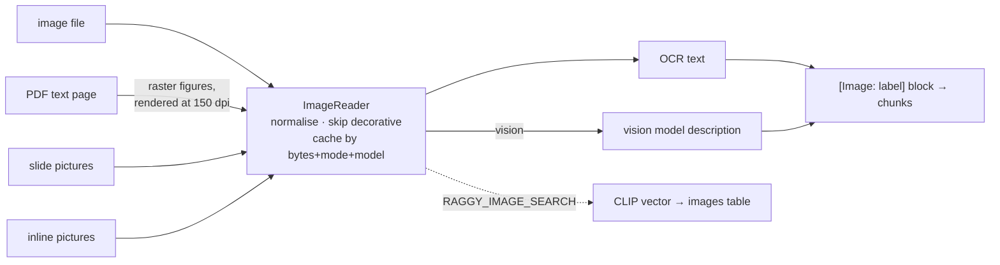

# Week 10: Images — OCR, vision descriptions and picture search

**[← Week 9: Rich documents](week09-rich-documents.md)** · **[Course Plan](../COURSE_PLAN.md)** · **[Images (guide)](../docs/images.md)** · **Week 11: Audio and video →** *(coming)*

---

**Time:** about 4 hours (1 reading, 1.5 reading and running the code, 1.5 on the experiments).
**Code for this week:** `git checkout week-10`
**Companion guide:** [`docs/images.md`](../docs/images.md): what OCR, a vision model and CLIP each see in a picture, and why the course keeps OCR text beside a model's description.

**You're done when:**

1. `uv run pytest` passes (offline, no keys, no model downloads),
2. you've run `RAGGY_IMAGES=ocr raggy ingest evals/images/docs` and found the torque table's answer with `raggy search "stem bolt torque"`, and
3. you can name one question in the `images` suite that OCR can't answer however good it is.

## 1. Read first

| Read | Look for |
| --- | --- |
| [`docs/images.md`](../docs/images.md) (this repo) | The three readers and what each loses; the block format; why descriptions are cached by image bytes. |
| [Learning Transferable Visual Models From Natural Language Supervision](https://arxiv.org/abs/2103.00020) (Radford et al., 2021): CLIP | Section 3.1.4 (zero-shot) and the limitations: CLIP is weak at reading text and counting. |

## 2. Pictures carry facts that text extraction misses

Week 9 read every word a document stores as text. A chart, a dimension drawing, a screenshot of a table, a photo of a rating label: these store their facts as pixels. Week 9's loaders skip them, so a question whose answer is "81 bikes, in March" in a bar chart has no chunk to find.

This week turns pictures into text the rest of the pipeline already handles, in two ways you choose with `RAGGY_IMAGES`:

- `ocr`: week 9's OCR engine transcribes the words in the picture.
- `vision`: a vision model describes the picture (its kind, title, labels and numbers, what's drawn), and the OCR text is kept beside the description.

Every picture becomes one block, always with the same header:

```text
[Image: ebb-spec-sheet.pdf p. 2, figure 1]
A technical side-view drawing of a cargo bike titled "Ebb E-Cargo dimensions (mm)" ...
Text in image:
Ebb E-Cargo dimensions (mm)
Wheelbase 1,850
Height 1,120
Box: 80 kg max
```

The block is chunked, embedded and cited like any text, and the header cites the picture by file, page and figure number. Optionally, `RAGGY_IMAGE_SEARCH=on` also embeds every picture with CLIP, so you can search pictures by what they look like: `raggy images "a blue cargo bike"`, or `raggy images --like photo.png`.

## 3. What you're building this week



| File | Lines | What it does |
| --- | --- | --- |
| `ingest/images.py` | 195 | `prepare_image` (decode, RGB, cap at 1,568 px, skip under 100 px), `ImageReader` (OCR / vision, cached in `vision-cache.sqlite`, failures fall back to OCR and are counted), `FigureReader` (each distinct picture once per document; a bad one is skipped with a warning) |
| `ingest/loaders/image.py` | 26 | PNG, JPEG, WebP, GIF, BMP and TIFF files as one block; with images off, a named error |
| `ingest/loaders/pdf_layout.py`, `office.py` | +80 | Raster figures on PDF text pages, placed by position; PPTX pictures per slide; DOCX inline pictures in document order |
| `generate/*_llm.py` | +25 | `complete(..., images=[png])`: OpenAI/Ollama data-URI parts, Claude image blocks |
| `embed/clip.py`, `store/images.py` | 46, 65 | CLIP ViT-B/32 (0.34 GB, MIT) through fastembed; an `images` table beside the chunks, kept in step on ingest and remove |
| `pipeline.py`, `config.py`, `cli.py` | +110 | `RAGGY_IMAGES`, `RAGGY_VISION`, `RAGGY_VISION_MODEL`, `RAGGY_IMAGE_SEARCH`; image settings in the index keys; `raggy images` |
| `evals/images/` | 219 + 24 questions | Eight documents whose answers exist only in pictures |

No new dependencies: Pillow, rapidocr and fastembed were already installed.

## 4. Walkthrough

### 4.1 Normalising a picture

`prepare_image` decodes the bytes with Pillow and flattens what models choke on: palette and transparent images onto white, CMYK and greyscale to RGB, an animated GIF to its first frame. It caps the long edge at 1,568 px; a 6,000 px phone photo costs more time and tokens without more detail. A picture under 100 px on its short side is decorative (an icon, a bullet, a logo) and is skipped.

### 4.2 Reading it

`ImageReader.read(data, label)` always runs OCR, and in `vision` mode also calls the vision model with the label as context ("Image: ebb-spec-sheet.pdf p. 2, figure 1"). The vision prompt (`vis-v1`) asks for the kind of image, its title, every label and number *kept with what it belongs to*, and what's drawn, in under 150 words, describing only what's visible.

The result is cached by **image bytes** + mode + model + prompt version. The same picture under another name is a cache hit, and a different model or prompt is a miss. A failed or empty description isn't cached: the block falls back to the OCR text, `failures` is counted, `raggy ingest` prints it, and an eval run shows a ⚠ line. That's week 7's rule again: a fallback must never pass for a result.

### 4.3 Pictures inside documents

- **PDF:** on a page with a text layer, every raster image (`page.images`) is cropped from the rendered page at 150 dpi, so masks and colour spaces come out as you see them. Each is placed in reading order by its position, like week 9's tables. A page with no text layer is a scan: week 9 OCRs it whole, and its "figure" isn't read twice.
- **PowerPoint:** picture shapes, per slide: `slide 1, picture 2`.
- **Word:** pictures anchored in each paragraph (`a:blip` relationships), in document order: `figure 1`.

One detail matters on real decks: the same logo on every slide. `FigureReader` hashes each picture's bytes and reads each distinct picture once per document, at its first appearance. One more test found that the scan test must count *text only*: a figure block would otherwise make a scanned page look like it had a text layer.

### 4.4 Picture search with CLIP

CLIP embeds pictures and text into one space, trained on photos with captions. With `RAGGY_IMAGE_SEARCH=on`, ingest collects every picture a loader read (`Document.metadata["images"]`), CLIP-embeds it, and stores it in an `images` table beside the chunks. Re-indexing a source replaces its pictures, and removing a source removes them. It needs `RAGGY_IMAGES` on, because only pictures a loader reads are found.

## 5. The numbers

### 5.1 What was measured

Before planning, one test chart (a 640 × 400 bar chart: "Bikes serviced per month, Merrow workshop 2026", four bars with values) was sent to both vision routes on this laptop:

| | time | result |
| --- | --- | --- |
| Ollama `qwen3.5:4b`, first call | 82.4 s (includes loading the model) | Correct values; misread "Merrow" as "Marrow"; long, chatty answer |
| Ollama `qwen3.5:4b`, warm, with the course prompt | 16.7 s | All four values right; "Merrow" right; two words run together |
| OpenAI `gpt-5.5` | 10.8 s, 357 prompt tokens | All values and labels exact |

### 5.2 What wasn't

The `images` suite (section 6) and its decision rules were written before any run. The full measurement (each mode's retrieval and answers, the CLIP comparison, seconds per picture) wasn't run for this release. So by the rules, **the defaults stay off**: `RAGGY_IMAGES=off` and `RAGGY_IMAGE_SEARCH=off`.

To measure it yourself:

```bash
RAGGY_IMAGES=off    uv run raggy eval --suite images --label off
RAGGY_IMAGES=ocr    uv run raggy eval --suite images --label ocr
RAGGY_IMAGES=vision RAGGY_VISION=ollama uv run raggy eval --suite images --label vision-local
RAGGY_IMAGES=vision RAGGY_VISION=openai RAGGY_VISION_MODEL=gpt-5.5 uv run raggy eval --suite images --label vision-hosted
```

The rules you'd apply, written before any run:

- **`ocr` over `off`:** on if `images` recall@4 rises, the four earlier fictional suites stay identical (none has a raster picture), and OCR costs under 2 s a picture.
- **`vision` over `ocr`:** on only if answer correctness rises by at least 0.05 with the *local* model and warm description time is at most 30 s a picture. Week 8 showed answer correctness moves by up to 0.06 on its own, so run each mode twice.
- **CLIP:** on only if text-to-picture recall@1 beats text search over the picture blocks by at least 0.05.

What to expect, from how the suite is built:

- With `off`, every answer is missing: 20 of 20 questions have no gold in any text (a test checks this).
- `ocr` should answer the `text-in-image` questions (the battery label, "Bay 3").
- `ocr` should struggle on `association` questions (which bar is March?), because OCR returns labels and values as separate lines.
- Only `vision` can answer the two `visual` questions (the cargo box's colour, the number of child seats).

**Recommendation until you've measured:** `RAGGY_IMAGES=ocr` is cheap (about 0.5 s a picture, offline) and can only add text. Turn on `vision` for collections where pictures carry the facts (spec sheets, dashboards, slide decks), and expect a one-off ingest cost of 10–20 s a picture, cached after that.

## 6. The `images` suite

Eight documents, built by `evals/images/make_docs.py`, with every answer only in a picture:

| Document | Picture | Questions test |
| --- | --- | --- |
| `merrow-service-chart.png` | bar chart, five months | which value belongs to which bar |
| `ebb-spec-sheet.pdf` (p. 2) | dimension drawing inside a PDF | numbers on dimension lines |
| `workshop-floorplan.png` | rooms and a fire-exit arrow | spatial relation, labels |
| `bt-5000-label.jpg` | battery rating label | text in the picture |
| `torque-settings.png` | screenshot of a table | rows read as rows |
| `ebb-product.png` | drawing with no words | colour and count only |
| `regional-team.pptx` | org chart on a slide, plus a 64 px logo on every slide | who reports to whom; decorative skip |
| `delivery-route.docx` | route map inline in a Word file | order of stops |

There are 24 questions: 20 answerable and 4 unanswerable (near misses: another workshop, a part not in the table). Gold is each picture's header, `[Image: <label>]`, which every mode writes identically. Retrieval scores the same way whatever the model writes, and answers are judged against references that hold exactly what the question asks (week 9's finding).

## 7. Why each choice

| Choice | Why | What it costs |
| --- | --- | --- |
| Pictures become text blocks | One index, one retriever, one citation path | A picture is only as findable as its text |
| OCR kept beside the description | Exact strings (part numbers, values) survive a paraphrasing model | Longer blocks |
| Cache by image bytes + mode + model + prompt | Re-ingest is free; renames don't re-describe | Edit the prompt without bumping `vis-v1` and you get stale text |
| Skip under 100 px; read repeats once | Logos and icons add noise, not facts | A tiny but meaningful icon is lost |
| A loud fallback to OCR | A failed description must not look like a result | One more counter |
| Vector-drawn PDF charts and HTML `` out of scope | No raster image to read / a fetch per image | Those charts stay as their text labels only |
| CLIP optional and off | Strong on photos, weak on text and charts | A second model and table when on |

## 8. Experiments and notes

Write your answers in `NOTES.md`.

1. Run the four `raggy eval --suite images` commands above, twice each. Fill in the rules' table. Which defaults would you set?
2. Compare one picture's `ocr` and `vision` blocks (`raggy search "stem bolts" -k 1` under each). Which question types does each answer?
3. Ingest with `RAGGY_IMAGE_SEARCH=on` and run `raggy images "a blue cargo bike"` and `raggy images "bar chart"`. Where is CLIP good, and where does the text index win?
4. Change one word in the vision prompt without bumping `VISION_VERSION`, and ingest again. What happens, and why is the version in the cache key?
5. Take a photo of a real label or whiteboard with your phone. What does OCR read? What does the local vision model add?

---

**Tested with:** Python 3.13.14, Pillow 11, rapidocr 3.10.0, fastembed 0.9.0, Ollama with `qwen3.5:4b`, on an Apple M2 with 8 GB of RAM.
