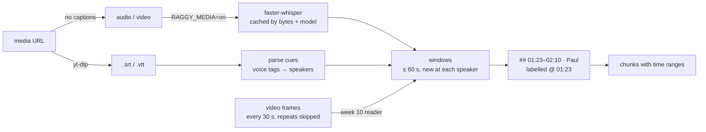

# Week 11: Audio and video — transcripts, keyframes and time citations

**[← Week 10: Images](week10-images.md)** · **[Course Plan](../COURSE_PLAN.md)** · **[Audio and video (guide)](../docs/audio-video.md)** · **[Week 12: Production →](week12-production.md)**

> **New to the ideas?** The general concepts behind this page, with diagrams, worked examples and reading links: [13 Multimodal RAG](../concepts/13-multimodal-rag.md).

---

**Time:** about 4 hours (1 reading, 1.5 reading and running the code, 1.5 on the experiments).
**Code for this week:** `git checkout week-11`
**Companion guide:** [`docs/audio-video.md`](../docs/audio-video.md): how Whisper turns speech into timed segments, why transcripts are chunked by time and speaker, keyframes, and what captions save.

**You're done when:**

1. `uv run pytest` passes (offline, no keys, no model downloads),
2. you've run `RAGGY_MEDIA=on raggy ingest evals/media/docs` and `raggy ask "How often should I oil the chain?"`, and seen a citation like `workshop-podcast-ep12.m4a @ 00:24–00:41`, and
3. you can explain why the livestream's captions load with media off and the podcast doesn't.

## 1. Read first

| Read | Look for |
| --- | --- |
| [`docs/audio-video.md`](../docs/audio-video.md) (this repo) | Segments, windows and labels; why a speaker change starts a window; keyframe sampling and near-duplicate skipping. |
| [Robust Speech Recognition via Large-Scale Weak Supervision](https://arxiv.org/abs/2212.04356) (Radford et al., 2022): Whisper | Section 3.8 on long-form transcription: 30-second windows and timestamp tokens. Section 6 on its failure modes (hallucinated text on silence). |

## 2. Speech is text with timestamps

A podcast, a recorded meeting or a training video holds its facts in speech, and week 10's readers see none of it. This week adds a transcriber, local and on the CPU: faster-whisper, a CTranslate2 build of Whisper, running at int8. It turns audio into segments, each with a start time, an end time and its text. raggy keeps the times all the way to the citation:

```text
[2] workshop-podcast-ep12.m4a @ 00:24–00:41
```

A reader can jump straight to the moment, instead of scrubbing through 40 minutes to check a claim.

Three kinds of media input:

- **Audio and video files** (`.mp3 .wav .m4a .flac .ogg .opus .aac .aiff` / `.mp4 .mov .mkv .webm .avi .m4v`) need `RAGGY_MEDIA=on`: transcription is the slow, model-backed step.
- **Subtitle files** (`.srt`, `.vtt`) always load. Someone already did the transcription, often with speaker names.
- **Media pages** (YouTube, Vimeo, SoundCloud and others) go through yt-dlp (`uv sync --extra media`). raggy uses the page's published English captions if it has any, and otherwise downloads the audio and transcribes it.

## 3. What you're building this week



| File | Lines | What it does |
| --- | --- | --- |
| `ingest/media.py` | 285 | `Segment`, `fmt_time`, `windows()`, `render()`, SRT/WebVTT parsing, `Transcriber` (faster-whisper, cached in `transcript-cache.sqlite`), `keyframes()`, the audio, video and subtitle loaders |
| `ingest/fetch.py` | +55 | `is_media_url`, `fetch_media`: captions first, audio otherwise, through yt-dlp |
| `ingest/loaders/__init__.py`, `config.py`, `pipeline.py` | +45 | Media suffixes; `RAGGY_MEDIA`, `RAGGY_WHISPER_MODEL`, `RAGGY_MEDIA_WINDOW`, `RAGGY_KEYFRAME_SECONDS`; all in the index keys |
| `evals/media/` | 133 + 18 questions | A two-voice podcast, a narrated slide video and a captioned livestream, built with macOS `say` and ffmpeg |

New dependencies: `faster-whisper` (which brings PyAV, so audio and video decode without a system ffmpeg), and optionally `yt-dlp`.

## 4. Walkthrough

### 4.1 Transcribing

`Transcriber.transcribe(data)` runs Whisper with a voice-activity filter (`vad_filter=True`), so stretches of silence aren't sent to the model. That matters: Whisper's best-known failure is inventing text over silence. The segments are cached by **audio bytes** + model + `tr-v1`. A renamed file is a cache hit; switching from `base` to `small` re-transcribes.

Model sizes follow the spec's rule for heavy local models, a small default and larger options:

| `RAGGY_WHISPER_MODEL` | Size | Notes |
| --- | --- | --- |
| `tiny` | ~75 MB | Fast, error-prone on names |
| `base` (default) | ~145 MB | The default for an 8 GB laptop |
| `small` | ~480 MB | Noticeably better on names and accents |
| `medium`, `large-v3` | 1.5 GB, 3 GB | Best quality; slow on CPU |

The first use downloads the model once.

### 4.2 Windows: chunking by time and by speaker

Segments are a few seconds each, too small to retrieve on their own. `windows(segments, 60)` groups consecutive segments while they share a speaker and fit in 60 seconds. A speaker change always starts a new window, so a chunk never blends two people's claims under one name. A single segment longer than the window is never split; its window just runs long.

Each window is rendered as a labelled part:

```text
## 00:24–00:41 · Paul

Paul: For the Ebb we recommend three bar in the rear tyre when the box is loaded.
Paul: ...
```

It's labelled `@ 00:24`. That's the whole trick: week 9 already turns labelled parts into `chunk.meta["page"]` / `["page_end"]` by character offset, and `location()` prints `@ 00:24–01:30`. No new chunk fields, no new store columns. The heading also lets week 4's structure chunker split on windows.

### 4.3 Speakers

Speaker names come from sources that have them: WebVTT voice tags (`<v Emily>`) and `Name:` line prefixes in captions or transcripts. Whisper alone doesn't know who's speaking. Automatic speaker diarization needs a separate model (pyannote, with a gated download) and is out of scope; the guide describes how it would slot in.

### 4.4 Video: audio plus keyframes

A video is transcribed like audio. With `RAGGY_IMAGES` on (week 10), raggy also samples one frame every `RAGGY_KEYFRAME_SECONDS` (30). The step grows for long videos, to at most 120 frames per file. A frame that looks like the previous kept one (mean difference of a 16 × 16 grey thumbnail under 6) is skipped, so a static slide is read once, not every 30 seconds. Each kept frame is read by week 10's image reader as `[Image: talk.mp4 @ 02:30, frame]` and placed in the window covering its time. A silent video with frames still loads.

### 4.5 Captions first

For a YouTube page, published captions are a free, exact, already-timed transcript, often with speakers. `fetch_media` asks yt-dlp for the page's information without downloading anything, takes an English `.vtt` track if one exists, and only otherwise downloads the audio. Captions also make the subtitle loader useful on its own: export a meeting's captions and ingest the `.vtt`.

## 5. The numbers

None this week. The `media` suite and its rule were written before any run, but the full measurement wasn't run for this release, so the rule keeps **`RAGGY_MEDIA=off`** as the default. With it off, a media file is a named error ("set RAGGY_MEDIA=on"); subtitle files load either way.

The rule, set before any run: media becomes on by default if the `media` suite's recall@4 under `on` rises against `off` (where every podcast and video answer is missing), the earlier suites stay identical, and `base` transcribes faster than real time on this M2.

To measure it:

```bash
uv run raggy eval --suite media --label off                  # captions only
RAGGY_MEDIA=on uv run raggy eval --suite media --label base
RAGGY_MEDIA=on RAGGY_WHISPER_MODEL=small uv run raggy eval --suite media --label small
RAGGY_MEDIA=on RAGGY_IMAGES=ocr uv run raggy eval --suite media --label base-frames
```

What to expect, from how the suite is built:

- `off` answers only the three caption questions (a test checks this).
- `base` should find most podcast answers, but the gold quotes are the script's words, so a mis-heard word ("Brightwater" as "bright water") loses that gold. Check `gold_missing`.
- Adding frames should help the video questions, whose slides repeat the narration.

## 6. The `media` suite

| File | What | Questions |
| --- | --- | --- |
| `workshop-podcast-ep12.m4a` | Two macOS voices as Emily and Paul, about 1.5 minutes on bike care | 8: tyre pressure, chain, brake pads, a winter offer |
| `battery-care.mp4` | Four slides over a narration | 4: charging, storage, the warning light |
| `ebb-launch-livestream.vtt` | Captions with voice tags, including a gap from 0:16 to 1:15 | 3: launch date, free rain cover, test rides |

There are 18 questions: 15 answerable and 3 unanswerable. Gold quotes avoid numbers, because Whisper may write "two weeks" as "2 weeks". The suite is non-strict like `rich` and `images`: gold the transcript doesn't contain counts as a miss.

## 7. Why each choice

| Choice | Why | What it costs |
| --- | --- | --- |
| faster-whisper, int8, CPU | Local, no GPU, one pip package (PyAV included) | Slower than whisper.cpp on Apple Silicon's GPU |
| `base` default | Fits an 8 GB laptop beside the other models | Mis-hears names more than `small` |
| VAD filter on | Silence is where Whisper invents text | Very quiet speech can be cut |
| Windows ≤ 60 s, split at speakers | Retrievable size; one speaker per chunk | A long answer spans several windows |
| Labels reuse week 9's page offsets | Time citations without new chunk fields | A range names window *starts*, not the last word's end |
| Captions before audio for URLs | Free, exact and timed; often with speakers | Auto-generated captions are skipped (lower quality) |
| Frames every 30 s, repeats skipped, ≤ 120 | Slides change slowly; bounded ingest | A fact shown for 10 s between samples is missed |
| No diarization | It needs pyannote and a gated model | Speakers only where the source names them |

## 8. Experiments and notes

Write your answers in `NOTES.md`.

1. Ingest `evals/media/docs` with `RAGGY_MEDIA=on`, then `raggy search "brake pads" -k 2`. Play the file at the cited time. Does the citation land on the sentence?
2. Re-ingest with `RAGGY_WHISPER_MODEL=tiny` and then `small`. Compare one window's text across the three. Which words change?
3. Set `RAGGY_MEDIA_WINDOW=15`, then `180`, and rerun experiment 1. How does the cited range change, and what does the answer model get?
4. Record yourself reading a paragraph with a long pause in the middle. Transcribe it with `vad_filter=False` (edit `Transcriber.transcribe`). Does Whisper invent anything in the pause?
5. Find a YouTube video with captions and one without, and `raggy ingest` both URLs. Which path did each take (look at the document type in `raggy sources`)?

---

**Tested with:** Python 3.13.14, faster-whisper 1.2.1, PyAV 19.0.2, yt-dlp 2026.10.26, on an Apple M2 with 8 GB of RAM.
